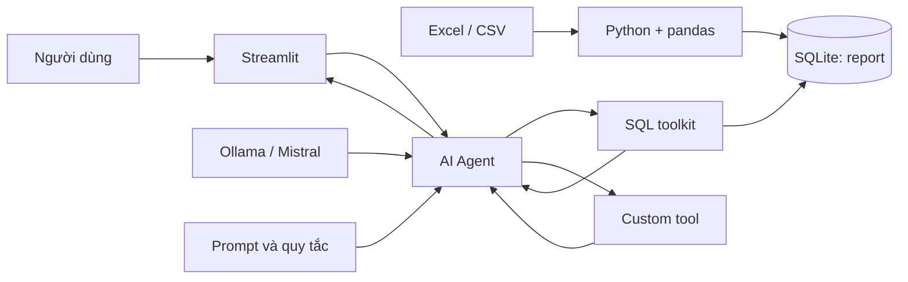

# Khóa học: Xây dựng AI Agent quản lý tồn kho với Ollama, LangChain, SQLite và Streamlit

## 1. Giới thiệu

Khóa học hướng dẫn xây dựng một ứng dụng có thể nhận câu hỏi bằng ngôn ngữ tự nhiên, tra cứu thông tin hàng hóa trong SQLite, gọi công cụ tính toán có kiểm soát và trả lời qua giao diện Streamlit. Trọng tâm là **đường đi của dữ liệu và cơ chế gọi công cụ**, thay vì để mô hình ngôn ngữ tự đoán con số.

**Ví dụ xuyên suốt:** người dùng hỏi “Giá trị tồn kho tối đa của SKU-02 là bao nhiêu?”. Agent cần tìm `inventory` và `unit_price` từ bảng `report`, rồi tính `inventory × unit_price`. Với dữ liệu *minh họa* 475 đơn vị và 28 đơn vị tiền/chiếc, kết quả là **13.300 đơn vị tiền**. Đây là giá trị tồn kho lý thuyết nếu bán hết ở mức giá đã ghi, **không phải doanh thu đã thực hiện**.

## 2. Lộ trình học

| Bài | Nội dung | Sản phẩm sau bài |
| --- | --- | --- |
| [01](01_TONG_QUAN_AI_AGENT_VA_KIEN_TRUC.md) | Agent, LLM, tools, ReAct và kiến trúc | Vẽ và giải thích luồng xử lý |
| [02](02_THIET_LAP_PYTHON_OLLAMA_LANGCHAIN.md) | Chuẩn bị Python, VS Code, Ollama và thư viện | Môi trường phát triển |
| [03](03_CHUYEN_EXCEL_CSV_SANG_SQLITE.md) | Nạp dữ liệu Excel/CSV vào SQLite | `grocery_data.db` có bảng `report` |
| [04](04_REACT_AGENT_VA_SQL_TOOLKIT.md) | Agent gọi SQL và phân biệt reasoning/action/observation | Thiết kế truy vấn an toàn |
| [05](05_XAY_DUNG_CONG_CU_TINH_TOAN.md) | Công cụ tùy chỉnh tính giá trị tồn kho | `custom_tools.py` |
| [06](06_THIET_KE_PROMPT_VA_QUY_TAC.md) | Prompt, chuẩn hóa SKU, giới hạn SQL | `prompt.py` |
| [07](07_LAP_RAP_AGENT_VA_KIEM_THU.md) | Kết nối SQLite–Ollama–LangChain | `agent.py` và kịch bản kiểm thử |
| [08](08_XAY_DUNG_GIAO_DIEN_STREAMLIT.md) | Giao diện hội thoại, hoàn thiện dự án | `user_input.py` |
| [09](09_LAB_TONG_HOP_VA_DANH_GIA.md) | Lab tích hợp, lỗi thường gặp, bài tập | Bản demo chạy cục bộ |

## 3. Sơ đồ tổng thể



**Cách đọc:** SQLite là nơi chứa dữ liệu có cấu trúc; Ollama vận hành mô hình ngôn ngữ; LangChain kết nối mô hình với SQL toolkit và công cụ tùy chỉnh; Streamlit là giao diện nhập câu hỏi và hiển thị câu trả lời.

## 4. Cấu trúc gói

```text
khoa_hoc_ai_agent_ton_kho/
├── 00_README.md
├── 01_...md đến 09_...md
└── assets/
    ├── README.md
    ├── grocery_data.csv
    ├── requirements.txt
    ├── load_excel.py
    ├── custom_tools.py
    ├── prompt.py
    ├── agent.py
    ├── user_input.py
    └── check_database.py
```

Mỗi bài Markdown đứng độc lập, có mục tiêu, giải thích, ví dụ, điểm dễ nhầm và câu hỏi trắc nghiệm kèm đáp án. Các tệp trong `assets/` là **mã tham khảo** để thực hành; môi trường và mô hình Ollama phải được cài riêng.

## 5. Chuẩn bị và chạy nhanh

1. Cài Python, VS Code, Ollama. Tải một model Ollama phù hợp với máy, ví dụ `mistral`.
2. Mở Terminal trong thư mục `assets/`, tạo môi trường ảo và cài `requirements.txt`.
3. Chạy `python load_excel.py` để chuyển `grocery_data.csv` thành `grocery_data.db`.
4. Chạy `python check_database.py` để kiểm tra bảng và số liệu.
5. Chạy `streamlit run user_input.py` rồi nhập câu hỏi thử nghiệm.

Ví dụ lệnh tại Windows PowerShell:

```powershell
python -m venv .venv
.\.venv\Scripts\Activate.ps1
python -m pip install -r requirements.txt
ollama pull mistral
python load_excel.py
python check_database.py
streamlit run user_input.py
```

> **Lưu ý tương thích:** `create_sql_agent` thuộc hướng tiếp cận LangChain Classic/Community, hữu ích để học mô hình ReAct và SQL toolkit, nhưng không phải kiến trúc được khuyến nghị cho hệ thống production mới. Model Ollama khác nhau về khả năng tuân thủ định dạng ReAct; một số câu hỏi có thể thất bại do parser ngay cả khi cơ sở dữ liệu đúng. Xem bài 07 và 09 để xử lý.

## 6. Tài liệu tham khảo kỹ thuật

- [LangChain: `create_sql_agent` — tham số, cảnh báo và trạng thái legacy](https://reference.langchain.com/python/langchain-community/agent_toolkits/sql/base/create_sql_agent)
- [LangChain Ollama integration](https://python.langchain.com/docs/integrations/chat/ollama/)
- [Ollama CLI](https://docs.ollama.com/cli)
- [Streamlit API](https://docs.streamlit.io/develop/api-reference)
- [SQLite `sqlite3` trong Python](https://docs.python.org/3/library/sqlite3.html)

## 7. Tiêu chí hoàn thành khóa học

Người học có thể: giải thích đường đi từ câu hỏi đến kết quả; tự nạp dữ liệu thành SQLite; thiết kế công cụ có đầu vào rõ ràng; viết prompt tránh suy diễn; kết nối agent và giao diện; kiểm tra ít nhất ba tình huống đúng/sai; nhận diện rủi ro bảo mật SQL.
