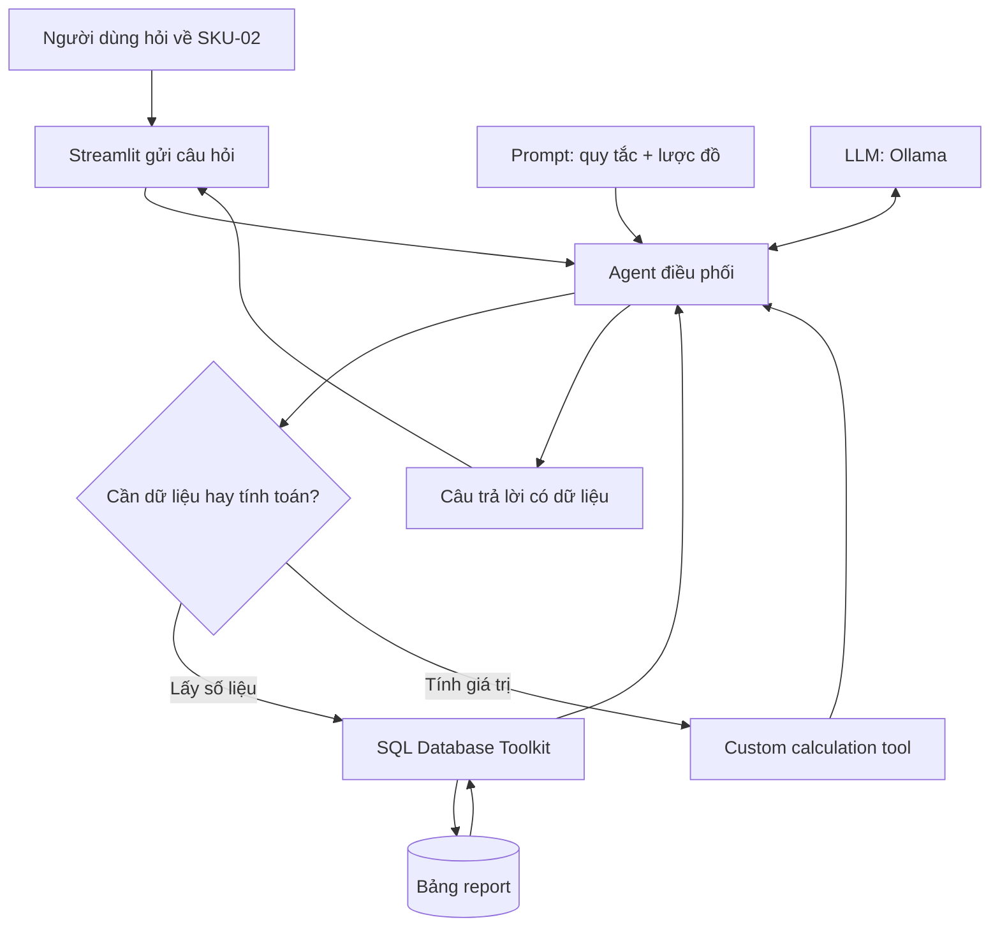
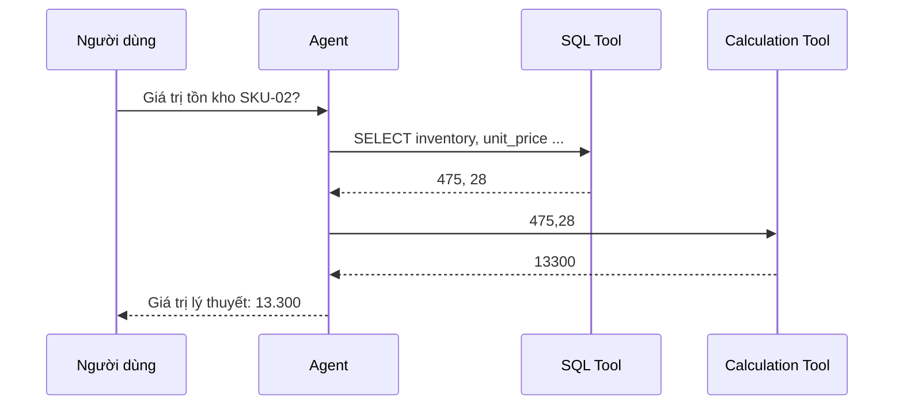

# Bài 01 — AI Agent, công cụ và kiến trúc ứng dụng hỏi đáp tồn kho

## 1. Tóm tắt

Một chatbot thông thường chủ yếu tạo phản hồi từ ngữ cảnh đầu vào và tri thức của mô hình. Khi cần trả lời câu hỏi dựa trên **số lượng tồn kho hiện tại của cửa hàng**, chỉ sinh văn bản là chưa đủ. Hệ thống phải đọc dữ liệu, chọn phép tính thích hợp và phản hồi có căn cứ. Đây là bài toán phù hợp với một **AI Agent có công cụ**.

## 2. Mục tiêu học tập

Sau bài này, bạn có thể:

- Phân biệt LLM, AI Agent, tool, database và framework điều phối.
- Giải thích tại sao phải lấy số liệu từ SQL trước khi tính toán.
- Mô tả vòng lặp ReAct ở mức hành động và kết quả quan sát.
- Vẽ được kiến trúc ứng dụng hỏi đáp tồn kho từ đầu đến cuối.

## 3. Từ câu hỏi đơn giản đến hệ thống có hành động

Giả sử nhân viên hỏi: **“Giá trị tồn kho tối đa của SKU-02 là bao nhiêu?”**. Để trả lời, hệ thống cần xác định mã hàng; tìm hai cột `inventory` và `unit_price`; thực hiện phép nhân; trình bày kết quả. Nếu chỉ hỏi LLM mà không cấp dữ liệu, nó có thể tạo ra con số trông hợp lý nhưng không liên quan đến bảng hàng hóa.

Đặt tên rõ cho chỉ tiêu: `inventory × unit_price` phản ánh **giá trị tồn kho ở giá bán niêm yết**, tức giá trị bán lý thuyết nếu bán hết hàng ở mức giá đó. Doanh thu thực tế phải dựa trên giao dịch bán hàng đã phát sinh; không thể suy ra từ số lượng hàng đang nằm trong kho.

## 4. Năm thành phần của hệ thống

| Thành phần | Vai trò | Ví dụ |
| --- | --- | --- |
| Database | Lưu dữ liệu có cấu trúc | SQLite, bảng `report` |
| LLM | Diễn giải câu hỏi, lựa chọn hành động | Model `mistral` chạy qua Ollama |
| Tool | Thực hiện thao tác cụ thể | Truy vấn SQL, nhân hai số |
| LangChain | Tích hợp model, prompt, toolkit, agent | `SQLDatabaseToolkit`, `create_sql_agent` |
| Streamlit | Giao diện cho người dùng | Ô nhập câu hỏi, nút Gửi |

Có thể hình dung LLM như bộ phận **lập kế hoạch**, công cụ như các **khả năng thao tác**, và LangChain như lớp **điều phối**. Đây chỉ là phép so sánh trực quan: LLM không phải “bộ não” theo nghĩa sinh học; khả năng sử dụng công cụ phụ thuộc mô hình, prompt và bộ điều phối thực tế.

## 5. Kiến trúc xử lý

Một yêu cầu có thể gọi nhiều công cụ theo thứ tự. Agent không “đưa dữ liệu vào LLM một lần rồi kết thúc”, mà dùng kết quả công cụ để quyết định bước tiếp theo.

## 6. ReAct: hành động dựa trên kết quả quan sát

**ReAct** là hướng tiếp cận kết hợp lựa chọn hành động và quan sát kết quả. Trong ví dụ tồn kho, vòng thao tác có thể là:

1. Nhận yêu cầu và xác định cần `inventory`, `unit_price`.
2. Gọi SQL tool với một truy vấn chỉ đọc.
3. Quan sát kết quả SQL, ví dụ `(475, 28)`.
4. Gọi công cụ tính `475 × 28`.
5. Quan sát `13300` và trả lời người dùng.

**Observation** chỉ là kết quả trả về của một lần gọi công cụ, không nhất thiết là kết thúc toàn bộ yêu cầu. Agent có thể tiếp tục thực hiện bước kế tiếp, nhưng phải giới hạn số vòng lặp để tránh chạy vô hạn. Nhật ký gọi công cụ cho phép kiểm tra các thao tác được thực thi; nó không đồng nghĩa với việc công bố đầy đủ suy luận nội bộ của mô hình.

## 7. ReAct và RAG có giống nhau không?

Không. **ReAct** nói về cách agent lựa chọn hành động và phản hồi theo kết quả. **RAG (Retrieval-Augmented Generation)** nói về việc truy xuất thông tin từ nguồn bên ngoài rồi bổ sung vào ngữ cảnh để tạo câu trả lời. Một agent ReAct có thể sử dụng truy xuất tài liệu (RAG) như một công cụ, nhưng hai khái niệm không đồng nhất.

## 8. Thực hành ngắn

Viết lại luồng xử lý của hai yêu cầu: (a) “Còn bao nhiêu chiếc SKU-02?” và (b) “Giá trị tồn kho lý thuyết của SKU-02?”. Với mỗi yêu cầu, chỉ ra dữ liệu cần đọc, có cần công cụ tính hay không và đầu ra mong muốn.

## 9. Câu hỏi ôn tập

### Câu 1

Vì sao một LLM độc lập không phải nguồn đáng tin cậy cho số lượng tồn kho hiện tại?

A. Vì LLM không thể đọc tiếng Việt.  
B. Vì Streamlit không lưu được dữ liệu.  
C. Vì LLM không tự có kết nối và dữ liệu tồn kho cập nhật của cửa hàng.  
D. Vì SQLite không hỗ trợ truy vấn.

**Đáp án:** C. **Giải thích:** Câu trả lời phải được nối với nguồn dữ liệu thực, không dựa vào việc mô hình đoán số.

### Câu 2

Thành phần nào thực sự thực thi câu lệnh `SELECT`?

A. SQL tool/đầu nối database.  
B. Nút Gửi của Streamlit.  
C. Prompt.  
D. Model như một phép tính trong văn bản.

**Đáp án:** A. **Giải thích:** Agent chọn công cụ; chính công cụ kết nối cơ sở dữ liệu và chạy SQL.

### Câu 3

Phép tính `inventory × unit_price` với tồn kho chưa bán phản ánh điều gì?

A. Lợi nhuận ròng.  
B. Tổng số đơn hàng.  
C. Doanh thu đã thu tiền.  
D. Giá trị bán lý thuyết của hàng đang tồn.

**Đáp án:** D. **Giải thích:** Chưa có thông tin giao dịch bán nên không thể gọi đây là doanh thu đã thực hiện.

### Câu 4

Sau một observation SQL, agent nên làm gì khi câu hỏi còn yêu cầu phép nhân?

A. Tự kết thúc ngay.  
B. Chọn công cụ tính với dữ liệu vừa nhận.  
C. Tạo số tiền bất kỳ.  
D. Viết dữ liệu mới vào database.

**Đáp án:** B. **Giải thích:** Observation cung cấp đầu vào cho hành động tiếp theo.

### Câu 5

Sự khác nhau chính giữa ReAct và RAG là gì?

A. ReAct quản lý luồng hành động; RAG bổ sung ngữ cảnh từ dữ liệu truy xuất.  
B. ReAct chỉ dùng cho robot; RAG chỉ dùng cho SQL.  
C. Hai khái niệm là một.  
D. RAG bắt buộc phải tính toán tồn kho.

**Đáp án:** A. **Giải thích:** ReAct mô tả phương thức agent sử dụng hành động; RAG là kỹ thuật truy xuất-thế hệ.

## 10. Tổng kết

AI Agent hỏi đáp tồn kho cần phối hợp LLM, database, tool và UI. Thiết kế tốt bắt đầu từ việc xác định **thao tác nào phải làm bằng dữ liệu và công cụ**, thay vì để mô hình sinh ra các con số không kiểm chứng.
