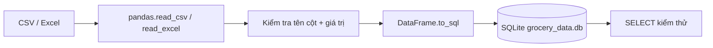

# Bài 03 — Chuyển dữ liệu tồn kho từ Excel/CSV sang SQLite

## 1. Tóm tắt

Dữ liệu tồn kho thường nằm trong bảng Excel hoặc CSV. SQL agent cần một cơ sở dữ liệu có cấu trúc, trong đó từng cột có ý nghĩa và từng hàng ứng với một SKU. Bài này sử dụng `pandas` kết hợp `sqlite3` để tạo bảng `report` trong tệp `grocery_data.db`.

## 2. Mục tiêu học tập

- Mô tả ý nghĩa của bảy trường dữ liệu hàng hóa.
- Nạp CSV hoặc Excel vào `DataFrame`.
- Chuyển bảng sang SQLite và xác minh bằng `SELECT`.
- Phân biệt thay thế bảng với bổ sung hàng.
- Kiểm tra được SKU và kiểu dữ liệu trước khi nhập.

## 3. Thiết kế bảng dữ liệu

| Cột | Ý nghĩa | Kiểu mong muốn |
| --- | --- | --- |
| `sku` | Mã đơn vị lưu kho (Stock Keeping Unit) | TEXT |
| `inventory` | Số lượng đang có | INTEGER |
| `daily_order_quantity` | Lượng đặt hàng trong một ngày | INTEGER |
| `expiration_date` | Ngày hết hạn | DATE dạng ISO hoặc TEXT có quy ước |
| `unit_price` | Giá mỗi đơn vị hàng | REAL/NUMERIC cho demo |
| `reorder_point` | Ngưỡng cần đặt hàng lại | INTEGER |
| `safety_stock` | Mức dự trữ an toàn | INTEGER |

Bảng mẫu ở `assets/grocery_data.csv` dùng cột tiếng Anh theo tên trên. Dữ liệu là **minh họa**, không phải dữ liệu kinh doanh đã xác minh. Khi dùng Excel thật, tên cột phải khớp hoặc được ánh xạ rõ ràng.

## 4. Luồng ETL đơn giản



`ETL` viết tắt cho Extract–Transform–Load: đọc dữ liệu, chuẩn hóa/kiểm tra, rồi ghi vào nguồn đích. Đối với dự án nhỏ, một script Python là đủ để thể hiện đầy đủ chu trình này.

## 5. Triển khai bằng Python

Tạo `load_excel.py`:

```python
import sqlite3
from pathlib import Path
import pandas as pd

DATABASE = Path("grocery_data.db")
SOURCE = Path("grocery_data.csv")

frame = pd.read_csv(SOURCE)  # Với Excel: pd.read_excel("grocery_data.xlsx")
frame.columns = frame.columns.str.strip().str.lower()

required = {"sku", "inventory", "unit_price"}
missing = required - set(frame.columns)
if missing:
    raise ValueError(f"Thiếu cột bắt buộc: {sorted(missing)}")

with sqlite3.connect(DATABASE) as conn:
    frame.to_sql("report", conn, if_exists="replace", index=False)

print("Đã tạo grocery_data.db với bảng report")
```

Đây là phiên bản minh họa ngắn. Bản thực hành có kiểm tra SKU trùng, số lượng âm và giá trị rỗng nằm trong `assets/load_excel.py`.

`if_exists="replace"` **xóa bảng cũ và tạo lại**: phù hợp lúc nạp lại toàn bộ file gốc để thử nghiệm. Khi cần giữ lịch sử hoặc cập nhật từng hàng, phải thiết kế khóa, UPSERT và chiến lược đồng bộ riêng, không lạm dụng `replace`.

## 6. Kiểm tra SQLite sau khi nhập

Trong chương trình hoặc tiện ích SQLite, thử:

```sql
SELECT sku, inventory, unit_price
FROM report
LIMIT 5;
```

Để lấy hai trường cần thiết cho SKU-02:

```sql
SELECT inventory, unit_price
FROM report
WHERE sku = 'SKU-02';
```

Trong Python, dùng placeholder để tránh nối giá trị người dùng vào SQL trực tiếp:

```python
import sqlite3

with sqlite3.connect("grocery_data.db") as conn:
    row = conn.execute(
        "SELECT inventory, unit_price FROM report WHERE sku = ?",
        ("SKU-02",),
    ).fetchone()
print(row)
```

Nếu mẫu dữ liệu chứa `inventory=475`, `unit_price=28`, kết quả là `(475, 28.0)` hoặc giá trị tương đương tùy kiểu SQLite.

## 7. Dữ liệu sạch và giới hạn

SKU có thể xuất hiện dưới dạng `SKU2`, `SKU-2`, `SKU-02` hoặc `SKU 02`. Trước khi truy vấn cần quyết định **chuẩn mã chính thức**; ví dụ dữ liệu mẫu thống nhất `SKU-02`. Không được tùy ý gán `SKU-2` thành `SKU-02` nếu doanh nghiệp thực sự có hai mã hàng khác nhau. Quy tắc chuẩn hóa chỉ áp dụng khi được xác nhận từ hệ thống.

SQLite tiện cho dự án cá nhân và demo. Với dữ liệu tiền tệ, dùng `Decimal` ở lớp tính toán hoặc lưu integer theo đơn vị nhỏ nhất để tránh sai số dấu phẩy động khi triển khai thực tế.

## 8. Bài thực hành

1. Chạy `python load_excel.py` với dữ liệu mẫu CSV.
2. Đọc năm hàng đầu bằng `SELECT` hoặc chạy `python check_database.py`.
3. Thay một giá trị `inventory` của SKU-02 trong CSV, nạp lại và kiểm tra kết quả.
4. Thử sửa `inventory` thành giá trị âm và quan sát bộ kiểm tra ở bản mã thực hành từ chối dữ liệu sai.

## 9. Câu hỏi ôn tập

### Câu 1

Tại sao cần đối chiếu tên cột trước khi gọi agent?

A. Để model chạy nhanh gấp đôi.  
B. Để tránh truy vấn vào tên trường không tồn tại.  
C. Để Streamlit chuyển thành HTML.  
D. Để đổi tất cả mã SKU.

**Đáp án:** B. **Giải thích:** Truy vấn SQL dựa trên lược đồ thực của database, không dựa vào tên cột phỏng đoán.

### Câu 2

`if_exists="replace"` có tác động gì?

A. Chỉ thêm hàng mới.  
B. Khóa database chỉ đọc.  
C. Tự tạo bản sao dự phòng.  
D. Thay thế bảng hiện tại bằng bảng được ghi từ DataFrame.

**Đáp án:** D. **Giải thích:** Dữ liệu bảng cũ có thể bị mất; cần thận trọng với dữ liệu thực.

### Câu 3

Truy vấn nào lấy giá và lượng tồn của một SKU cụ thể?

A. `SELECT inventory, unit_price FROM report WHERE sku = 'SKU-02';`  
B. `DELETE FROM report;`  
C. `DROP TABLE report;`  
D. `SELECT * FROM missing_table;`

**Đáp án:** A. **Giải thích:** Truy vấn `SELECT` chọn đúng hai cột cần thiết và lọc theo mã SKU.

### Câu 4

Lợi ích của placeholder `?` trong truy vấn Python SQLite là gì?

A. Thêm màu cho giao diện.  
B. Tự nhân giá tiền.  
C. Truyền tham số tách khỏi nội dung câu lệnh SQL, giảm rủi ro injection.  
D. Tăng số hàng tồn kho.

**Đáp án:** C. **Giải thích:** Driver xử lý giá trị tham số thay vì ghép chuỗi SQL không an toàn.

### Câu 5

Trường nào thích hợp nhất để định danh sản phẩm trong ví dụ?

A. `expiration_date`.  
B. `sku`.  
C. `safety_stock`.  
D. `daily_order_quantity`.

**Đáp án:** B. **Giải thích:** SKU là mã định danh mặt hàng; các cột còn lại mô tả thuộc tính hoặc chỉ số.

## 10. Tổng kết

Bước nhập dữ liệu là nền tảng tính đúng của agent. Khi `report` có tên cột chuẩn và giá trị đáng tin cậy, SQL toolkit mới có thể truy vấn một cách nhất quán.
