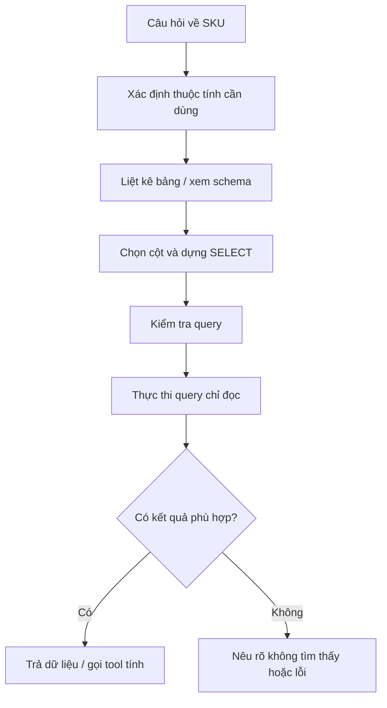

# Bài 04 — Cơ chế ReAct và bộ công cụ SQL trong LangChain

## 1. Tóm tắt

LLM không tự kết nối SQLite. Lớp SQL toolkit cung cấp các công cụ để khám phá bảng, đọc lược đồ và thực thi truy vấn. Agent sử dụng các công cụ đó theo một vòng xử lý có kiểm soát. Bài này tập trung vào nguyên lý và giới hạn an toàn của việc trao quyền truy cập cơ sở dữ liệu cho model.

## 2. Mục tiêu học tập

- Phân biệt `SQLDatabase`, `SQLDatabaseToolkit` và SQL agent.
- Mô tả các bước lấy lược đồ, tạo truy vấn, đọc kết quả.
- Phân biệt observation với câu trả lời cuối.
- Phân tích được rủi ro của SQL do LLM tạo ra.

## 3. Cách SQL toolkit hỗ trợ agent

`SQLDatabase` là wrapper kết nối cơ sở dữ liệu. `SQLDatabaseToolkit` xây dựng nhóm công cụ phục vụ thao tác SQL. `create_sql_agent` tạo tác nhân có thể điều phối các công cụ đó theo câu hỏi.

Ví dụ khởi tạo mang tính khung:

```python
from langchain_community.utilities import SQLDatabase
from langchain_community.agent_toolkits import SQLDatabaseToolkit
from langchain_ollama import ChatOllama

llm = ChatOllama(model="mistral", temperature=0)
db = SQLDatabase.from_uri("sqlite:///grocery_data.db")
toolkit = SQLDatabaseToolkit(db=db, llm=llm)
tools = toolkit.get_tools()
print([tool.name for tool in tools])
```

Thông thường toolkit có công cụ liệt kê bảng, tra lược đồ, kiểm tra truy vấn và chạy SQL. Tên chính xác phụ thuộc phiên bản được cài đặt; kiểm tra danh sách tool trên máy trước khi cấu hình prompt gọi tên cụ thể.

## 4. Chuỗi truy vấn có kiểm chứng



Không cần liệt kê toàn bộ bảng mỗi lần nếu thông tin đã được toolkit cung cấp trong ngữ cảnh, nhưng agent cần dùng **schema chính xác**, không tự đặt tên cột.

## 5. ReAct ở mức hành động

Mỗi bước có thể được biểu diễn bằng các thông tin kiểm chứng được: hành động đã chọn, tham số truyền vào và kết quả trả về. Ví dụ:

```text
User: SKU-02 có bao nhiêu hàng?
Tool: sql_db_query
Input: SELECT inventory FROM report WHERE sku = 'SKU-02';
Observation: 475
Final answer: SKU-02 hiện có 475 đơn vị (theo bảng report).
```

Nếu người dùng yêu cầu giá trị tồn kho, observation đầu tiên là `(475, 28)`; agent phải tiếp tục gọi công cụ tính. Ngược lại, nếu chỉ hỏi số lượng, một truy vấn SQL có thể đã đủ. **Observation không tự động là tín hiệu dừng**; agent chỉ kết thúc khi nhiệm vụ đã có dữ liệu cần thiết hoặc không thể tiếp tục hợp lệ.

## 6. Các tham số điều phối

Hàm `create_sql_agent` trong API LangChain Community/Classic hỗ trợ nhiều tham số quan trọng:

| Tham số | Vai trò |
| --- | --- |
| `llm` | Model ngôn ngữ dùng trong agent |
| `toolkit` | Bộ công cụ SQL đã kết nối database |
| `agent_type` | Kiểu điều phối, ví dụ `zero-shot-react-description` |
| `extra_tools` | Công cụ tùy chỉnh được thêm vào |
| `prefix` | Prompt hướng dẫn, cần placeholder `{dialect}` và `{top_k}` |
| `max_iterations` | Giới hạn số vòng thử |
| `verbose` | Ghi log vận hành phục vụ debug |
| `handle_parsing_errors` | Có thể cấu hình qua `agent_executor_kwargs` |

**Cảnh báo tương thích:** hàm `create_sql_agent` hiện trả về một `AgentExecutor` thuộc hướng LangChain Classic/legacy. Nó phù hợp để học từ cấu trúc có sẵn nhưng dự án production nên xem xét kiến trúc agent mới và các biện pháp server-side. Nếu model Ollama hỗ trợ tool calling tin cậy, có thể thử `agent_type="tool-calling"`; không phải mọi model đều hỗ trợ.

## 7. Bảo vệ cơ sở dữ liệu

Prompt “chỉ SELECT” chỉ là hướng dẫn cho model, **không phải hàng rào bảo mật**. SQL agent có khả năng tạo và thực thi SQL thông qua kết nối được cấp. Vì vậy cần:

- Dùng user database chỉ đọc hoặc SQLite URI `mode=ro` cho agent.
- Giới hạn bảng được nhìn thấy, ví dụ chỉ `report`.
- Kiểm soát truy vấn nặng, giới hạn hàng, giám sát thời gian.
- Không cấp quyền truy cập database sản xuất bằng tài khoản có quyền sửa/xóa.
- Không hiển thị thông tin nhạy cảm hoặc SQL log cho người dùng không có quyền.

Một ví dụ SQLite URI chỉ đọc dùng khi ghép ứng dụng trong bài 07:

```python
from pathlib import Path
from langchain_community.utilities import SQLDatabase

path = Path("grocery_data.db").resolve()
uri = f"sqlite:///file:{path.as_posix()}?mode=ro&uri=true"
db = SQLDatabase.from_uri(uri, include_tables=["report"])
```

## 8. Thực hành

Chạy đoạn khởi tạo SQL toolkit, in danh sách các tool và so sánh với mô tả. Sau đó viết thủ công hai truy vấn: lấy tồn kho của SKU-02; lấy hai trường cần thiết để tính giá trị lý thuyết. Chỉ dùng `SELECT`.

## 9. Câu hỏi ôn tập

### Câu 1

Chức năng của `SQLDatabaseToolkit` là gì?

A. Gộp các công cụ thao tác SQL để agent sử dụng.  
B. Chạy trực tiếp giao diện web.  
C. Tải model Ollama.  
D. Tự tạo dữ liệu sản phẩm.

**Đáp án:** A. **Giải thích:** Toolkit cung cấp nhóm thao tác cho agent kết nối database.

### Câu 2

Vì sao cần lấy schema?

A. Để thay thế giá sản phẩm.  
B. Để lưu lịch sử chat.  
C. Để biết tên bảng và cột thực tế trước khi truy vấn.  
D. Để khởi động Streamlit.

**Đáp án:** C. **Giải thích:** Truy vấn đúng phụ thuộc cấu trúc dữ liệu thực tế.

### Câu 3

Dùng `max_iterations=7` chủ yếu để làm gì?

A. Bảo đảm 100% câu trả lời chính xác.  
B. Giới hạn vòng xử lý của agent.  
C. Đọc đúng 7 hàng dữ liệu.  
D. Đặt số lượng tồn kho tối đa.

**Đáp án:** B. **Giải thích:** Đây là giới hạn số bước thực thi, không phải chất lượng dự đoán.

### Câu 4

Biện pháp nào bảo vệ tốt hơn trước truy vấn SQL gây sửa đổi dữ liệu?

A. Chỉ đặt `temperature=0`.  
B. Chỉ dùng prompt dài.  
C. Tăng `verbose=True`.  
D. Kết nối bằng quyền chỉ đọc ở lớp database.

**Đáp án:** D. **Giải thích:** Quyền truy cập ở backend chặn thao tác ghi dù prompt bị bỏ qua.

### Câu 5

Kết quả `475, 28` từ SQL với câu hỏi giá trị tồn kho có nghĩa là gì?

A. Là dữ liệu đầu vào để thực hiện bước nhân tiếp theo.  
B. Là hai câu trả lời cuối không cần xử lý.  
C. Là lỗi cú pháp.  
D. Có nghĩa phải xóa bảng.

**Đáp án:** A. **Giải thích:** Agent cần chuyển dữ liệu vừa nhận sang phép tính phù hợp.

## 10. Tổng kết

SQL toolkit cho phép agent tra cứu dữ liệu thực thay vì suy diễn. Tính chính xác cần cả schema đúng, giới hạn quyền truy cập và một quy trình kiểm tra query/kết quả rõ ràng.
