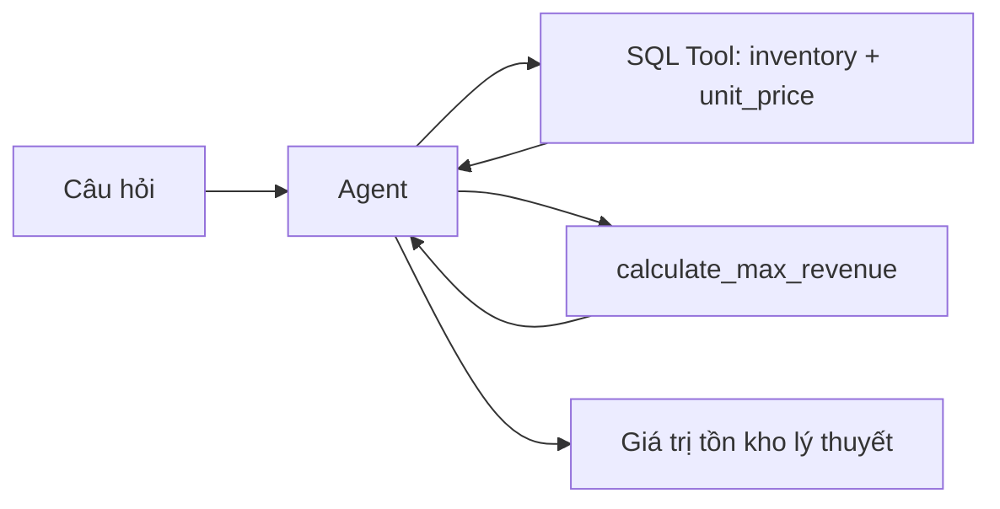

# Bài 05 — Xây dựng công cụ tùy chỉnh để tính giá trị tồn kho

## 1. Tóm tắt

Một SQL agent có thể tìm số liệu, nhưng nhiều câu hỏi cần phép tính nghiệp vụ. Khi đóng gói phép tính thành **tool**, ta quy định rõ đầu vào, công thức, kiểu dữ liệu, lỗi và đầu ra, thay vì để model tự suy luận ra một số tiền.

## 2. Mục tiêu học tập

- Giải thích tại sao cần custom tool khi đã có SQL toolkit.
- Tạo một tool bằng decorator `@tool`.
- Phân tích chuỗi nhập theo định dạng `inventory,unit_price`.
- Kiểm tra được đầu vào sai, số âm và trường hợp tồn kho bằng 0.
- Phân biệt tên nghiệp vụ “max revenue” trong ví dụ với doanh thu thực tế.

## 3. Xác định công thức và quy ước

Trong dự án, công cụ được đặt tên theo mạch bài giảng là `calculate_max_revenue`. Tuy nhiên, phép tính được triển khai là:

$$
V_{\text{ton kho}} = Q_{\text{ton kho}} \times P_{\text{don vi}}
$$

Với $Q_{\text{ton kho}}$ là lượng hàng đang còn và $P_{\text{don vi}}$ là giá bán mỗi đơn vị. Công thức cho ra **giá trị tồn kho theo mức giá dự kiến**. Nó không trừ chi phí, không xét giảm giá, hoàn hàng, thuế và không chứng minh hàng đã bán. Trong ứng dụng kinh doanh thực, nên đặt tên chỉ tiêu là `potential_inventory_value`; ở đây giữ tên tool `calculate_max_revenue` để nhất quán với mạch triển khai ban đầu.

Ví dụ minh họa: SKU-02 có `inventory=475` và `unit_price=28`, vì vậy `475 × 28 = 13.300` đơn vị tiền.

## 4. Vì sao không để LLM nhân trực tiếp?

Phép nhân đơn giản thường nằm trong khả năng của LLM, nhưng đối với ứng dụng cần kiểm thử và kiểm soát, một tool tường minh có lợi ích: một đầu vào xác định, một công thức thống nhất, kết quả dễ tái hiện và dễ thay thế bằng nghiệp vụ phức tạp hơn. Chẳng hạn sau này có thể bổ sung công cụ tính điểm đặt hàng lại hoặc xác định hàng sắp hết hạn.

## 5. Viết tool

Tạo `custom_tools.py`:

```python
from decimal import Decimal, InvalidOperation
from langchain_core.tools import tool

@tool
def calculate_max_revenue(tool_input: str) -> str:
    """Calculate theoretical inventory value from 'quantity,unit_price'.

    Input example: '475,28'. This is not realized sales revenue.
    """
    try:
        parts = tool_input.split(",")
        if len(parts) != 2:
            return "Lỗi: dùng định dạng quantity,unit_price, ví dụ 475,28."
        quantity = int(parts[0].strip())
        price = Decimal(parts[1].strip())
        if quantity < 0 or price < 0 or not price.is_finite():
            return "Lỗi: số lượng và giá phải là số hữu hạn không âm."
        value = Decimal(quantity) * price
        return f"{value:.2f}"
    except (ValueError, InvalidOperation):
        return "Lỗi: giá trị đầu vào không hợp lệ."
```

**Giải thích:** `@tool` biến hàm Python thành công cụ mà agent có thể gọi. Docstring giải thích cách sử dụng, giúp model chọn và tạo đầu vào đúng. `split(",")` tách hai trường; `int` bảo đảm số lượng nguyên; `Decimal` giúp phép tính thập phân thích hợp hơn với giá trị tiền tệ. Bản chạy đi kèm nằm ở `assets/custom_tools.py`.

## 6. Kiểm thử độc lập

Chạy hàm qua giao diện tool:

```python
from custom_tools import calculate_max_revenue

assert calculate_max_revenue.invoke("475,28") == "13300.00"
assert calculate_max_revenue.invoke("0,28") == "0.00"
print(calculate_max_revenue.invoke("sai,28"))
```

Kiểm tra công cụ trước khi thêm vào agent giúp tách lỗi Python ra khỏi lỗi tạo hành động của LLM.

## 7. Tích hợp với SQL toolkit



Công cụ tính **không tự đọc database**; nó nhận đúng hai giá trị từ SQL. Điều đó cho phép tái sử dụng với nhiều SKU, nhưng agent phải ghép kết quả đúng mã hàng.

## 8. Lỗi thường gặp

- Truyền chuỗi có nhãn như `inventory=475,price=28` khi tool cần hai số: cần tuân thủ định dạng.
- Dùng dấu phẩy làm dấu thập phân như `28,50`: input kỹ thuật cần dấu chấm để ghi số thập phân.
- Không kiểm tra số âm hoặc `NaN`: phải từ chối dữ liệu không hợp lệ.
- Gọi kết quả là doanh thu đã bán: sai ý nghĩa nghiệp vụ.
- Model gọi tool trước khi truy vấn SQL: cần bổ sung kiểm thử tích hợp.

## 9. Thực hành

Viết ba ca kiểm thử cho tool: số lượng 1 với giá 15.5, tồn kho 0, dữ liệu sai định dạng. Nâng cao: tạo tool `calculate_reorder_gap` nhận tồn kho và điểm đặt hàng lại; tự xác định và giải thích công thức trước khi code.

## 10. Câu hỏi ôn tập

### Câu 1

Tại sao phải lấy tồn kho và giá từ SQL trước khi gọi tool?

A. Vì tool tự tạo dữ liệu dự báo.  
B. Vì SQLite chỉ hỗ trợ phép nhân.  
C. Vì model không biết cộng.  
D. Vì kết quả phải dựa trên số liệu thực của SKU được hỏi.

**Đáp án:** D. **Giải thích:** Công cụ xử lý đầu vào do agent cung cấp, không tự xác minh nguồn số liệu.

### Câu 2

`@tool` trong LangChain giúp làm gì?

A. Tự khởi động SQLite.  
B. Biến hàm thành công cụ được agent gọi.  
C. Tạo giao diện Streamlit.  
D. Cài model Ollama.

**Đáp án:** B. **Giải thích:** Decorator đăng ký hàm cùng mô tả để agent sử dụng.

### Câu 3

Với `inventory=475` và `unit_price=28`, kết quả phép tính là bao nhiêu?

A. 13.300.  
B. 503.  
C. 447.  
D. 17.

**Đáp án:** A. **Giải thích:** 475 nhân 28 bằng 13.300.

### Câu 4

`Decimal` có lợi ích nào khi xử lý giá tiền?

A. Tự tra cứu dữ liệu.  
B. Thay thế agent.  
C. Hạn chế sai số kiểu nhị phân của `float` trong phép tính thập phân.  
D. Chặn toàn bộ SQL injection.

**Đáp án:** C. **Giải thích:** `Decimal` hỗ trợ biểu diễn và tính toán thập phân theo ngữ cảnh.

### Câu 5

Câu nào mô tả đúng kết quả `inventory × unit_price`?

A. Chắc chắn là lợi nhuận sau thuế.  
B. Luôn là doanh thu tháng trước.  
C. Là tổng số đơn hàng.  
D. Là giá trị tồn kho theo mức giá đơn vị, chưa phải doanh thu đã thực hiện.

**Đáp án:** D. **Giải thích:** Hàng tồn chưa được xác nhận đã bán.

## 11. Tổng kết

Tool cần hợp đồng đầu vào rõ ràng và kiểm thử độc lập. Tính toán chỉ đáng tin khi đầu vào lấy từ nguồn đúng và kết quả được gọi bằng đúng tên chỉ tiêu.
