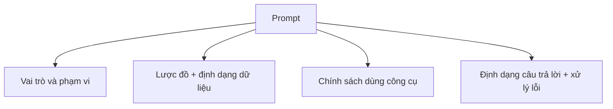

# Bài 06 — Thiết kế prompt và quy tắc dùng SQL, công cụ, mã SKU

## 1. Tóm tắt

Prompt là hợp đồng hướng dẫn agent: dữ liệu có cấu trúc thế nào, khi nào cần gọi SQL, khi nào cần gọi công cụ tính toán và làm gì nếu thiếu dữ liệu. Prompt tốt vừa rõ về nghiệp vụ, vừa sử dụng schema thực tế.

## 2. Mục tiêu học tập

- Thiết kế prompt gồm vai trò, schema, quy tắc hành động và cách trả lời.
- Quy định đúng thứ tự tra cứu rồi tính toán.
- Xử lý biến thể SKU có kiểm soát.
- Giảm việc dùng số liệu suy đoán.
- Phân biệt prompt với quyền bảo mật cưỡng chế ở backend.

## 3. Bốn lớp thông tin của prompt

**Vai trò:** agent chỉ hỗ trợ dữ liệu tồn kho. **Schema:** bảng `report`, các trường cụ thể. **Quy tắc hành động:** dùng SQL trước khi tính, không tự bịa giá. **Quy tắc trả lời:** xác nhận đúng SKU, nêu rõ không tìm thấy, gọi đúng tên chỉ tiêu.



Sơ đồ tách prompt thành các phần để dễ gỡ lỗi: khi agent truy vấn sai tên trường thì sửa schema; khi công cụ bị bỏ qua thì xem lại chính sách hành động.

## 4. Ví dụ `prompt.py`

```python
SQL_AGENT_PREFIX = """
Bạn là trợ lý quản lý tồn kho có quyền tra cứu SQLite.
Cơ sở dữ liệu dùng phương ngữ SQL: {dialect}.
Chỉ dùng bảng report, tối đa {top_k} hàng nếu không có yêu cầu khác.

Các cột: sku, inventory, daily_order_quantity,
expiration_date, unit_price, reorder_point, safety_stock.

1. Khi cần số liệu, dùng SQL SELECT đọc hàng phù hợp.
2. Không tự tạo mã SKU, số lượng hay giá bán.
3. Khi tính giá trị tồn kho, lấy inventory, unit_price rồi
   gọi calculate_max_revenue theo định dạng quantity,unit_price.
4. Nếu không tìm thấy SKU, nói rõ không tìm thấy.
5. Với nhiều SKU, bảo toàn đúng cặp SKU và dữ liệu.
6. Không thực thi truy vấn ghi/sửa/xóa.
7. Không gọi giá trị tồn kho lý thuyết là doanh thu đã bán.
"""
```

API `create_sql_agent` yêu cầu prefix chứa hai placeholder **`{dialect}` và `{top_k}`**. Không xóa chúng khi dùng phiên bản API tương ứng. Bản `assets/prompt.py` còn bổ sung quy tắc chỉ trả lời khi đã có kết quả công cụ.

## 5. Chuẩn hóa mã SKU

Người dùng có thể nhập `SKU2`, `SKU-2`, `SKU 02` hoặc `SKU-02`. Trong dữ liệu **minh họa**, quy ước mã chính thức là `SKU-02`, vì vậy có thể diễn giải các dạng thường gặp theo quy tắc đó. Nhưng ở hệ thống thật, không được tùy ý coi các mã đó tương đương: hai mã có thể là hai sản phẩm khác nhau. Hãy dựa vào bảng alias hoặc quy ước của cơ sở dữ liệu.

## 6. Xử lý câu hỏi nhiều SKU

Với câu hỏi “Giá trị của SKU-02 và SKU-05?”, agent phải lấy từng bản ghi, đảm bảo `inventory` và `unit_price` cùng một SKU, rồi tính riêng. Không được nhân tồn kho của SKU này với giá của SKU khác.

Với câu hỏi “Có bao nhiêu SKU hết hạn trong 10 ngày?”, cần tra `sku` và `expiration_date` theo quy ước ngày thống nhất. Không được tự điền ngày tháng không nằm trong dữ liệu.

## 7. Ví dụ hướng dẫn hành động

```text
Người dùng: SKU-02 có bao nhiêu hàng?
Cách xử lý: SQL đọc inventory theo mã; trả kết quả thực.

Người dùng: Tính giá trị tồn kho SKU-02.
Cách xử lý: SQL đọc inventory và unit_price;
sau đó gọi calculate_max_revenue với hai giá trị vừa tìm.
```

Việc đưa sẵn con số mẫu như 475 và 28 vào prompt có thể khiến model lặp lại số từ ví dụ thay vì đọc SQL. Hãy ưu tiên minh họa **quy trình** hơn là gài kết quả cố định.

## 8. Giới hạn của prompt

Quy tắc “không bịa số”, `temperature=0` và prompt chi tiết chỉ làm giảm một số lỗi, **không đảm bảo** tính đúng. Hãy kiểm tra kết quả trực tiếp, bảo vệ database bằng quyền chỉ đọc và giới hạn truy vấn nặng ở tầng thực thi.

## 9. Thực hành

Viết lại prompt để hỗ trợ câu hỏi “Những SKU nào có `inventory` thấp hơn `safety_stock`?”. Nêu đủ cột cần tra và xác định việc lọc bằng `SELECT` đã đủ hay cần custom tool. Thêm một ví dụ cho việc so sánh hai SKU.

## 10. Câu hỏi ôn tập

### Câu 1

Vì sao prompt cần ghi đúng tên cột?

A. Để UI có màu đẹp.  
B. Để tăng số token.  
C. Để SQL agent tham chiếu đúng lược đồ.  
D. Để CSV xóa hàng.

**Đáp án:** C. **Giải thích:** Cột sai dẫn tới truy vấn SQL sai hoặc không chạy.

### Câu 2

Khi hỏi giá trị tồn kho, thứ tự hợp lý nhất là gì?

A. Tính trước rồi đọc SQL.  
B. Đọc `inventory`, `unit_price` rồi tính.  
C. Trả số có sẵn trong ví dụ.  
D. Xóa bảng rồi nạp lại.

**Đáp án:** B. **Giải thích:** Phép tính phải dựa vào dữ liệu thật của SKU.

### Câu 3

Nếu SQL không tìm thấy SKU, agent nên làm gì?

A. Nêu rõ không tìm thấy, không bịa số.  
B. Chọn hàng gần giống bất kỳ.  
C. Dùng SKU-02 mặc định.  
D. Trả giá bằng 0 không thông báo.

**Đáp án:** A. **Giải thích:** Không có bản ghi khác với bản ghi có giá trị 0.

### Câu 4

Điều gì dễ sai khi hỏi nhiều SKU?

A. Giao diện có quá nhiều màu.  
B. Không thể gọi SQL.  
C. Không cần tính.  
D. Ghép nhầm giá của SKU này với tồn kho SKU khác.

**Đáp án:** D. **Giải thích:** Phải giữ quan hệ giữa các trường và mã sản phẩm.

### Câu 5

Cách đáng tin hơn để ngăn lệnh `DELETE` chạy là gì?

A. Prompt thật dài.  
B. Chỉ dùng `temperature=0`.  
C. Giới hạn quyền database ở backend.  
D. Dùng giao diện tối.

**Đáp án:** C. **Giải thích:** Quyền chỉ đọc là rào chắn hệ thống, không chỉ là lời nhắc.

## 11. Tổng kết

Prompt hiệu quả chuyển yêu cầu nghiệp vụ thành quy tắc lấy dữ liệu và dùng công cụ. Chất lượng còn phụ thuộc schema, bộ kiểm thử và giới hạn truy cập, không chỉ vào câu chữ.
