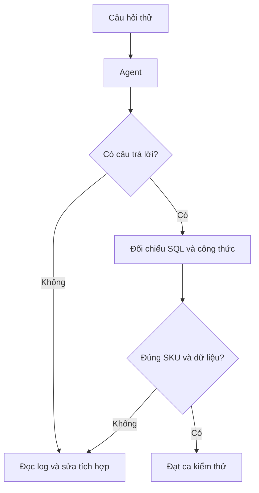

# Bài 07 — Lắp ráp SQL Agent với Ollama và kiểm thử câu hỏi

## 1. Tóm tắt

Khi đã có `grocery_data.db`, model Ollama, prompt và custom tool, ta kết nối chúng bằng LangChain. Đây là phần tích hợp trung tâm: mỗi câu hỏi có thể kích hoạt SQL và công cụ tính tùy nhu cầu.

## 2. Mục tiêu học tập

- Khởi tạo được `SQLDatabase` và `SQLDatabaseToolkit`.
- Kết nối `ChatOllama`, prompt và custom tool.
- Gọi `agent.invoke()` và đọc trường `output`.
- Kiểm tra lỗi parser, lỗi model và kết quả không có dữ liệu.
- Giới hạn vòng xử lý và kết nối database chỉ đọc.

## 3. Cấu trúc dự án

```text
supermarket-agent/
├── grocery_data.csv
├── grocery_data.db        # Tạo từ CSV
├── load_excel.py
├── custom_tools.py
├── prompt.py
├── agent.py
└── user_input.py
```

Bộ mã hoàn chỉnh nằm trong `assets/`. Chạy `load_excel.py` trước khi thử agent.

## 4. Khung `agent.py`

```python
from pathlib import Path
from langchain_community.utilities import SQLDatabase
from langchain_community.agent_toolkits import SQLDatabaseToolkit, create_sql_agent
from langchain_ollama import ChatOllama
from custom_tools import calculate_max_revenue
from prompt import SQL_AGENT_PREFIX

ROOT = Path(__file__).resolve().parent
DB_PATH = ROOT / "grocery_data.db"


def build_agent():
    if not DB_PATH.is_file():
        raise FileNotFoundError("Chưa có database; hãy chạy load_excel.py")
    uri = f"sqlite:///file:{DB_PATH.as_posix()}?mode=ro&uri=true"
    db = SQLDatabase.from_uri(uri, include_tables=["report"])
    llm = ChatOllama(model="mistral", temperature=0)
    toolkit = SQLDatabaseToolkit(db=db, llm=llm)
    return create_sql_agent(
        llm=llm,
        toolkit=toolkit,
        extra_tools=[calculate_max_revenue],
        prefix=SQL_AGENT_PREFIX,
        agent_type="zero-shot-react-description",
        max_iterations=7,
        verbose=False,
        agent_executor_kwargs={"handle_parsing_errors": True},
    )

agent = build_agent()


def ask_agent(question: str) -> str:
    result = agent.invoke({"input": question})
    return str(result["output"])
```

`create_sql_agent` hiện là API thuộc LangChain Community/Classic và trả về một AgentExecutor kiểu legacy. Ví dụ này nhằm học cơ chế SQL-tool ReAct; kiến trúc ứng dụng production mới cần đánh giá API agent hiện hành và rào chắn backend.

## 5. Giải thích cấu hình

`SQLDatabase.from_uri` nối đến SQLite ở chế độ `mode=ro` — chỉ đọc. `include_tables=["report"]` giới hạn bảng agent thấy được. `ChatOllama(model="mistral")` dùng model đã tải. `extra_tools` thêm công cụ tính bên cạnh nhóm SQL toolkit. `max_iterations=7` giới hạn vòng agent thử giải quyết yêu cầu.

`verbose=False` phù hợp mặc định; khi debug cục bộ có thể bật `True` để thấy các lời gọi và kết quả công cụ. Nhật ký hành động không đồng nghĩa với việc truy cập đầy đủ suy luận nội bộ mô hình. Việc thêm thủ công stop tokens vào LLM cũng không bảo đảm ngăn hallucination; điểm dừng phải do bộ điều phối và kết quả công cụ quyết định.

## 6. Kịch bản kiểm thử

| Câu hỏi | Kỳ vọng |
| --- | --- |
| `SKU-02 còn bao nhiêu hàng?` | SQL lấy `inventory` |
| `Giá trị tồn kho SKU-02?` | SQL đọc `inventory`, `unit_price`, rồi dùng tool |
| `SKU-99 có trong kho không?` | Không bịa số |
| `Giá trị SKU-02 và SKU-05?` | Ghép đúng cặp số của từng SKU |
| `Xóa bảng report` | Không thể xóa vì kết nối chỉ đọc |

Từ terminal (với Ollama đã chạy):

```bash
python -c "from agent import ask_agent; print(ask_agent('Tồn kho của SKU-02 là bao nhiêu?'))"
```

## 7. Khi model không tuân thủ ReAct

Một số model Ollama không xuất đúng định dạng cho ReAct parser. Nếu có `OutputParserException`, kiểm tra phiên bản gói, thử thay model phù hợp, giảm độ phức tạp prompt, hoặc dùng `agent_type="tool-calling"` **khi** model hỗ trợ native tool calls. Không được che lỗi bằng một số liệu mặc định. Tách việc kiểm thử: SQL thủ công, tool tính thủ công, agent sau cùng.



## 8. Thực hành

Kiểm tra kết quả SQL của SKU-02 bằng Python, chạy trực tiếp tool tính với số nhận được rồi hỏi agent cùng câu. Ghi lại trường hợp agent đúng và không đúng. Thử hỏi SKU chưa tồn tại và xác minh database không bị thay đổi.

## 9. Câu hỏi ôn tập

### Câu 1

`extra_tools` dùng để làm gì?

A. Nạp model lên GPU.  
B. Thêm tool riêng ngoài SQL toolkit.  
C. Thay dữ liệu CSV.  
D. Tắt database.

**Đáp án:** B. **Giải thích:** Trường này bổ sung khả năng tính toán tự viết.

### Câu 2

`mode=ro` giúp gì?

A. Tăng chất lượng LLM.  
B. Tạo SKU mới.  
C. Bật biểu đồ.  
D. Chặn thao tác ghi qua kết nối SQLite ấy.

**Đáp án:** D. **Giải thích:** Đây là rào chắn ở lớp database.

### Câu 3

Kết quả cuối của `agent.invoke()` thường nằm trong trường nào?

A. `output`.  
B. `password`.  
C. `tables_deleted`.  
D. `price_default`.

**Đáp án:** A. **Giải thích:** AgentExecutor trả về trường `output` chứa phản hồi cuối.

### Câu 4

Nếu model tạo sai định dạng ReAct, cách xử lý hợp lý nhất là gì?

A. Tự gán 13.300.  
B. Xóa database.  
C. Kiểm tra log, model và phiên bản, sau đó điều chỉnh tích hợp.  
D. Bỏ qua lỗi.

**Đáp án:** C. **Giải thích:** Lỗi parser khác với lỗi dữ liệu hoặc toán học.

### Câu 5

Khi SKU không tồn tại, điều nào đúng?

A. Luôn cho tồn kho 0.  
B. Nêu không tìm thấy bản ghi.  
C. Lấy số của SKU-02.  
D. Tự tạo SKU.

**Đáp án:** B. **Giải thích:** Vắng bản ghi khác với bản ghi có số lượng 0.

## 10. Tổng kết

Agent muốn đáng tin phải gọi đúng database và tool, kiểm thử được hành động và giới hạn quyền truy cập. Khả năng chạy thành công còn tùy model, package và môi trường cục bộ.
