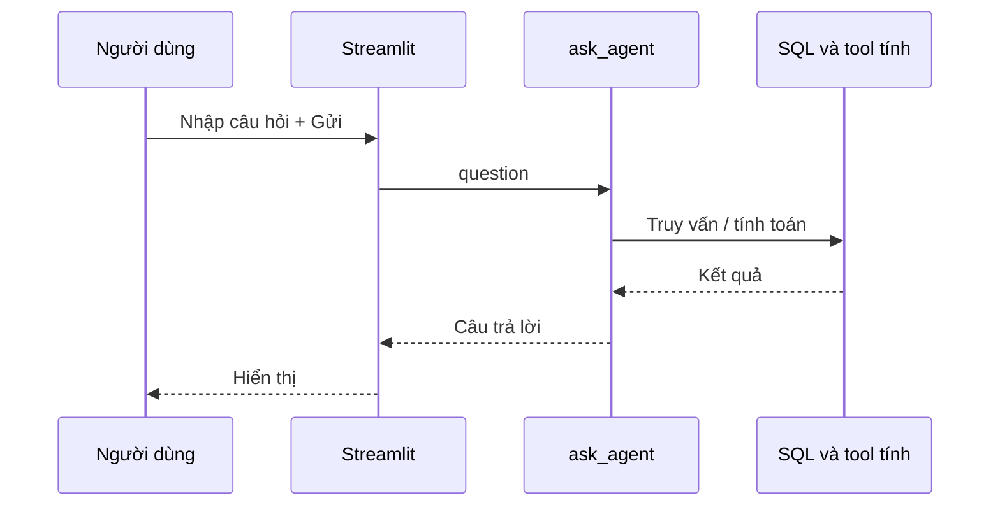

# Bài 08 — Xây dựng giao diện hỏi đáp bằng Streamlit

## 1. Tóm tắt

Streamlit tạo giao diện web bằng Python, giúp người dùng nhập câu hỏi, nhấn Gửi và xem kết quả của agent mà không cần viết frontend HTML/CSS/JavaScript riêng. Nó không tự xử lý SQL: mọi logic nghiệp vụ vẫn nằm trong `ask_agent`.

## 2. Mục tiêu học tập

- Sử dụng `st.title`, `st.text_input`, `st.button` và `st.write`.
- Kết nối nút Gửi đến `ask_agent()`.
- Kiểm tra input rỗng và lỗi kết nối model.
- Chạy ứng dụng với `streamlit run`.
- Phân biệt giao diện với lớp truy vấn dữ liệu.

## 3. Luồng xử lý



Streamlit chỉ thu thập input và trình bày output. Quyền database, kiểm tra công thức và quy tắc agent vẫn phải thực hiện ở tầng ứng dụng.

## 4. Tạo file `user_input.py`

```python
import streamlit as st
from agent import ask_agent

st.set_page_config(page_title="AI Agent tồn kho")
st.title("Trợ lý AI quản lý tồn kho")
st.caption("Hỏi về SKU, tồn kho và giá trị bán lý thuyết")

question = st.text_input("Nhập câu hỏi")

if st.button("Gửi"):
    if not question.strip():
        st.warning("Vui lòng nhập câu hỏi.")
    else:
        try:
            with st.spinner("Đang tra cứu dữ liệu..."):
                answer = ask_agent(question)
            st.write(answer)
        except Exception:
            st.error("Không thể xử lý yêu cầu. Hãy kiểm tra Ollama và log.")
```

Bản trong `assets/user_input.py` chỉ khởi tạo agent khi người dùng gửi câu hỏi để thông báo lỗi dễ hiểu hơn nếu thiếu database hoặc service.

## 5. Chạy ứng dụng

Tại thư mục chứa `user_input.py`:

```bash
streamlit run user_input.py
```

Mở URL local mà Streamlit thông báo. Thử các câu hỏi: “SKU-02 có bao nhiêu hàng?”, “Giá trị tồn kho SKU-02 là bao nhiêu?” và “SKU-99 có trong kho không?”. Đối chiếu kết quả với cơ sở dữ liệu.

## 6. Những điểm cần lưu ý

Streamlit chạy lại script khi tương tác. Khi cần tối ưu, có thể sử dụng cơ chế cache phù hợp nhưng phải xem xét trạng thái và người dùng. `st.session_state` giữ trạng thái trong phiên tương tác phù hợp, **không phải bộ nhớ dài hạn xuyên nhiều phiên**. Muốn lưu hội thoại bền vững phải dùng kho lưu trữ riêng.

Không hiển thị exception chi tiết, mật khẩu hoặc dữ liệu nội bộ trên UI công khai. Hãy ghi lỗi kỹ thuật vào log an toàn và trả thông báo ngắn, dễ hiểu cho người dùng.

## 7. Thực hành

Thêm hai câu hỏi gợi ý bên dưới tiêu đề. Kiểm tra khi không nhập gì, khi Ollama chưa chạy và khi SKU không tồn tại. Giải thích vì sao ở cả ba trường hợp đều không nên đưa ra con số đoán.

## 8. Câu hỏi ôn tập

### Câu 1

Lệnh chạy ứng dụng Streamlit là gì?

A. `python install streamlit`  
B. `streamlit create ui`  
C. `ollama run user_input.py`  
D. `streamlit run user_input.py`

**Đáp án:** D. **Giải thích:** `streamlit run` chạy server UI từ script Python.

### Câu 2

`st.text_input` dùng để làm gì?

A. Nhận một dòng nhập của người dùng.  
B. Kết nối SQLite trực tiếp.  
C. Tải model.  
D. Tự tính giá trị tồn kho.

**Đáp án:** A. **Giải thích:** Widget thu nhận văn bản và chuyển cho logic Python.

### Câu 3

Vì sao kiểm tra câu hỏi rỗng trước khi gọi agent?

A. Để có màu giao diện.  
B. Để tránh lượt xử lý vô nghĩa.  
C. Vì SQLite không có chuỗi rỗng.  
D. Để tăng RAM.

**Đáp án:** B. **Giải thích:** Kiểm tra input giúp ứng dụng ổn định và dễ dùng.

### Câu 4

`st.session_state` thích hợp dùng cho điều gì?

A. Lưu cơ sở dữ liệu sản xuất.  
B. Lưu thông tin vĩnh viễn qua mọi thiết bị.  
C. Giữ trạng thái UI trong phiên tương tác.  
D. Đọc dữ liệu SQL tự động.

**Đáp án:** C. **Giải thích:** Đây là trạng thái phiên của Streamlit, không phải kho nhớ dài hạn liên phiên.

### Câu 5

Nếu service Ollama chưa chạy, giao diện nên làm gì?

A. Hiển thị lỗi dễ hiểu, giúp kiểm tra log.  
B. Tự tạo số minh họa thành kết quả.  
C. Xóa database.  
D. Ẩn mọi câu hỏi.

**Đáp án:** A. **Giải thích:** Lỗi kết nối không được thay bằng kết quả sai.

## 9. Tổng kết

Giao diện Streamlit hoàn thiện trải nghiệm hỏi đáp. Agent và database tiếp tục là nơi chịu trách nhiệm về độ đúng, quyền truy cập và xử lý lỗi.
