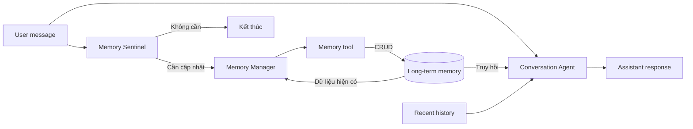

# Bài 02. Kiến trúc Conversation Agent và Memory Agent

## 1. Tóm tắt

Một thiết kế dễ kiểm soát cho trợ lý có bộ nhớ dài hạn là dùng hai luồng chức năng: **Conversation Agent** tạo câu trả lời và **Memory Agent** theo dõi thông tin cần ghi nhớ. Hai luồng dùng chung kho ký ức nhưng không có cùng nhiệm vụ.

## 2. Mục tiêu học tập

Bạn sẽ phân biệt được trách nhiệm của hai agent, thiết kế luồng đọc/ghi dữ liệu, mô tả đầu vào của Conversation Agent và giải thích vì sao không nên để mọi lượt chat đều tạo dữ kiện mới.

## 3. Conversation Agent: trả lời với ngữ cảnh cá nhân

Một yêu cầu như “Hãy lên thực đơn bữa tối” được giải bằng cách kết hợp:

1. **System prompt**: vai trò và nguyên tắc của trợ lý lập thực đơn.
2. **Recent messages**: những câu đã nói trong cuộc trò chuyện hiện tại.
3. **Long-term memories**: thông tin dài hạn được truy hồi từ kho ký ức.
4. **Latest user message**: nhiệm vụ vừa được giao.

Ví dụ, bộ nhớ có thể cung cấp ba dữ kiện: gia đình sáu người, vợ chồng không ăn thịt và con gái út dị ứng sữa. Conversation Agent sử dụng chúng để lập phương án phù hợp, đồng thời hỏi lại khi chưa rõ thành viên nào sẽ ăn món nào.

## 4. Memory Agent: quan sát và cập nhật kiến thức

Memory Agent không phải là một chatbot thứ hai trả lời người dùng. Công việc của nó là xem tin nhắn mới có chứa sự kiện dài hạn hay không, đối chiếu với dữ liệu cũ rồi tạo một hoặc nhiều thao tác:

- `create`: thêm ký ức mới.
- `update`: thay thế/cập nhật ký ức đã có.
- `delete`: xóa ký ức không còn đúng hoặc theo yêu cầu người dùng.
- Không thực hiện thao tác nếu không có gì cần thay đổi.

Một câu dài có thể chứa nhiều sự kiện. “Nhà tôi có sáu người, vợ tôi không ăn thịt và con gái út dị ứng sữa” tương ứng **ba ký ức**, không chỉ một đoạn văn không cấu trúc.

## 5. Sơ đồ kiến trúc hai luồng



Conversation Agent nhận bộ nhớ từ nhánh truy hồi; Memory Agent thay đổi dữ liệu qua tool. Có thể thiết kế việc ghi như một tác vụ riêng, nhưng phải xử lý đồng bộ hoặc thứ tự sự kiện nếu người dùng lập tức hỏi lại điều vừa cung cấp.

## 6. Tại sao phải tách hai nhiệm vụ?

**Khả năng kiểm soát:** mỗi luồng có prompt và đầu ra khác nhau. Nhánh hội thoại được tối ưu để hữu ích; nhánh ký ức được tối ưu để trích xuất chính xác.

**Khả năng tối ưu chi phí:** không phải tin nhắn nào cũng đáng gọi mô hình mạnh để lưu dữ liệu. Một lớp lọc ban đầu có thể bỏ qua tin nhắn không có dữ kiện mới.

**Khả năng kiểm thử:** dễ phân biệt lỗi “agent không ghi nhớ” với lỗi “agent đã nhớ nhưng không truy hồi” hoặc “truy hồi đúng nhưng trả lời sai”.

## 7. Thiết kế đầu vào và đầu ra

Ví dụ đối tượng gửi sang Conversation Agent:

```json
{
  "user_message": "Gợi ý bữa tối cho cả nhà",
  "recent_messages": [],
  "relevant_memories": [
    {"subject": "family", "category": "attribute", "value": "6 thành viên"},
    {"subject": "wife", "category": "dislike", "value": "thịt"},
    {"subject": "youngest_daughter", "category": "allergy", "value": "sữa"}
  ]
}
```

Đây là **định dạng minh họa**, không phải schema bắt buộc của LangChain. Điểm quan trọng là dữ kiện có cả chủ thể và loại thông tin.

## 8. Lỗi thiết kế thường gặp

Nếu chỉ lưu bộ nhớ trong session state, phiên sau sẽ không còn dữ liệu. Nếu nhúng toàn bộ kho vào mọi prompt, token và thông tin nhiễu tăng. Nếu Memory Agent tự sửa trực tiếp cơ sở dữ liệu bằng văn bản tự do, khó xác thực và kiểm toán. Vì vậy, cần tool có schema rõ ràng và database độc lập.

## 9. Thực hành

Vẽ hai nhánh đọc và ghi cho phát biểu “Tôi thích cà phê nhưng vợ tôi không uống cà phê”. Xác định hai chủ thể, hai sự kiện và cách một phiên mới sử dụng chúng khi gợi ý đồ uống.

## 10. Câu hỏi ôn tập

**Câu 1.** Agent nào chịu trách nhiệm tạo phản hồi cho câu “Hôm nay ăn gì”?

A. Memory Manager.  
B. Database engine.  
C. Conversation Agent.  
D. Memory Sentinel.

**Đáp án:** C. **Giải thích:** Conversation Agent xử lý yêu cầu hội thoại với dữ liệu đã truy hồi.

**Câu 2.** Một câu chứa ba dữ kiện mới nên sinh ra bao nhiêu thao tác tạo ký ức?

A. Có thể là ba thao tác.  
B. Bắt buộc không thao tác.  
C. Luôn chỉ một thao tác.  
D. Luôn mười thao tác.

**Đáp án:** A. **Giải thích:** Mỗi dữ kiện độc lập có thể tạo một bản ghi riêng.

**Câu 3.** Phần nào cung cấp dữ kiện từ phiên trước?

A. Cửa sổ trình duyệt.  
B. Một câu chào mới.  
C. CSS của giao diện.  
D. Kho ký ức được truy hồi.

**Đáp án:** D. **Giải thích:** Bộ nhớ ngoài giúp tái sử dụng dữ kiện xuyên phiên.

**Câu 4.** Lý do mạnh nhất để tách Memory Agent khỏi Conversation Agent là gì?

A. Để buộc mọi câu trả lời dùng hai mô hình đắt nhất.  
B. Để tối ưu, kiểm soát và kiểm thử hai trách nhiệm khác nhau.  
C. Để bỏ hẳn lưu trữ.  
D. Để không phải xử lý lỗi.

**Đáp án:** B. **Giải thích:** Hai luồng có tiêu chí chất lượng và chi phí khác nhau.

**Câu 5.** Lỗi nào làm mất ký ức giữa các phiên?

A. Lưu bộ nhớ vào database bền vững.  
B. Truy hồi theo chủ thể.  
C. Chỉ giữ ký ức trong biến phiên.  
D. Gắn nhãn dị ứng.

**Đáp án:** C. **Giải thích:** Biến phiên không đảm bảo tồn tại sau khi phiên kết thúc.

## 11. Tổng kết

Thiết kế hai agent tạo ra sự phân tách rành mạch giữa **trả lời** và **ghi nhớ**. Để luồng ghi chính xác, cần mô hình dữ liệu có cấu trúc và các thao tác cập nhật rõ ràng.
