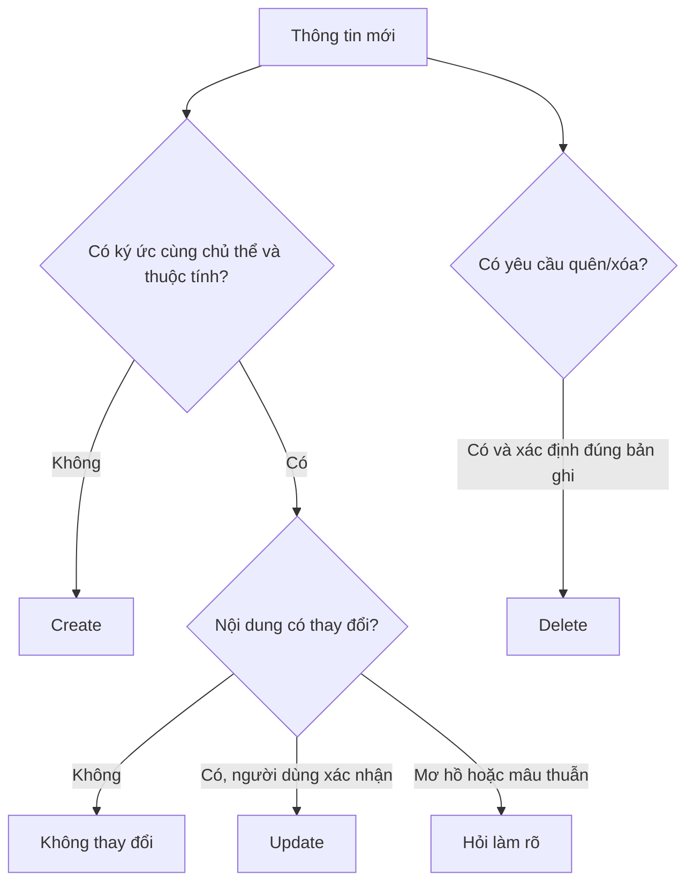

# Bài 03. Thiết kế dữ liệu ký ức và thao tác CRUD

## 1. Tóm tắt

Trích xuất ký ức chỉ hữu ích khi hệ thống biết đang lưu thông tin về **ai**, thuộc **loại gì**, có **nội dung gì** và cần **thực hiện hành động nào**. Bài học xây dựng bốn nhóm ký ức cho ứng dụng nấu ăn và cách xử lý dữ liệu cũ khi người dùng sửa lời nói.

## 2. Mục tiêu học tập

Bạn có thể gắn nhãn bốn loại ký ức, mô tả `create/update/delete`, xây dựng biểu diễn JSON có cấu trúc, xử lý một thông điệp sinh nhiều thay đổi và phân biệt khẳng định rõ ràng với suy đoán.

## 3. Bốn nhóm ký ức cho ứng dụng nấu ăn

| Nhóm | Nhãn kỹ thuật gợi ý | Ví dụ | Mức ưu tiên sử dụng |
| --- | --- | --- | --- |
| Món ưa thích | `like` | “Tôi thích taco cho bữa sáng” | Tín hiệu cá nhân hóa |
| Món không thích/không ăn | `dislike` | “Vợ tôi không ăn thịt” | Ràng buộc hoặc ưu tiên cần làm rõ |
| Dị ứng thực phẩm | `allergy` | “Con gái út dị ứng sữa” | Ràng buộc an toàn quan trọng |
| Thuộc tính gia đình | `attribute` | “Gia đình tôi có sáu người” | Cung cấp ngữ cảnh lập thực đơn |

Phân loại phụ thuộc vào **ngữ nghĩa**, không chỉ từ khóa. “Không ăn thịt” có thể phản ánh lối ăn kiêng chứ không phải ghét thịt; trong thiết kế tối giản có thể đưa vào nhóm `dislike`, nhưng bản sản phẩm cần phân biệt rõ nguyên nhân để tránh suy diễn.

## 4. Cấu trúc một ký ức

Một bản ghi tối thiểu nên có:

```json
{
  "memory_id": "m_001",
  "user_id": "user_123",
  "subject": "youngest_daughter",
  "category": "allergy",
  "value": "sữa",
  "source_text": "Con gái út của tôi dị ứng sữa",
  "status": "active"
}
```

`memory_id` dùng để sửa hoặc xóa chính xác; `user_id` ngăn trộn thông tin giữa nhiều người dùng; `subject` chỉ người thực sự có thuộc tính. `source_text` giúp kiểm tra nguồn gốc và quyết định khi thông tin mâu thuẫn. Trong môi trường thực tế, còn có thể lưu `created_at`, `updated_at`, phạm vi thời gian và mức độ xác nhận.

## 5. Bộ ba thao tác tạo, cập nhật và xóa

**Create:** Khi kho chưa có thông tin tương ứng.

```json
{"action":"create","category":"like","subject":"user","new_value":"taco"}
```

**Update:** Khi người dùng sửa một thông tin đang có, ví dụ “Nhà tôi giờ có bảy người”.

```json
{"action":"update","category":"attribute","subject":"family","old_value":"6 thành viên","new_value":"7 thành viên"}
```

**Delete:** Khi người dùng xác nhận dữ kiện không còn đúng hoặc yêu cầu xóa.

```json
{"action":"delete","category":"like","subject":"user","old_value":"taco"}
```

Trong phần trình diễn đơn giản, một tool nhận thông tin cũ dưới dạng **chuỗi đầy đủ** để tìm bản ghi cần sửa/xóa. Cách đó thuận tiện khi làm prototype, nhưng có thể nhầm giữa các chuỗi giống nhau. Hệ thống sản phẩm nên dùng ID ổn định và kiểm tra quyền truy cập theo `user_id`.

## 6. Một thông điệp, nhiều thao tác

Thông điệp: “Nhà tôi có sáu người, vợ tôi không ăn thịt và con gái út bị dị ứng sữa.”

```json
[
  {"action":"create","subject":"family","category":"attribute","new_value":"6 thành viên"},
  {"action":"create","subject":"wife","category":"dislike","new_value":"thịt"},
  {"action":"create","subject":"youngest_daughter","category":"allergy","new_value":"sữa"}
]
```

Đây là lý do Memory Manager phải hỗ trợ đầu ra nhiều lời gọi tool thay vì buộc mỗi tin nhắn tạo một bản ghi duy nhất.

## 7. Nhận biết thay đổi và mâu thuẫn



Khi mâu thuẫn chưa rõ, việc hỏi lại thường an toàn hơn là tự sửa. Ví dụ “Tôi không ăn thịt” và “Vợ tôi ăn thịt” không phải hai dữ kiện trái ngược: chúng nói về hai người khác nhau.

## 8. Bảo vệ tính chính xác

Đặc biệt với dị ứng, hệ thống không nên suy ra rằng “không ăn sữa” luôn có nghĩa “dị ứng sữa”. Nếu chưa chắc, phải hỏi. Trong trường hợp người dùng xác nhận dị ứng, các công đoạn gợi ý món và kiểm tra nguyên liệu cần coi đây là ràng buộc nghiêm ngặt; việc gắn nhãn tốt không tự đảm bảo món ăn an toàn.

## 9. Bài tập

Hãy tạo JSON operations cho chuỗi: “Tôi thích cà phê. À, thực ra người dị ứng sữa là con trai tôi, không phải con gái.” Giả sử trước đó hệ thống lưu `allergy(youngest_daughter, sữa)`. Kết quả cần có một `create` cho sở thích cà phê, một thay đổi xóa/cập nhật ký ức sai và một ký ức đúng cho con trai. Nêu rõ vì sao không nên sửa chủ thể nếu câu nói chưa đủ xác nhận.

## 10. Câu hỏi ôn tập

**Câu 1.** Vì sao cần lưu `subject`?

A. Để phân biệt thành viên được nhắc đến.  
B. Để biến mọi dữ liệu thành số.  
C. Để không phải lưu giá trị.  
D. Để tăng kích thước tệp vô hạn.

**Đáp án:** A. **Giải thích:** Một dị ứng của con không thể gắn cho bố mẹ.

**Câu 2.** Người dùng xác nhận từ sáu thành bảy người; hành động hợp lý là gì?

A. Thêm một bản ghi mâu thuẫn và giữ cả hai đều đúng.  
B. Không xử lý.  
C. Xóa tất cả sở thích.  
D. Cập nhật thuộc tính số thành viên.

**Đáp án:** D. **Giải thích:** Cùng một thuộc tính đã thay đổi giá trị.

**Câu 3.** Thuộc tính nào cần ưu tiên khi lọc món ăn có nguy cơ?

A. Màu giao diện.  
B. Dị ứng thực phẩm đã xác nhận.  
C. Số lượt chat.  
D. Tên thiết bị.

**Đáp án:** B. **Giải thích:** Dị ứng là thông tin an toàn, không chỉ là sở thích.

**Câu 4.** Hạn chế của việc định vị ký ức cũ bằng chuỗi văn bản là gì?

A. Luôn chính xác tuyệt đối.  
B. Không thể đọc lại văn bản.  
C. Dễ nhầm những bản ghi giống hoặc gần giống nhau.  
D. Bắt buộc dùng GPU.

**Đáp án:** C. **Giải thích:** ID và ràng buộc người dùng giúp định vị ổn định hơn.

**Câu 5.** Khi thiếu căn cứ để phân loại “không ăn sữa” thành dị ứng, nên làm gì?

A. Hỏi rõ loại hạn chế ăn uống.  
B. Tự khẳng định là dị ứng.  
C. Bỏ qua toàn bộ thông tin.  
D. Gán cho mọi thành viên.

**Đáp án:** A. **Giải thích:** Không nên suy đoán các dữ kiện an toàn.

## 11. Tổng kết

Kho ký ức có cấu trúc cần **chủ thể, loại, giá trị và thao tác thay đổi**. Khi các trường đó đủ rõ, Memory Manager mới có thể sử dụng tool để cập nhật dữ liệu nhất quán.
