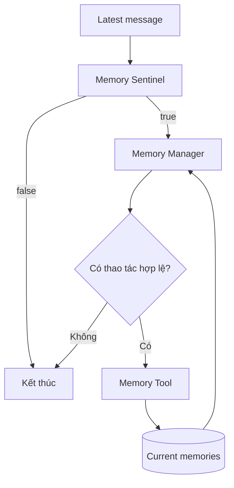

# Bài 04. Memory Sentinel và Memory Manager

## 1. Tóm tắt

Một agent không cần sử dụng mô hình mạnh để phân tích chuyên sâu mọi câu nói. Có thể tách quy trình thành hai bước: **Memory Sentinel** phát hiện thông điệp có thông tin đáng xét; **Memory Manager** quyết định tạo, sửa, xóa hay bỏ qua ký ức. Đây là cách triển khai đơn giản, dễ thử nghiệm và có thể tối ưu sau.

## 2. Mục tiêu học tập

Bạn sẽ thiết kế được điều kiện lọc của Sentinel, đầu vào/đầu ra của Manager, prompt hướng dẫn trích xuất, và chiến lược chống ghi trùng hoặc ghi nhầm.

## 3. Sentinel: bộ gác cổng giá rẻ

Sentinel nhận thông điệp mới và, nếu cần, một phần ký ức hiện có. Nhiệm vụ hẹp: đánh giá liệu câu nói có dữ kiện mới hoặc thay đổi về sở thích, không thích, dị ứng, thuộc tính gia đình hay không. Bản thiết kế ban đầu chỉ yêu cầu kết quả `true/false`.

Ví dụ:

| Thông điệp | Kết quả Sentinel đề xuất | Lý do |
| --- | --- | --- |
| “Tôi thích taco cho bữa sáng” | `true` | Có sở thích dài hạn tiềm năng |
| “Thời tiết hôm nay đẹp” | `false` | Không thuộc phạm vi bộ nhớ thực đơn |
| “À, nhà tôi có bảy người, không phải sáu” | `true` | Có yêu cầu cập nhật |
| “Cảm ơn nhé!” | `false` | Không có dữ kiện cần lưu |
| “Hãy quên chuyện tôi thích taco” | `true` | Yêu cầu xóa ký ức |

Sentinel chỉ là lớp lọc. Kết quả `true` không đồng nghĩa chắc chắn phải ghi vào database; quyết định cuối thuộc về Memory Manager. Một lớp lọc bỏ sót (false negative) có thể làm mất thông tin quan trọng, đặc biệt là dị ứng.

## 4. Manager: suy luận và chuẩn hóa thay đổi

Memory Manager cần so sánh **thông điệp mới nhất** với **những ký ức liên quan đã lưu**. Sau đó nó chọn số lượng thao tác phù hợp và trả về lời gọi tool có cấu trúc.



Một tin nhắn có thể khiến Manager gọi tool nhiều lần. Chẳng hạn “Nhà sáu người, vợ không ăn thịt, con gái dị ứng sữa” có thể tạo ba lệnh `create` với ba nhóm tương ứng.

## 5. Mẫu prompt cho Sentinel

```text
Bạn là Memory Sentinel của một trợ lý lập thực đơn.
Chỉ kiểm tra thông điệp mới nhất có chứa thông tin đáng ghi nhớ
hoặc yêu cầu cập nhật/xóa thuộc các nhóm sau hay không:
- like: sở thích món ăn
- dislike: món không thích hoặc không ăn
- allergy: dị ứng thực phẩm đã nói rõ
- attribute: thuộc tính gia đình liên quan đến lên thực đơn

Không tự suy luận dị ứng từ việc không thích món ăn.
Không coi một yêu cầu chỉ dành cho hôm nay là sở thích dài hạn.
Trả về JSON: {"contains_memory": true} hoặc {"contains_memory": false}.
```

Để tránh mâu thuẫn, định nghĩa rõ hành vi cần làm với các phát biểu có phạm vi thời gian hoặc thiếu chủ thể. Nếu ứng dụng đặt yêu cầu không bỏ sót dị ứng, nên ưu tiên đưa những phát biểu nghi vấn sang Manager thay vì loại ngay.

## 6. Mẫu prompt cho Manager

```text
Bạn là Memory Manager. Hãy phân tích thông điệp mới nhất và
những ký ức đang tồn tại. Chỉ tạo thao tác đối với dữ kiện
được người dùng phát biểu rõ hoặc cập nhật/xóa rõ ràng.

Mỗi thao tác phải chứa:
- action: create | update | delete
- subject: chủ thể
- category: like | dislike | allergy | attribute
- new_value: giá trị mới nếu có
- old_value hoặc memory_id: bản ghi cần thay thế/xóa nếu có

Không tạo thao tác nếu nội dung chỉ trùng ký ức đã có.
Không gán thuộc tính của thành viên này cho thành viên khác.
Nếu thông tin mâu thuẫn nhưng chưa đủ rõ, cần báo cần xác minh.
Có thể trả về nhiều thao tác hoặc danh sách rỗng.
```

Đây là prompt minh họa cho việc thiết kế hệ thống. Khi sử dụng tool calling thật, nên áp schema bằng cơ chế structured output và xác thực dữ liệu tại server, không chỉ tin vào lời nhắc.

## 7. Cân nhắc mô hình và chi phí

Trong bản demo được giảng, người xây dựng sử dụng một mô hình chi phí thấp để làm Sentinel và **GPT-4** cho Manager để thử nghiệm nhanh. Điểm chính không phải bắt buộc dùng GPT-4, mà là **dành năng lực suy luận lớn hơn cho nhiệm vụ cần so sánh, phân loại và cập nhật**. Tên model ở đây phản ánh cách dựng prototype, không phải khuyến nghị model mới nhất.

Chi phí tổng quát phụ thuộc số lượt gọi, số token đọc/ghi và tỷ lệ tin nhắn bị Sentinel chuyển tiếp. Thử nghiệm nên đo cả chi phí lẫn tỷ lệ bỏ sót thông tin, thay vì chỉ tối ưu tốc độ.

## 8. Quy trình xử lý lỗi

1. Sentinel trả `false` cho một phát biểu dị ứng: ghi nhận false negative và điều chỉnh prompt/bộ lọc.
2. Manager sinh `update` nhưng không có bản ghi đích: không cập nhật tùy tiện; hỏi lại hoặc chuyển sang `create` nếu thực sự mới.
3. Tool nhận `category` không hợp lệ: từ chối, log lỗi và không ghi dữ liệu bẩn.
4. Manager tìm ra ký ức đã tồn tại cùng nội dung: bỏ qua thao tác để tránh nhân bản.

## 9. Bài tập

Hãy soạn dữ liệu kiểm thử gồm 10 câu: ba câu thêm ký ức, hai câu sửa, một câu xóa, hai câu không liên quan và hai câu mơ hồ. Đánh dấu kết quả kỳ vọng của Sentinel và Manager cho từng câu, đặc biệt lưu ý những câu không ăn món nào đó chỉ trong một ngày.

## 10. Câu hỏi ôn tập

**Câu 1.** Vai trò của Sentinel là gì?

A. Lưu mọi câu chat.  
B. Tự đề xuất món ăn.  
C. Xóa toàn bộ ký ức.  
D. Lọc thông điệp đáng phân tích sâu.

**Đáp án:** D. **Giải thích:** Sentinel là cửa lọc trước khi dùng Manager tốn công hơn.

**Câu 2.** Sentinel trả `true` có nghĩa là gì?

A. Chắc chắn phải ghi một ký ức.  
B. Cần chuyển sang bước xem xét chuyên sâu.  
C. Người dùng luôn có dị ứng.  
D. Cơ sở dữ liệu đã cập nhật xong.

**Đáp án:** B. **Giải thích:** Manager có thể vẫn quyết định không thay đổi dữ liệu.

**Câu 3.** Manager cần đọc gì để xác định cập nhật thay vì tạo mới?

A. Ký ức liên quan hiện có.  
B. Màu nền ứng dụng.  
C. Kích thước màn hình.  
D. Tên tệp CSS.

**Đáp án:** A. **Giải thích:** Cần đối chiếu dữ kiện mới với bản ghi cũ.

**Câu 4.** Tại sao false negative ở Sentinel nguy hiểm?

A. Nó tự sinh thêm ký ức.  
B. Nó luôn làm code chạy sai cú pháp.  
C. Nó làm thông tin quan trọng không được chuyển sang bước ghi nhớ.  
D. Nó làm hết dung lượng màn hình.

**Đáp án:** C. **Giải thích:** Thông điệp bị lọc sẽ không đến Manager.

**Câu 5.** Khi tool nhận enum `category` không hợp lệ, nên làm gì?

A. Ghi nguyên dữ liệu bất kể đúng sai.  
B. Đổi ngẫu nhiên sang allergy.  
C. Bỏ mọi kiểm tra để nhanh hơn.  
D. Từ chối và báo lỗi có kiểm soát.

**Đáp án:** D. **Giải thích:** Database cần được bảo vệ bằng validation ngoài LLM.

## 11. Tổng kết

**Sentinel lọc, Manager quyết định, tool thực thi** là ba vai trò khác nhau. Thiết kế này giúp giữ pipeline đơn giản, có thể đo lường và nâng cấp từng bước.
