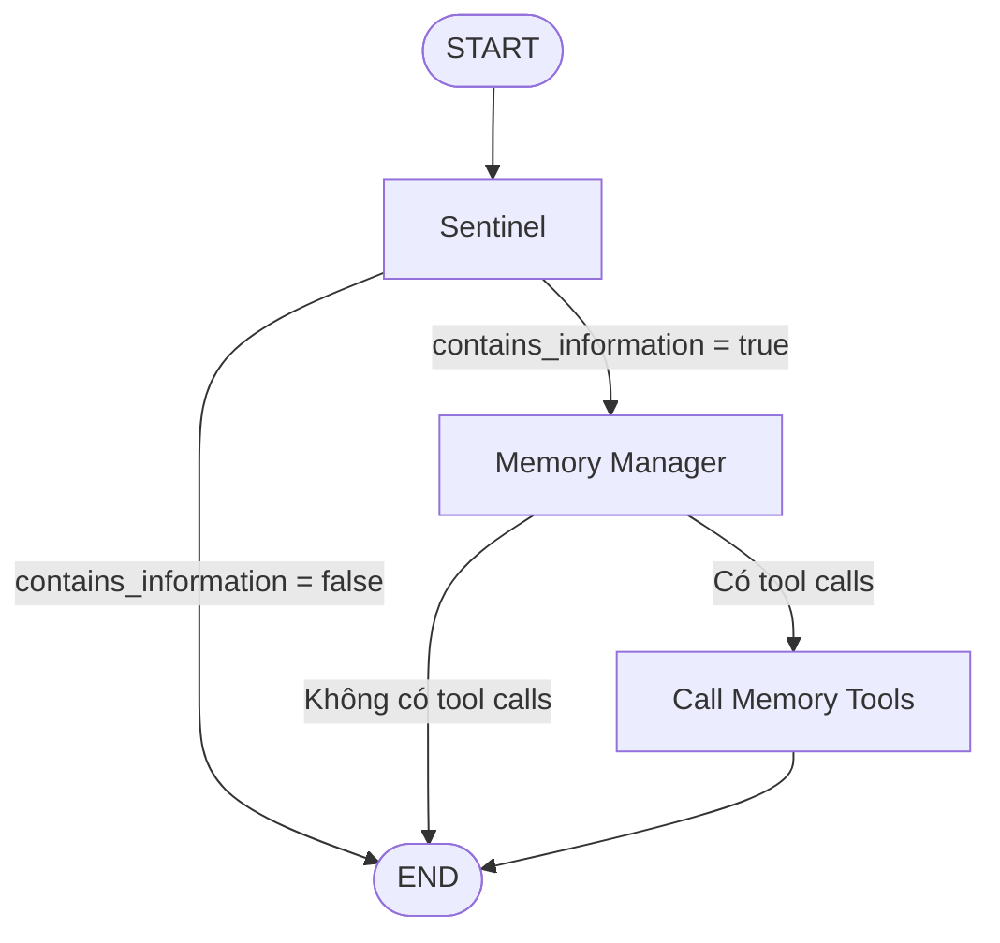

# Bài 05. Điều phối Memory Agent bằng LangGraph

## 1. Tóm tắt

LangGraph cho phép biểu diễn một quy trình LLM dưới dạng **đồ thị có trạng thái (stateful graph)**. Với hệ thống bộ nhớ, đồ thị có thể rất ngắn: bắt đầu ở Sentinel, chuyển sang Manager khi cần, rồi thực thi các lời gọi tool trước khi kết thúc.

## 2. Mục tiêu học tập

Bạn sẽ nhận diện được các phần tử state/node/edge, giải thích conditional routing, mô tả cơ chế tool calling và vẽ lại đồ thị cho một thông điệp chứa nhiều dữ kiện.

## 3. Khái niệm cốt lõi

**State** giữ dữ liệu cần truyền giữa các bước, ví dụ danh sách `messages`, `memories`, cờ `contains_information` và các tool calls.

**Node** thực hiện một công việc cụ thể: gọi Sentinel, gọi Manager hoặc thực thi tool.

**Edge** quy định bước chuyển tiếp. **Conditional edge** quyết định nhánh theo kết quả node, chẳng hạn kết thúc ngay nếu Sentinel nói không có thông tin cần lưu.

**Tool calling** cho phép mô hình yêu cầu thực hiện một hành động có schema, sau đó ứng dụng kiểm tra và gọi hàm tương ứng. Mô hình chỉ đề xuất hành động; code ứng dụng quyết định hiệu lực ghi/xóa dữ liệu.

## 4. Đồ thị ba node



Luồng này cố ý không thiết kế một vòng tự suy luận kéo dài. Agent chạy qua một số bước hữu hạn và dừng. Điều này phù hợp với tác vụ quản lý ký ức có phạm vi hẹp, giúp dễ theo dõi hơn so với một agent mở có thể lặp quá nhiều.

## 5. Phân tích từng node

### 5.1. Node `sentinel`

Đọc thông điệp mới nhất, gọi prompt của Sentinel rồi đặt `contains_information`. Node có thể không cần gửi toàn bộ lịch sử dài nếu chỉ phân loại sự kiện gần nhất; tuy nhiên cần bối cảnh bổ sung trong trường hợp câu mới tham chiếu tới câu cũ, chẳng hạn “Không, ý tôi là con trai”.

### 5.2. Node `memory_manager`

Đọc thông điệp, các ký ức liên quan và trạng thái từ bước trước. Manager trả về danh sách đề xuất thay đổi. Với tool calling, mỗi đề xuất cần chứa tham số như `action`, `subject`, `category`, `new_value`, `memory_id`.

### 5.3. Node `call_tools`

Duyệt các lời gọi tool, xác thực tham số và áp dụng từng thay đổi lên database. Có thể ghi log kết quả công cụ để kiểm toán. Bản demo đơn giản có thể kết thúc ngay sau node này vì nhiệm vụ ghi nhớ không cần sinh phản hồi riêng cho người dùng.

## 6. Pseudocode luồng điều khiển

```python
# Pseudocode minh họa luồng, không phải mã chạy trực tiếp với LangGraph.
def memory_workflow(message, existing_memories):
    contains_information = sentinel(message, existing_memories)
    if not contains_information:
        return []

    operations = memory_manager(message, existing_memories)
    if not operations:
        return []

    results = []
    for operation in operations:
        validated = validate_operation(operation)
        results.append(apply_memory_tool(validated))
    return results
```

Việc chuyển pseudocode sang LangGraph sử dụng state schema, node functions, các cạnh có điều kiện và khả năng `bind_tools` tương ứng với phiên bản thư viện bạn đang dùng. Chỉ nên sao chép API cụ thể sau khi đối chiếu tài liệu chính thức của phiên bản cài đặt.

## 7. Ví dụ một lượt chạy

Thông điệp: “Gia đình tôi có sáu người. Vợ tôi không ăn thịt. Con gái út dị ứng sữa.”

1. `sentinel` xác định có thông tin cần xem xét.
2. `memory_manager` tách ba sự kiện và tạo ba lời gọi `create`.
3. `call_tools` thực thi ba thao tác dữ liệu độc lập, ghi kết quả.
4. Đồ thị kết thúc.

Nếu câu nói là “Cảm ơn bạn”, Sentinel trả `false` và không chạy hai node còn lại. Nếu ký ức đã tồn tại, Manager có thể trả về mảng rỗng.

## 8. Quan sát và kiểm thử luồng

Nên log tối thiểu: ID lượt chat, kết quả lọc, các thao tác được đề xuất, validation pass/fail và kết quả database. Khi xem trace, cần phân biệt thao tác *được LLM đề xuất* với thao tác *đã thực hiện thành công*. Một lời gọi tool sai schema không đồng nghĩa dữ liệu đã thay đổi.

## 9. Bài tập

Thêm một nhánh xử lý `needs_confirmation` vào sơ đồ: nếu Manager gặp dữ kiện mâu thuẫn hoặc chưa rõ dị ứng, không ghi ngay mà tạo yêu cầu làm rõ. Giải thích nhánh nào nên kết thúc và nhánh nào chuyển sang tool.

## 10. Câu hỏi ôn tập

**Câu 1.** Thành phần nào giữ dữ liệu qua các node của workflow?

A. State.  
B. Màu node.  
C. Font chữ.  
D. Tên hình ảnh.

**Đáp án:** A. **Giải thích:** State lưu đầu vào và kết quả trung gian.

**Câu 2.** Khi Sentinel trả `false`, nhánh hợp lý là gì?

A. Luôn gọi Manager thêm ba lần.  
B. Ghi bản sao của mọi ký ức.  
C. Kết thúc nhánh quản lý ký ức.  
D. Xóa database.

**Đáp án:** C. **Giải thích:** Bộ lọc xác định không có thay đổi đáng phân tích.

**Câu 3.** Khi Manager không sinh tool call, hệ thống cần làm gì?

A. Bắt buộc tạo dữ liệu giả.  
B. Có thể kết thúc mà không sửa dữ liệu.  
C. Xóa hết ký ức cũ.  
D. Sinh trả lời món ăn mới ngay từ node tool.

**Đáp án:** B. **Giải thích:** Không phải lượt phân tích nào cũng tạo thay đổi.

**Câu 4.** Vai trò của `call_tools` là gì?

A. Chỉ đổi kích thước biểu đồ.  
B. Chỉ hiển thị chat UI.  
C. Sửa prompt hệ thống tự động.  
D. Xác thực và thực thi các thao tác dữ liệu.

**Đáp án:** D. **Giải thích:** Tool là nơi code ứng dụng thực sự thực hiện CRUD.

**Câu 5.** Vì sao workflow ngắn, có điểm dừng rõ ràng hữu ích?

A. Dễ kiểm soát và tránh vòng suy luận không cần thiết.  
B. Bắt buộc mọi agent không được có trạng thái.  
C. Không cần kiểm thử.  
D. Loại bỏ hoàn toàn lỗi trích xuất.

**Đáp án:** A. **Giải thích:** Đồ thị hữu hạn phù hợp với tác vụ cập nhật ký ức xác định.

## 11. Tổng kết

LangGraph giúp thể hiện rõ các bước và điều kiện rẽ nhánh. Giá trị cốt lõi nằm ở **luồng trạng thái có thể theo dõi**, không phải số lượng node hay độ phức tạp của agent.
