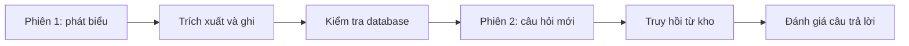

# Bài 06. Kiểm thử và đánh giá một Memory Agent

## 1. Tóm tắt

Hệ thống bộ nhớ không chỉ cần “chạy được” mà còn phải **ghi đúng, sửa đúng, xóa đúng và truy hồi đúng**. Đặc biệt, một lỗi ở nhóm dị ứng có thể gây hậu quả nghiêm trọng nếu hệ thống gợi ý món không phù hợp. Bài này thiết kế các tình huống đánh giá từ mức tin nhắn đến mức hội thoại đa phiên.

## 2. Mục tiêu học tập

Bạn có thể xây dựng bộ test phân loại Sentinel, xác minh CRUD của Manager, nhận diện ký ức gắn sai chủ thể và kiểm tra đầu ra sau khi mở một phiên mới.

## 3. Kiểm thử ba tầng

| Tầng | Đơn vị kiểm thử | Ví dụ |
| --- | --- | --- |
| Bộ lọc | Sentinel có bỏ sót thông tin? | “Con tôi bị dị ứng sữa” có bị bỏ qua không? |
| Cập nhật | Manager/Tool có ghi đúng? | “Giờ nhà bảy người” có cập nhật số thành viên không? |
| Sử dụng | Conversation Agent có khai thác đúng? | Phiên mới có tránh gợi ý món chứa chất gây dị ứng đã ghi nhận không? |

Nên test riêng từng tầng. Khi gợi ý sai, kiểm tra kho ký ức trước: nếu lưu đúng nhưng không truy hồi, sửa lớp retrieval; nếu truy hồi đúng nhưng phản hồi bỏ qua ràng buộc, sửa cách xây prompt và kiểm tra hậu xử lý.

## 4. Bộ ca kiểm thử cơ bản

**T1 — Tạo nhiều ký ức:** “Nhà tôi có sáu người, vợ không ăn thịt, con gái út dị ứng sữa.” Kỳ vọng ba bản ghi đúng chủ thể và nhóm.

**T2 — Cập nhật:** “À, gia đình tôi có bảy người.” Kỳ vọng thay `6` thành `7`; không tạo hai sự thật cùng hoạt động.

**T3 — Xóa:** “Tôi không còn thích taco nữa, hãy bỏ sở thích đó.” Kỳ vọng không còn bản ghi sở thích taco hoạt động.

**T4 — Bỏ qua:** “Cảm ơn!” Kỳ vọng không sinh thao tác.

**T5 — Phạm vi thời gian:** “Tuần này đừng làm taco.” Kỳ vọng không tự biến thành dữ kiện “không bao giờ ăn taco”.

**T6 — Sửa chủ thể:** “Người dị ứng sữa là con trai tôi, không phải con gái.” Kỳ vọng ký ức của con gái được xử lý và thông tin về con trai được tạo; cần có bước xác minh nếu không rõ người nào là chủ thể trước đó.

**T7 — Nhiều phiên:** Phiên 1 lưu dị ứng; phiên 2 hỏi đề xuất bữa tối. Kỳ vọng backend truy hồi ký ức từ database, không dựa vào biến RAM phiên trước.

## 5. Các chỉ số nên theo dõi

**Đối với Sentinel**, đo số trường hợp thực sự có thông tin đáng xét nhưng bị bỏ qua (false negative), đặc biệt trên ca dị ứng. Có thể sử dụng precision, recall và F1 cho việc phân loại thông điệp, nhưng các con số chỉ có ý nghĩa khi có tập nhãn kỳ vọng đáng tin cậy.

**Đối với Manager**, nên đánh giá độ chính xác của hành động (`create/update/delete/no-op`), chủ thể, nhóm, giá trị và bản ghi đích. Một thao tác đúng loại nhưng sai thành viên vẫn là lỗi.

**Đối với hệ thống đầy đủ**, dùng kiểm thử hội thoại hai phiên: sau khi thực hiện chuỗi sửa/xóa, xác nhận trạng thái database và khả năng trả lời với dữ liệu mới nhất.

## 6. Quy trình kiểm tra một ca đa phiên

Nếu test chỉ giữ một cửa sổ chat liên tục, kết quả không chứng minh được rằng bộ nhớ thật sự tồn tại qua nhiều phiên.

## 7. Quy tắc an toàn cho thông tin nhạy cảm

Dị ứng liên quan đến sức khỏe. Hệ thống phải xin phép và giới hạn phạm vi sử dụng dữ liệu, không suy đoán chẩn đoán, và không dựa duy nhất vào mô hình sinh ngôn ngữ để xác nhận an toàn nguyên liệu. Với ứng dụng thực phẩm thực tế, cần đối chiếu nguyên liệu, nguy cơ nhiễm chéo và xác minh với người dùng khi thông tin không chắc chắn.

## 8. Bài tập thực hành

Dùng bộ dữ liệu ở [`assets/tinh_huong_kiem_thu.md`](assets/tinh_huong_kiem_thu.md), lập bảng gồm `input`, `expected_operations`, `actual_operations`, `pass/fail`, `error_reason`. Thực hiện cả một phép cập nhật liên tiếp hai lần để kiểm tra tính lặp lại mà không tạo bản ghi trùng.

## 9. Câu hỏi ôn tập

**Câu 1.** Kiểm thử nào chứng minh bộ nhớ đa phiên tốt nhất?

A. Chỉ hỏi hai câu trong cùng cửa sổ chat.  
B. Chỉ xem màu giao diện.  
C. Ghi ở phiên 1, mở phiên 2 và truy hồi từ kho dữ liệu.  
D. Không cần xem database.

**Đáp án:** C. **Giải thích:** Phải vượt ranh giới phiên mới chứng minh tính bền vững.

**Câu 2.** “Dị ứng sữa” bị Sentinel bỏ qua được tính là gì?

A. False negative.  
B. True positive.  
C. True negative.  
D. Update thành công.

**Đáp án:** A. **Giải thích:** Ca có thông tin nhưng bộ lọc đánh dấu không có.

**Câu 3.** Agent lưu đúng dị ứng nhưng không lấy ra khi lập thực đơn; lỗi nhiều khả năng ở đâu?

A. Tool tạo bản ghi duy nhất.  
B. Bàn phím người dùng.  
C. Cơ chế xuất file CSV.  
D. Truy hồi hoặc kết hợp ngữ cảnh.

**Đáp án:** D. **Giải thích:** Dữ liệu đúng nhưng không đến giai đoạn trả lời.

**Câu 4.** Vì sao phải kiểm thử cả chủ thể?

A. Vì không cần phân biệt thành viên.  
B. Vì gắn sai người có thể làm lời khuyên không phù hợp.  
C. Vì mọi ký ức đều về một người.  
D. Vì chỉ cần category là đủ.

**Đáp án:** B. **Giải thích:** Dị ứng và khẩu vị thuộc về những người cụ thể.

**Câu 5.** Khi có dữ kiện dị ứng nhưng nguyên liệu chưa rõ, cách xử lý hợp lý là gì?

A. Khẳng định món chắc chắn an toàn.  
B. Bỏ tất cả kiểm tra.  
C. Yêu cầu xác minh thông tin còn thiếu và kiểm tra thành phần.  
D. Tự xóa dị ứng.

**Đáp án:** C. **Giải thích:** Sự không chắc chắn cần được biểu lộ thay vì che giấu.

## 10. Tổng kết

Hệ thống chỉ đáng tin khi **lưu đúng và dùng đúng**. Kiểm thử đa phiên, kiểm thử sai chủ thể và kiểm thử dị ứng là ba nhóm cần ưu tiên từ sớm.
