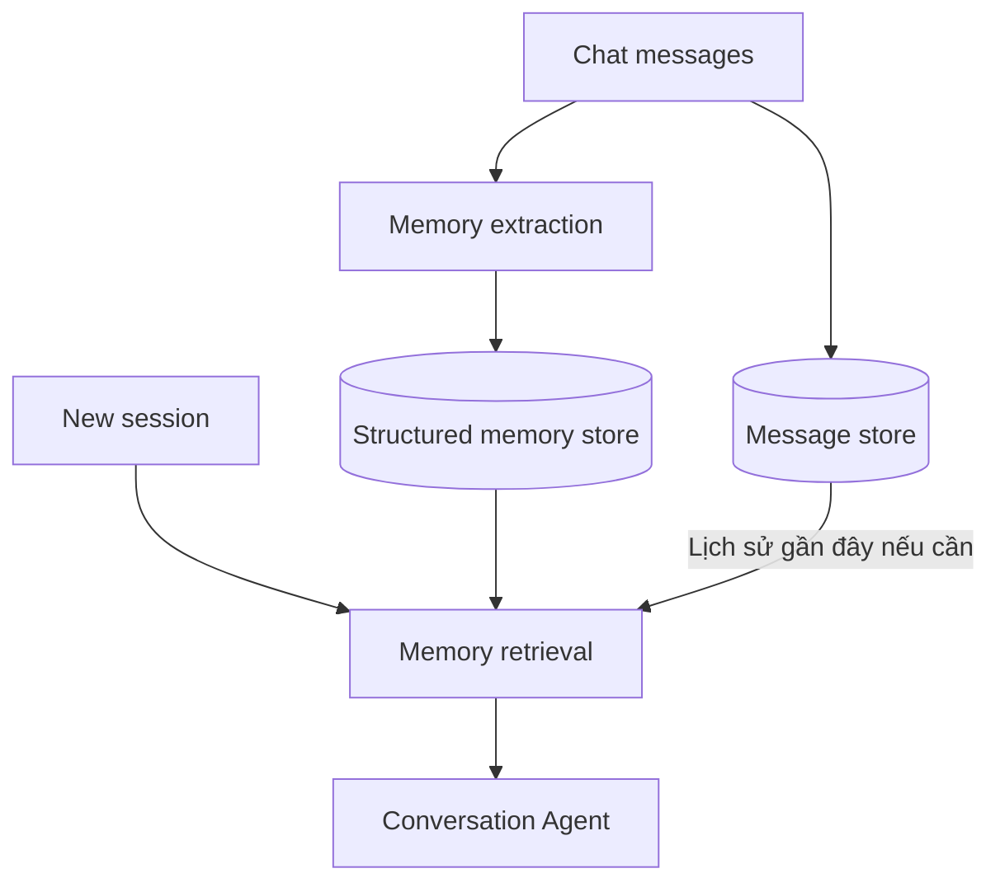

# Bài 07. Lưu trữ bền vững và tối ưu chi phí bộ nhớ

## 1. Tóm tắt

Prototype có thể xử lý bộ nhớ sau mỗi thông điệp và lưu trạng thái hội thoại trong một phiên. Khi mở rộng quy mô, ba vấn đề xuất hiện: **chi phí gọi mô hình**, **tính bền vững của dữ liệu** và **khả năng truy hồi đúng ký ức ở đúng thời điểm**. Bài này phân tích các phương án cải tiến phù hợp với kiến trúc Sentinel–Manager.

## 2. Mục tiêu học tập

Bạn sẽ so sánh xử lý theo từng tin nhắn với xử lý theo lô, thiết kế cách lưu hội thoại và ký ức, giải thích khi nào cần truy hồi chọn lọc và lập kế hoạch tối ưu dựa trên cả chi phí lẫn độ chính xác.

## 3. Ghi nhớ mỗi tin nhắn hay sau một khoảng thời gian?

| Phương án | Ưu điểm | Hạn chế |
| --- | --- | --- |
| Sau mỗi tin nhắn | Ký ức được xem xét sớm, ít bỏ quên khi phiên kết thúc | Nhiều lần gọi model, chi phí cao |
| Khi đủ một nhóm tin nhắn | Giảm số lần khởi tạo mô hình, có thêm ngữ cảnh | Ký ức mới có thể chưa sẵn sàng ngay |
| Cuối phiên | Dễ tổng hợp một lần | Nếu phiên mất kết nối hoặc kết thúc bất thường có thể chưa được lưu |
| Khi rút gọn lịch sử ngắn hạn | Tận dụng bước chuyển ký ức cũ ra khỏi cửa sổ ngữ cảnh | Phụ thuộc chiến lược rút gọn và checkpoint |

Trong triển khai đơn giản, việc chạy trên mỗi tin nhắn là một lựa chọn dễ hiểu. Khi số người dùng tăng, có thể chuyển sang xử lý theo lô hoặc hàng đợi sự kiện, nhưng cần đảm bảo thông tin quan trọng không bị mất trước lúc ghi.

## 4. Lưu lịch sử và lưu ký ức là hai việc khác nhau

**Lưu lịch sử hội thoại** là lưu các lượt tin nhắn có thứ tự, phục vụ xem lại và khôi phục phiên. **Lưu ký ức dài hạn** là lưu các dữ kiện đã chọn lọc, có chủ thể và nhãn. Có thể dùng một database cho cả hai nhưng cần bảng hoặc collection riêng.

Không nên đồng nhất “chat có thể mở lại” với “agent có bộ nhớ dài hạn”: nếu chỉ xem toàn bộ transcript, mô hình vẫn có thể phải xử lý quá nhiều dữ liệu.

## 5. Truy hồi chọn lọc và vector store

Ban đầu, ứng dụng thực đơn có thể chỉ có vài ký ức, nên truy vấn theo `user_id`, `category`, `subject` là đủ. Khi bộ nhớ lớn hơn, không nên nạp mọi dữ kiện cho mọi loại câu hỏi.

Ví dụ, khi hỏi “Nhà tôi có bao nhiêu người?”, ưu tiên `attribute`. Khi hỏi món ăn, phải xem các ràng buộc ăn uống phù hợp; những ký ức về sở thích ít liên quan có thể xếp ưu tiên thấp. Một **vector store** có thể giúp tìm ký ức tương đồng về ngữ nghĩa, nhưng không tự thay thế được các điều kiện lọc chặt như `user_id`, dị ứng đã xác nhận hay trạng thái hiệu lực.

## 6. Nguyên tắc truy hồi cho trợ lý nấu ăn

1. Xác định người dùng hiện tại, tuyệt đối không trộn dữ liệu tài khoản.
2. Truy vấn những dữ kiện liên quan tới yêu cầu hiện tại.
3. Đối với thực đơn, luôn kiểm tra các ràng buộc ăn uống và dị ứng đã xác nhận thuộc những người sẽ ăn món đó.
4. Chỉ thêm ký ức sở thích phù hợp để tránh làm prompt dài và nhiễu.
5. Hiển thị hoặc áp dụng trạng thái mới nhất; ký ức bị xóa không được truy hồi như thông tin còn đúng.

Đây là các nguyên tắc thiết kế cho sản phẩm, không phải bằng chứng rằng bản demo đã hoàn thiện vector search hay cơ chế an toàn đầy đủ.

## 7. Đánh đổi chi phí và độ chính xác

Việc dùng mô hình rẻ để lọc giúp giảm số lần gọi Manager, nhưng không nên đo thành công chỉ bằng tiết kiệm chi phí. Nếu Sentinel bỏ sót một dữ kiện dị ứng, khoản tiết kiệm không bù được lỗi. Một chiến lược hợp lý là đo tỷ lệ bỏ sót ở các nhóm, chi phí mỗi lượt chat, thời gian trễ và mức độ trùng lặp của kho.

Có thể ưu tiên lưu đồng bộ các dữ kiện an toàn đã xác nhận và xử lý bất đồng bộ các sở thích ít quan trọng hơn, nhưng phải bảo đảm sự nhất quán giữa câu trả lời mới và các thay đổi vừa được gửi.

## 8. Tính riêng tư và quyền kiểm soát

Thông tin về thành viên gia đình và dị ứng là dữ liệu cá nhân. Hệ thống thực tế nên có sự đồng ý lưu trữ, chức năng xem/sửa/xóa ký ức, giới hạn truy cập và chính sách lưu giữ. Bất kỳ quy trình “quên” nào cũng phải xử lý các bản sao, chỉ mục tìm kiếm và cache có liên quan thay vì chỉ ẩn chúng khỏi giao diện.

## 9. Bài tập

Giả sử ứng dụng nhận hàng nghìn tin nhắn mỗi ngày, nhưng chỉ một phần nhỏ chứa dữ kiện dài hạn. Hãy thiết kế hai phương án: (A) lọc mỗi tin nhắn rồi ghi ngay; (B) đưa tin nhắn vào hàng đợi và xử lý theo nhóm. So sánh nguy cơ mất dữ kiện, chi phí, độ trễ truy hồi và độ phức tạp vận hành.

## 10. Câu hỏi ôn tập

**Câu 1.** Vì sao không cần nạp toàn bộ ký ức vào mọi prompt?

A. Vì mọi ký ức đều vô ích.  
B. Vì chọn lọc có thể giảm token và nhiễu.  
C. Vì database không cho đọc dữ liệu.  
D. Vì chỉ có đúng một loại ký ức.

**Đáp án:** B. **Giải thích:** Truy hồi liên quan giúp ngữ cảnh gọn và đúng nhiệm vụ.

**Câu 2.** Ưu điểm của lưu sau mỗi tin nhắn là gì?

A. Không bao giờ tốn chi phí.  
B. Tự động sửa mọi lỗi.  
C. Không cần database.  
D. Xét thông tin sớm, giảm nguy cơ quên lúc kết thúc phiên.

**Đáp án:** D. **Giải thích:** Trích xuất sớm giúp ký ức được ghi trước khi thông điệp trôi khỏi bộ nhớ ngắn hạn.

**Câu 3.** Vector store có thể giúp điều gì?

A. Truy hồi ký ức gần nghĩa khi kho dữ liệu lớn.  
B. Thay thế hoàn toàn kiểm tra dị ứng.  
C. Bảo đảm mọi dữ kiện đều đúng.  
D. Tự định danh người dùng an toàn không cần xác thực.

**Đáp án:** A. **Giải thích:** Tìm kiếm ngữ nghĩa là một công cụ retrieval, không thay thế validation.

**Câu 4.** Xử lý cuối phiên có rủi ro nào?

A. Luôn sinh thêm ba bản ghi.  
B. Luôn chính xác hơn.  
C. Dữ kiện có thể chưa được lưu nếu phiên kết thúc bất thường.  
D. Bắt buộc dùng GPU.

**Đáp án:** C. **Giải thích:** Trì hoãn ghi tạo ra khoảng thời gian dễ mất sự kiện.

**Câu 5.** Khi tối ưu Memory Agent, nên đo yếu tố nào?

A. Chỉ số lượng dòng CSS.  
B. Cả chi phí lẫn tỷ lệ bỏ sót dữ kiện quan trọng.  
C. Chỉ độ dài tên agent.  
D. Chỉ màu nút trên UI.

**Đáp án:** B. **Giải thích:** Giảm chi phí mà tăng lỗi dữ liệu không phải tối ưu toàn hệ thống.

## 11. Tổng kết

Chiến lược bộ nhớ tốt phải cân bằng **ghi kịp thời, truy hồi có chọn lọc, tính bền vững và độ chính xác**. Khi dữ liệu cá nhân được lưu lâu dài, quyền kiểm soát của người dùng cũng là một thành phần kiến trúc thiết yếu.
