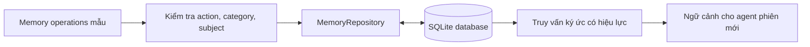

# Bài 08. Lab: Xây dựng bộ nhớ dài hạn có cấu trúc với SQLite

## 1. Tổng quan

Bài lab xây dựng phần lõi lưu trữ và truy hồi ký ức cho một AI Agent gợi ý món ăn. Để dễ chạy và kiểm chứng, chúng ta dùng **Python + SQLite**; phần phát hiện thông tin bằng LLM được **mô phỏng** bằng các thao tác đã xác định trước. Bài này không giả vờ rằng quy tắc mô phỏng đã có thể hiểu mọi câu tiếng Việt.

## 2. Mục tiêu và sản phẩm

Sau bài lab, bạn chạy được một kho ký ức lưu thành tệp SQLite, thực hiện thêm/sửa/xóa, in dữ kiện còn hiệu lực và chứng minh dữ liệu đọc được ở phiên sau. Sản phẩm là một mô-đun storage tối thiểu có thể kết nối với Memory Manager thật về sau.

## 3. Chuẩn bị

- Python 3 có thư viện chuẩn `sqlite3`.
- Tệp [`assets/memory_demo.py`](assets/memory_demo.py) và [`assets/schema.sql`](assets/schema.sql).
- Terminal bất kỳ; không cần API key hoặc gói Python bên ngoài.

Cấu trúc:

```text
khoa_hoc_ai_agent_bo_nho_dai_han/
├── README.md
├── 08-lab-bo-nho-sqlite.md
└── assets/
    ├── memory_demo.py
    ├── schema.sql
    └── tinh_huong_kiem_thu.md
```

## 4. Kiến trúc lab



Repository nhận **thao tác bộ nhớ có cấu trúc**, không nhận văn bản tự do. Đây là điểm tách để sau này thay đầu vào bằng các tool calls do LangGraph/Manager tạo ra.

## 5. Các bước thực hiện

### 5.1. Chạy mô phỏng lần đầu

Từ thư mục khóa học, chạy:

```bash
python assets/memory_demo.py
```

Chương trình dùng một tệp cơ sở dữ liệu tạm của Python, tạo ba ký ức: gia đình sáu người, vợ không ăn thịt, con gái út dị ứng sữa. Sau đó nó cập nhật thành bảy người, xóa ký ức mẫu về sở thích taco và in những ký ức còn hoạt động.

**Checkpoint:** terminal phải hiển thị các bản ghi với `category`, `subject`, `value` và kết quả sau cập nhật; không cần truy cập Internet.

### 5.2. Xem thiết kế bảng

Mở `assets/schema.sql`. Bảng có `memory_id`, `user_id`, `subject`, `category`, `value`, `active` và các trường thời gian. Trường `user_id` giúp cách ly hồ sơ; `active` giúp mô phỏng xóa mềm để kiểm tra luồng.

### 5.3. Thử một yêu cầu cập nhật

Trong phần mã mẫu, thay giá trị mới của `family` từ “7 thành viên” thành “8 thành viên”, chạy lại và kiểm tra dữ liệu cuối. Cần thấy chỉ còn **một** bản ghi thuộc tính số thành viên có hiệu lực cho gia đình.

### 5.4. Thử xóa theo ID

Thêm một ký ức thích món ăn, lấy `memory_id` trả về và xóa bằng `delete`. Truy vấn ký ức có hiệu lực không còn hiển thị bản ghi đã bị xóa.

### 5.5. Chứng minh khả năng lưu lâu dài

Để lưu vào ổ đĩa, tạo hoặc sửa lệnh gọi `MemoryRepository` với `db_path="memory.sqlite3"` thay vì `":memory:"`. Chạy một chương trình khác đọc cùng file. Tính bền vững đến từ SQLite trên đĩa; chế độ `:memory:` mặc định chỉ là mô phỏng trong một lần chạy.

## 6. Kết nối với LLM trong kiến trúc đầy đủ

Sau khi storage chạy đúng, xây dựng **đầu nối** theo luồng:

1. Nhận câu chat mới.
2. Gọi Sentinel để quyết định có cần phân tích sâu không.
3. Nếu có, gửi thông điệp cùng ký ức đang lưu cho Manager.
4. Kiểm tra đầu ra có cấu trúc `create/update/delete`, gồm cả `user_id` và chủ thể.
5. Áp dụng qua repository với validation.
6. Khi phiên mới bắt đầu, truy hồi ký ức liên quan để đưa vào Conversation Agent.

Không đưa văn bản LLM sinh ra trực tiếp vào câu SQL. Dùng truy vấn có tham số, kiểm tra người dùng và quyền sửa/xóa.

## 7. Kiểm tra kết quả và debug

| Hiện tượng | Nguyên nhân có thể | Hướng kiểm tra |
| --- | --- | --- |
| Phiên mới không đọc được | Đang dùng `:memory:` thay vì file SQLite | Chuyển sang `memory.sqlite3` |
| Có hai bản ghi cùng thuộc tính | Đã `create` thay vì `update` | Xem khóa bản ghi và logic cập nhật |
| Xóa sai ký ức | Truyền sai ID hoặc thiếu điều kiện `user_id` | Kiểm tra điều kiện truy vấn |
| Dị ứng bị gắn cho bố | Sai `subject` trong kết quả trích xuất | Bổ sung ca kiểm thử chủ thể |
| Tool trả action lạ | Thiếu validation | Chỉ cho phép ba thao tác quy định |

## 8. Deliverable và checklist

Nộp hoặc tự lưu: mã thực hành, tệp cơ sở dữ liệu mẫu trên ổ đĩa, ảnh/log trạng thái trước–sau `update`, kết quả kiểm thử hai phiên và mô tả cách thay bộ tạo thao tác mẫu bằng Memory Manager dùng LLM.

Kiểm tra: (1) một người dùng không đọc được ký ức người khác; (2) `update/delete` chỉ tác động đúng `memory_id`; (3) `active=0` không xuất hiện khi truy hồi; (4) mọi thao tác có kết quả xác định.

## 9. Câu hỏi ôn tập

**Câu 1.** Vì sao ví dụ có thể chạy mà không cần API key?

A. Vì SQLite tự huấn luyện LLM.  
B. Vì chương trình dùng thao tác mẫu có cấu trúc thay cho trích xuất bằng LLM.  
C. Vì dữ liệu được lấy từ Internet.  
D. Vì Python không cần bộ nhớ.

**Đáp án:** B. **Giải thích:** Lab cô lập tầng lưu trữ để học và test độc lập.

**Câu 2.** Cấu hình nào giúp dữ liệu còn tồn tại sau khi chương trình dừng?

A. `:memory:`.  
B. Biến cục bộ.  
C. Danh sách trong RAM.  
D. SQLite file trên đĩa.

**Đáp án:** D. **Giải thích:** `:memory:` bị giải phóng khi kết nối kết thúc.

**Câu 3.** Khi xóa ký ức, điều kiện truy vấn nên gắn với gì?

A. `memory_id` và `user_id`.  
B. Chỉ màu giao diện.  
C. Tên món ngẫu nhiên.  
D. Số lượt người truy cập trang chủ.

**Đáp án:** A. **Giải thích:** Xác định đúng bản ghi và đúng người dùng.

**Câu 4.** Phần nào nên được kết nối với đầu ra tool của Memory Manager?

A. CSS.  
B. File README.  
C. Repository có validation.  
D. Hình minh họa.

**Đáp án:** C. **Giải thích:** Repository là lớp thực thi thao tác dữ liệu có kiểm soát.

**Câu 5.** Vì sao nên kiểm thử storage riêng trước khi tích hợp LLM?

A. Vì LLM luôn chính xác tuyệt đối.  
B. Để phân biệt lỗi trích xuất và lỗi lưu trữ.  
C. Vì không thể có hai module.  
D. Để loại bỏ hoàn toàn database.

**Đáp án:** B. **Giải thích:** Kiểm thử từng lớp giúp khoanh vùng lỗi nhanh hơn.

## 10. Tổng kết

Bộ nhớ dài hạn đa phiên đòi hỏi một lớp lưu trữ thực sự bền vững. Bài lab cung cấp lõi CRUD và retrieval tối thiểu; bước kế tiếp của dự án là nối nó với pipeline Sentinel–Manager, đo chất lượng và bổ sung kiểm soát an toàn.
