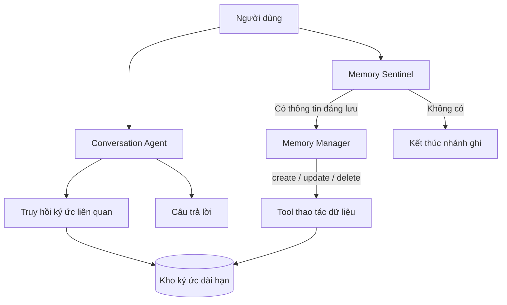

# Khóa học: Xây dựng AI Agent có bộ nhớ dài hạn

Khóa học thực hành thiết kế một trợ lý hội thoại có thể **ghi nhớ thông tin bền vững qua nhiều phiên**, lấy ví dụ từ ứng dụng lập thực đơn cho gia đình. Người học sẽ xây dựng luồng hội thoại, trích xuất thông tin đáng nhớ, quản lý ký ức có cấu trúc và khai thác chúng khi trả lời.

## 1. Đối tượng và kiến thức chuẩn bị

Phù hợp với người đã biết Python cơ bản, hiểu khái niệm LLM, prompt, API và cơ sở dữ liệu. Có thể học lý thuyết trước khi tiếp cận LangChain/LangGraph; các ví dụ ở thư mục `assets/` chỉ dùng thư viện chuẩn Python để thực nghiệm an toàn.

## 2. Lộ trình học

| Thứ tự | Bài học | Kết quả cần đạt |
| --- | --- | --- |
| 01 | [Bộ nhớ dài hạn và bài toán hội thoại đa phiên](01-bo-nho-dai-han-va-hoi-thoai-da-phien.md) | Phân biệt lịch sử hội thoại, bộ nhớ ngắn hạn và ký ức dài hạn. |
| 02 | [Kiến trúc Conversation Agent và Memory Agent](02-kien-truc-hai-agent.md) | Vẽ được luồng đọc/ghi bộ nhớ và phân chia trách nhiệm. |
| 03 | [Thiết kế dữ liệu ký ức và thao tác CRUD](03-thiet-ke-du-lieu-ky-uc.md) | Xây dựng cấu trúc lưu sở thích, không thích, dị ứng và thuộc tính gia đình. |
| 04 | [Memory Sentinel và Memory Manager](04-memory-sentinel-va-manager.md) | Thiết kế bộ lọc rẻ và bộ quản lý ký ức dựa trên LLM. |
| 05 | [Điều phối workflow bằng LangGraph](05-workflow-langgraph.md) | Hiểu state, node, conditional edge và lời gọi tool. |
| 06 | [Kiểm thử các tình huống hội thoại](06-kiem-thu-va-danh-gia.md) | Đánh giá thêm/sửa/xóa, phân biệt dị ứng và khẩu vị, kiểm thử đa phiên. |
| 07 | [Lưu trữ bền vững và tối ưu chi phí](07-luu-tru-va-toi-uu.md) | Chọn thời điểm trích xuất, lưu trữ và truy hồi bộ nhớ phù hợp. |
| 08 | [Lab: Xây dựng bộ nhớ có cấu trúc với SQLite](08-lab-bo-nho-sqlite.md) | Chạy được kho ký ức mẫu và mô phỏng 2 phiên hội thoại. |

## 3. Sơ đồ tổng quan



Đọc theo hai nhánh: **nhánh trả lời** sử dụng ký ức đã lưu; **nhánh cập nhật** quan sát thông điệp mới để tạo, sửa hoặc xóa ký ức. Chúng có thể được triển khai độc lập để tránh để chất lượng trích xuất ký ức chi phối trực tiếp thời gian trả lời.

## 4. Tài nguyên thực hành

- [`assets/memory_demo.py`](assets/memory_demo.py): mã Python chạy độc lập, minh họa lưu, cập nhật, xóa và truy hồi ký ức bằng SQLite. Đây là bản mô phỏng quy tắc, **không phải mô hình LLM**.
- [`assets/schema.sql`](assets/schema.sql): cấu trúc bảng ký ức gợi ý cho bài lab.
- [`assets/tinh_huong_kiem_thu.md`](assets/tinh_huong_kiem_thu.md): tình huống và kết quả mong đợi.

Chạy thử tại thư mục khóa học:

```bash
python assets/memory_demo.py
```

## 5. Phạm vi kiến thức

Trọng tâm là **bộ nhớ có cấu trúc cho agent gợi ý thực đơn**: loại ký ức, Sentinel, Manager, tool, LangGraph và đánh đổi chi phí–độ chính xác. Những ví dụ triển khai SQLite, khóa định danh, kiểm thử và bảo vệ dữ liệu là phần bổ trợ kỹ thuật giúp áp dụng trong dự án thực tế; không phải khẳng định rằng ứng dụng demo ban đầu đã triển khai toàn bộ các phần này.

## 6. Tiêu chí hoàn thành khóa học

Bạn hoàn thành khi có thể phân tích một câu nói thành 0 hoặc nhiều thao tác bộ nhớ, ghi dữ liệu lâu dài, truy hồi ở một phiên mới, kiểm tra khả năng sửa/xóa và giải thích được vì sao dị ứng phải được xử lý chặt hơn sở thích món ăn.
