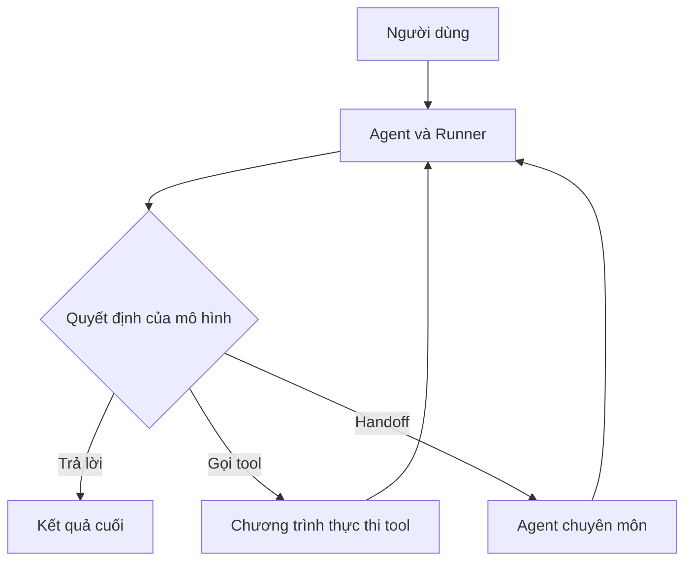

# Tổng quan AI Agents và lộ trình học

**Loại:** Lesson | **Trình độ:** Cơ bản → Trung cấp | **Thời điểm học:** 00:00:00

## 1. Tóm tắt
Phân biệt LLM, agent, tool và hệ thống nhiều agent; nắm được vòng lặp thực thi và xác định phạm vi phù hợp để sử dụng agent.

## 2. Mục tiêu học tập
- Giải thích được kiến thức cốt lõi của **Tổng quan AI Agents và lộ trình học** bằng ví dụ độc lập.
- Phân biệt được trường hợp sử dụng đúng và rủi ro triển khai thường gặp.
- Chạy hoặc kiểm tra được đoạn Python minh họa theo yêu cầu của bài.
- Phân tích kết quả, xác định lỗi và đề xuất cách sửa có căn cứ.

## 3. Bối cảnh và vấn đề
Từ một ứng dụng mô hình chỉ phản hồi văn bản, chúng ta muốn xây dựng hệ thống có thể xử lý nhiệm vụ, gọi công cụ khi phù hợp, báo cáo trạng thái và giữ đúng quyền truy cập. Bài học giải thích từng khái niệm bằng ví dụ có thể kiểm tra, không phụ thuộc vào một UI cụ thể.

## 4. Kiến thức cốt lõi

### 4.1. Mô hình trả lời và agent hành động
Một hệ thống dựa trên LLM không nhất thiết đã là agent. Mô hình chỉ trả lời câu hỏi thuộc kiểu ứng dụng hỏi–đáp; agent có thể lựa chọn công cụ, thực hiện hành động được cấp quyền và tiếp tục cho đến khi đạt điều kiện dừng. OpenAI Agents SDK cung cấp các cấu phần `Agent`, `Runner`, `tools`, `handoffs`, `guardrails`, `sessions` và `tracing` để xây dựng vòng lặp này bằng Python.

Khả năng tự chủ là **có giới hạn**: quyền truy cập, ngân sách, điều kiện dừng và xác nhận hành động phải do ứng dụng quy định. Một agent không tự có quyền đọc cơ sở dữ liệu, gửi email hay thao tác hệ thống nếu lập trình viên chưa cấp công cụ tương ứng.

Một yêu cầu như “sắp xếp lịch ngày mai” có thể đòi hỏi đọc lịch, so sánh hạn chót, đề xuất khung giờ và — nếu được phép — tạo sự kiện. Một lời gọi mô hình đơn lẻ không thực hiện được các tác động bên ngoài nếu không có lớp tool. Agent phối hợp suy luận và công cụ, nhưng không có nghĩa mọi tác vụ đều cần thiết kế nhiều agent.

### 4.2. Vòng lặp agent và điều kiện dừng
Luồng điển hình là: nhận yêu cầu → chuẩn bị hướng dẫn/ngữ cảnh → gọi mô hình → mô hình chọn trả lời hoặc gọi công cụ/handoff → ứng dụng thực thi → đưa kết quả trở lại mô hình → kết thúc với `final_output`. Người lập trình nên thiết lập giới hạn lượt chạy, kiểm soát quyền truy cập và xử lý lỗi.


Sơ đồ chỉ biểu diễn luồng logic; trong thực tế điều khiển có thể chuyển hẳn sang agent tiếp nhận sau handoff.

### 4.3. Khi nào cần nhiều agent
Dùng một agent nếu nhiệm vụ đơn giản, số tool ít và tiêu chí thành công rõ. Tách agent khi có vai trò chuyên môn khác nhau (thu thập dữ liệu, phân tích, phản biện, viết báo cáo) hoặc cần cấu hình quyền công cụ khác nhau. Đánh giá bằng chất lượng, chi phí, độ trễ và khả năng truy vết, không chỉ số lượng agent.

## 5. Ví dụ Python
```python
from agents import Agent, Runner

assistant = Agent(
    name="Daily planning assistant",
    instructions="Giúp người dùng lập kế hoạch. Không khẳng định đã đặt lịch nếu chưa có công cụ đặt lịch."
)
result = Runner.run_sync(assistant, "Lập một lịch học Python 60 phút")
print(result.final_output)
```

## 6. Phân tích ví dụ
`Runner.run_sync` tiện cho ví dụ script đồng bộ; trong ứng dụng bất đồng bộ hãy dùng `await Runner.run(...)`. Agent ví dụ chưa có tool nên chỉ tạo kế hoạch trên văn bản, không sửa lịch thật.

**Lưu ý khi chạy:** Cần cấu hình `OPENAI_API_KEY`, cài `openai-agents` và dùng model mà tài khoản có quyền truy cập. Lời gọi API có thể phát sinh phí. Các ví dụ không thay thế bước kiểm tra quyền và dữ liệu trong ứng dụng thực.

## 7. Lỗi thường gặp và cách tránh
- **Sai lầm:** Nhầm câu trả lời do mô hình tạo với một thao tác thực sự đã hoàn thành. **Cách xử lý:** kiểm tra lại điều kiện đầu vào, quyền hạn và kết quả thực thi bằng test hoặc trace.
- **Sai lầm:** Cấp công cụ ghi/xóa dữ liệu ngay khi mới thử nghiệm. **Cách xử lý:** kiểm tra lại điều kiện đầu vào, quyền hạn và kết quả thực thi bằng test hoặc trace.
- **Sai lầm:** Tạo nhiều agent khi một agent và vài hàm thông thường đã đủ. **Cách xử lý:** kiểm tra lại điều kiện đầu vào, quyền hạn và kết quả thực thi bằng test hoặc trace.

## 8. Thực hành ngắn
Vẽ vòng lặp agent của trợ lý lập kế hoạch: phân loại yêu cầu “gợi ý lịch”, “kiểm tra lịch”, “tạo lịch”; ghi rõ thao tác nào phải gọi tool và thao tác nào cần xác nhận. Chạy mã ví dụ và so sánh lời trả lời với quyền thực tế.

## 9. Câu hỏi ôn tập trắc nghiệm
### 9.1. Câu 1
Đặc điểm cốt lõi của agent có tool là gì?

A. Mọi câu trả lời đều đúng  
B. Có thể lựa chọn thực thi hành động qua công cụ được cấp  
C. Không cần ràng buộc quyền  
D. Luôn có nhiều mô hình  

**Đáp án:** B
**Giải thích:** Công cụ tạo cầu nối có kiểm soát từ mô hình sang thao tác thực.

### 9.2. Câu 2
Yêu cầu “đặt lịch” không có tool lịch phải xử lý thế nào?

A. Thông báo đã đặt  
B. Tự tạo kết quả giả  
C. Giải thích chưa thể thực hiện và gợi ý bước kế tiếp  
D. Bỏ qua yêu cầu  

**Đáp án:** C
**Giải thích:** Không thể xác nhận side effect khi chưa thực thi công cụ tương ứng.

### 9.3. Câu 3
Khi nào nên ưu tiên một agent?

A. Nhiệm vụ hẹp, ít công cụ  
B. Mọi trường hợp  
C. Bất kỳ khi nào có database  
D. Khi có 100 công cụ  

**Đáp án:** A
**Giải thích:** Một agent đơn giản thường rẻ, dễ quan sát và bảo trì hơn.

### 9.4. Câu 4
Vòng lặp nào mô tả đúng?

A. Tool → user → tool vô hạn  
B. LLM → kết thúc luôn  
C. Tool tự chọn instruction  
D. Model chọn tool, ứng dụng thực thi, trả kết quả về vòng lặp  

**Đáp án:** D
**Giải thích:** Runner điều phối các bước mô hình/tool đến khi có kết quả cuối.

### 9.5. Câu 5
Vì sao giới hạn quyền là cần thiết?

A. Để tăng token  
B. Vì agent có thể gọi tool gây tác động ngoài hệ thống  
C. Để thay thế authentication  
D. Vì model tự động kiểm tra mọi quyền  

**Đáp án:** B
**Giải thích:** Thực thi công cụ phải được ràng buộc bởi quyền và quy tắc ứng dụng.

## 10. Tổng kết
Phân biệt LLM, agent, tool và hệ thống nhiều agent; nắm được vòng lặp thực thi và xác định phạm vi phù hợp để sử dụng agent. Mấu chốt là chọn mức tự động hóa vừa đủ, giữ dữ liệu có căn cứ và thử nghiệm hành vi thực tế trước khi đưa vào hệ thống phục vụ người dùng.

## 11. Đọc thêm
- [Tài liệu SDK chính thức](https://openai.github.io/openai-agents-python/)
- [Quickstart Python](https://openai.github.io/openai-agents-python/quickstart/)
