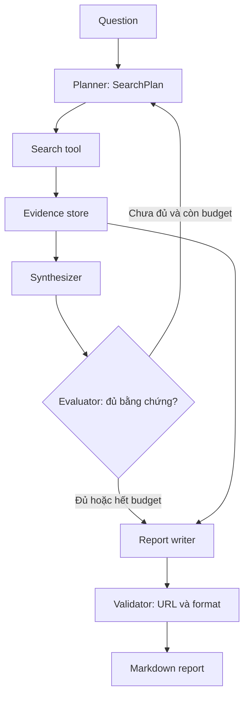

# Kiến trúc dữ liệu, evidence và kiểm soát nguồn nghiên cứu

**Loại:** Project | **Phạm vi:** thiết kế dữ liệu và thuật toán cho Deep Research

## 1. Bài toán

Một kết quả tìm kiếm thường chỉ là tiêu đề, URL, đoạn trích và đôi khi có ngày xuất bản. Chỉ đưa tất cả chuỗi này cho model và yêu cầu “viết báo cáo có trích dẫn” dễ làm mất liên hệ giữa kết luận và bằng chứng. Vì vậy pipeline phải lưu một dạng evidence rõ ràng, khác với văn bản trả lời cuối.

## 2. Mục tiêu

- Thiết kế cấu trúc `Evidence` và `ResearchState` có thể serialize.
- Phân biệt chứng cứ tìm được và suy luận của agent.
- Đặt chính sách chống trùng lặp URL, kiểm soát nguồn và giới hạn vòng lặp.
- Kiểm thử khả năng xuất Markdown khi dữ liệu thiếu.

## 3. Kiến trúc ứng dụng



`Evidence store` không phải “bộ nhớ trí tuệ” của model mà là bản ghi ứng dụng. Sau mỗi truy vấn, ứng dụng lưu kết quả, chuẩn hóa URL, ghi nguồn và thời điểm lấy nếu có. Evaluator xem khoảng thiếu để đưa ra truy vấn bổ sung, nhưng không được tự vượt budget.

## 4. Schema tham khảo

```python
from pydantic import BaseModel, Field

class Evidence(BaseModel):
    query: str
    title: str
    url: str
    excerpt: str
    retrieved_at: str | None = None

class SearchPlan(BaseModel):
    question: str
    queries: list[str] = Field(min_length=1, max_length=6)

class Evaluation(BaseModel):
    sufficient: bool
    missing_angles: list[str]
    suggested_queries: list[str]

class ResearchState(BaseModel):
    question: str
    evidence: list[Evidence] = []
    rounds_completed: int = 0
```

`Evidence.url` đang dùng `str` nhằm giữ ví dụ dễ theo dõi; trong ứng dụng production cần xác thực định dạng URL, domain, redirects và loại bỏ URL rỗng/không thực tế. Các trường text từ search có thể chứa prompt injection, nên phải coi là dữ liệu, không thực hiện hướng dẫn trong đó.

## 5. Thuật toán điều phối

```python
def should_continue(evaluation: Evaluation, round_no: int, max_rounds: int) -> bool:
    return (not evaluation.sufficient and round_no < max_rounds
            and len(evaluation.suggested_queries) > 0)

def deduplicate_evidence(items: list[Evidence]) -> list[Evidence]:
    unique = {}
    for item in items:
        key = item.url.strip().rstrip("/").lower()
        if key and key not in unique:
            unique[key] = item
    return list(unique.values())
```

Giới hạn `max_rounds` là **tham số do ứng dụng quyết định**, không phải con số mặc định của SDK. Ngoài số vòng, cần giới hạn số truy vấn, đồng thời và chi phí tổng.

## 6. Kiểm thử

Thử với ba trường hợp: evidence đầy đủ và nhất quán; evidence trùng URL; evidence có tiêu đề nhưng không có URL. Trường hợp cuối phải bị loại khỏi danh sách trích dẫn hoặc được đánh dấu chưa xác minh, không tự đoán URL.

## 7. Deliverables

Đầu ra gồm các Pydantic model, hàm lọc trùng, bảng test và sơ đồ luồng. Bổ sung tiêu chí chấp nhận: báo cáo không được dẫn nguồn không nằm trong `Evidence`.

## 8. Câu hỏi ôn tập

### 8.1. Câu 1
Vì sao cần `Evidence` tách biệt với văn bản cuối?

A. Vì Markdown không thể chứa URL.  
B. Vì dữ liệu bằng chứng cần được đối chiếu và kiểm chứng trước khi viết.  
C. Vì model không viết được tiếng Việt.  
D. Vì Python không có chuỗi.

**Đáp án:** B

**Giải thích:** Tách evidence tạo cơ sở kiểm tra nguồn và chống trích dẫn bịa.

### 8.2. Câu 2
Khi không có URL đã xác minh, ứng dụng nên làm gì?

A. Tự sinh URL gần đúng.  
B. Coi là nguồn tốt nhất.  
C. Không trích dẫn như nguồn xác thực.  
D. Chuyển sang URL của trang chủ bất kỳ.

**Đáp án:** C

**Giải thích:** Nguồn phải truy nguyên về dữ liệu được thu thập.

### 8.3. Câu 3
Điều kiện dừng của vòng lặp phải thuộc về đâu?

A. Backend/code ứng dụng.  
B. Chỉ prompt.  
C. File `.env` ngẫu nhiên.  
D. Graphviz.

**Đáp án:** A

**Giải thích:** Chính sách dừng và budget phải có kiểm soát tất định.

### 8.4. Câu 4
Giá trị từ một trang web trả về được xem là gì?

A. System instruction.  
B. Lệnh có quyền cao nhất.  
C. Mật khẩu hệ thống.  
D. Dữ liệu ngoài chưa đáng tin.

**Đáp án:** D

**Giải thích:** Nội dung thu thập có thể chứa prompt injection.

### 8.5. Câu 5
Khả năng trùng URL có thể giảm bằng cách nào?

A. Tăng token.  
B. Chuẩn hóa khóa và deduplicate.  
C. Tạo thêm agent.  
D. Tắt logs.

**Đáp án:** B

**Giải thích:** Lọc trùng ở lớp ứng dụng đáng tin hơn kỳ vọng model nhớ.

## 9. Tổng kết

Deep Research chất lượng cao phụ thuộc nhiều vào cấu trúc dữ liệu evidence và kiểm chứng nguồn. Mô hình là công cụ suy luận/hỗ trợ viết; backend quyết định lưu trữ, chính sách truy cập, giới hạn và cấu trúc bằng chứng.
