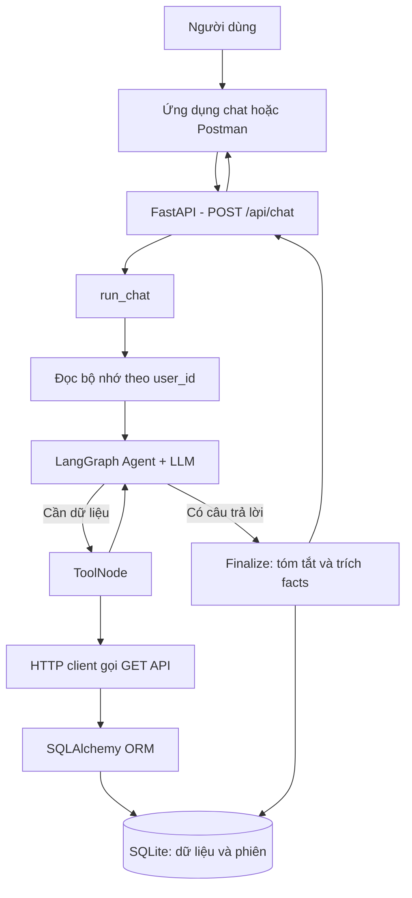

# Khóa học: Xây dựng AI Chatbot Full-stack với FastAPI, LangGraph, SQLAlchemy và bộ nhớ dài hạn

## 1. Tổng quan

Một chatbot ứng dụng trong doanh nghiệp phải làm được nhiều hơn việc tạo ra câu trả lời tự nhiên. Khi người dùng hỏi **“Có bao nhiêu khách hàng sống ở Delhi?”**, bot phải lấy số liệu thật từ cơ sở dữ liệu. Khi người dùng nói **“Tôi tên là Rahul”** rồi mở phiên mới, bot cần nhận biết đó là cùng người dùng và truy xuất thông tin phù hợp đã lưu. Với câu hỏi không cần dữ liệu nội bộ, bot vẫn có thể trả lời trực tiếp.

Khóa học xây dựng **phần backend của một chatbot AI có công cụ truy vấn SQL và bộ nhớ xuyên phiên**. Phần frontend và triển khai lên cloud là những giai đoạn mở rộng, không phải các chức năng đã hoàn thành trong phần backend này.

**Kết quả đầu ra:** một dịch vụ FastAPI có API dữ liệu, endpoint `/api/chat`, agent LangGraph biết chọn công cụ, bảng lưu lịch sử tóm tắt và dữ kiện dài hạn, cùng quy trình kiểm thử bằng Postman.

## 2. Mục tiêu học tập

Sau khóa học, người học có thể:

1. Phân tích kiến trúc của chatbot kết hợp LLM, backend và dữ liệu doanh nghiệp.
2. Xây dựng mô hình quan hệ với SQLAlchemy và lưu thông tin phiên hội thoại.
3. Cung cấp API kiểu dữ liệu chặt chẽ qua FastAPI và Pydantic.
4. Định nghĩa công cụ để agent truy vấn khách hàng, đơn hàng, tồn kho.
5. Thiết kế đồ thị LangGraph theo chu trình **agent → tools → agent → finalize**.
6. Trích xuất, hợp nhất, lưu và tái sử dụng bộ nhớ qua các phiên khác nhau.
7. Kiểm thử luồng trả lời trực tiếp, truy vấn cơ sở dữ liệu và ghi nhớ xuyên phiên.

## 3. Kiến trúc tổng thể

Có **hai đường dữ liệu** quan trọng. Đường truy vấn nghiệp vụ dùng công cụ để đọc thông tin chính xác từ các bảng. Đường bộ nhớ lưu các thông tin có ích về người dùng để những lần trò chuyện sau tiếp tục sử dụng. Hai đường không thay thế nhau: một sự kiện về tồn kho cần được lấy lại từ bảng tồn kho hiện tại, không nên dựa vào trí nhớ do LLM tóm tắt trước đó.

## 4. Cấu trúc khóa học

| Bài | Nội dung | Thành phẩm |
| --- | --- | --- |
| 01 | Chuẩn bị dự án, thư viện và cấu hình | Môi trường backend hoạt động |
| 02 | Thiết kế dữ liệu và SQLAlchemy ORM | Bốn nhóm bảng, kết nối SQLite |
| 03 | FastAPI, Pydantic và API truy vấn | Health, customers, orders, inventory, chat |
| 04 | Công cụ và đồ thị LangGraph | Agent quyết định gọi công cụ hoặc trả lời |
| 05 | Bộ nhớ dài hạn xuyên phiên | Lưu summary và memory facts theo người dùng |
| 06 | Ghép luồng `run_chat` | Pipeline backend từ request tới response |
| 07 | Kiểm thử và lựa chọn RAG/Text-to-SQL | Bộ kịch bản test, checklist an toàn |
| 08 | Lab cuối khóa | Hoàn thiện và kiểm chứng dự án |

Mỗi bài là một tài liệu Markdown có thể đọc độc lập. Ví dụ mã được thiết kế **để minh họa rõ cơ chế**; khi áp dụng cần đối chiếu phiên bản thư viện thực tế, thống nhất import và tên module theo cấu trúc dự án.

## 5. Học như thế nào để nắm vững

Học theo thứ tự từ **01 đến 08**: chạy được database trước, sau đó API, kế tiếp là agent, cuối cùng mới bổ sung memory. Đừng gộp toàn bộ vào một file trong giai đoạn học: khó xác định lỗi đến từ ORM, HTTP, xử lý tool hay tóm tắt LLM.

Một vòng thực hành hiệu quả gồm: đọc nguyên lý, chạy một phần nhỏ, kiểm tra đầu ra bằng HTTP hoặc câu lệnh SQL, sau đó giải thích vì sao hệ thống hoạt động. Tạo hai session khác nhau với cùng một `user_id` là bài kiểm tra cốt lõi của tính năng bộ nhớ dài hạn.

## 6. Các ranh giới cần lưu ý

- **Backend đã thực hiện:** SQLite, SQLAlchemy, FastAPI, LangGraph, tool calling, lưu và nạp bộ nhớ, kiểm thử thủ công.
- **Chưa thực hiện trong phạm vi này:** giao diện chat hoàn chỉnh, triển khai cloud, quy trình xác thực/phân quyền sẵn sàng cho production.
- **Các hướng nâng cấp:** PostgreSQL, kiểm thử tự động, streaming, hạn chế quyền truy vấn, tách dịch vụ memory, đánh giá chi phí và chất lượng tóm tắt.

## 7. Câu hỏi ôn tập

**Câu 1.** Vì sao chatbot cần tool truy vấn đơn hàng thay vì chỉ dựa vào câu trả lời của LLM?  
A. Để bảo đảm số liệu lấy từ nguồn nghiệp vụ hiện tại.  
B. Để bỏ qua xác thực người dùng.  
C. Vì LLM không tạo được văn bản.  
D. Vì mọi câu hỏi đều phải gọi SQL.  
**Đáp án: A.** Công cụ là cầu nối tới dữ liệu thật và có thể kiểm soát.

**Câu 2.** Thành phần nào chịu trách nhiệm điều phối các nút agent và tools?  
A. SQLite. B. CORS. C. LangGraph. D. Pydantic.  
**Đáp án: C.** LangGraph mô hình hóa trạng thái và các cạnh điều khiển.

**Câu 3.** Vì sao phải có `user_id` bên cạnh `session_id`?  
A. Để xác định chủ sở hữu của các phiên và truy xuất bộ nhớ xuyên phiên.  
B. Để tăng token. C. Để sinh tên bảng. D. Để thay API key.  
**Đáp án: A.** Một người dùng có nhiều session nhưng memory phải thuộc đúng người đó.

**Câu 4.** Bước nào thực hiện sau khi agent có câu trả lời cuối?  
A. Xóa database. B. Gọi ngẫu nhiên công cụ. C. Đổi schema. D. Finalize và lưu bộ nhớ.  
**Đáp án: D.** Nút finalize có nhiệm vụ tóm tắt và ghi nhớ.

**Câu 5.** Phần nào không thuộc sản phẩm backend đã xây dựng?  
A. `POST /api/chat`. B. Giao diện cloud đã triển khai. C. SQLAlchemy. D. SessionRecord.  
**Đáp án: B.** Frontend và cloud deployment thuộc các chặng tiếp theo.

## 8. Tổng kết

Khóa học tập trung vào kiến trúc **LLM + dữ liệu có cấu trúc + bộ nhớ lâu dài**. Giá trị cốt lõi không nằm ở một model cụ thể, mà ở cách thiết kế các đường dữ liệu, luồng điều phối và nơi lưu trạng thái để chatbot thực sự hữu ích qua nhiều phiên hội thoại.
