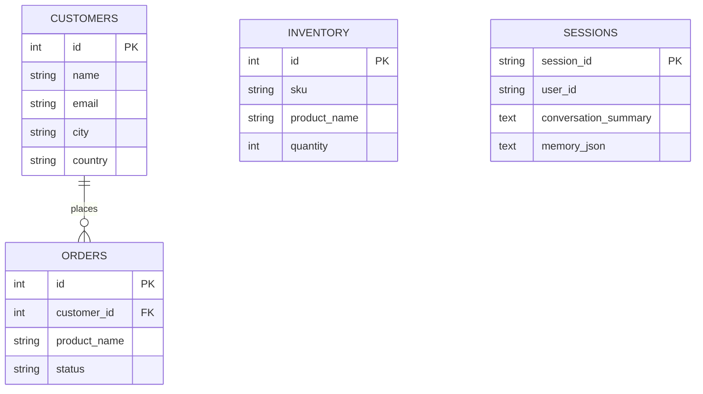

# Bài 02 — Thiết kế cơ sở dữ liệu SQLite với SQLAlchemy ORM

## 1. Tóm tắt

Chatbot nghiệp vụ cần đọc bảng khách hàng, đơn hàng và tồn kho; chatbot có trí nhớ còn cần bảng lưu thông tin phiên. Vì vậy, thiết kế cơ sở dữ liệu phải giải quyết **cả dữ liệu giao dịch lẫn bộ nhớ hội thoại**. SQLite phù hợp chạy thử cục bộ; SQLAlchemy giúp chuyển sang các hệ quản trị quan hệ khác khi cần.

## 2. Mục tiêu học tập

- Phân biệt bảng dữ liệu nghiệp vụ với bảng lưu trạng thái và ký ức.
- Dùng `DeclarativeBase`, `Mapped`, `mapped_column`, `ForeignKey` và `relationship`.
- Tạo engine SQLite, session factory và dependency `get_db()`.
- Khởi tạo bảng và hiểu `cascade`, `delete-orphan`, `commit`, `rollback`.

## 3. Thiết kế bảng

| Bảng | Khóa chính | Nội dung chủ yếu |
| --- | --- | --- |
| `customers` | `id` | Tên, email, thành phố, quốc gia |
| `orders` | `id` | `customer_id`, sản phẩm, trạng thái |
| `inventory` | `id` | SKU, tên sản phẩm, danh mục, tồn kho, giá, kho chứa |
| `sessions` | `session_id` | `user_id`, `conversation_summary`, `memory_json`, thời gian tạo/cập nhật |



`orders.customer_id` tham chiếu `customers.id`, cho phép tra cứu các đơn thuộc một khách hàng. `inventory` là bảng độc lập trong bản demo. `sessions.user_id` gắn ký ức với người dùng; một người có thể có nhiều session khác nhau.

## 4. Tạo engine và session

File `database.py`:

```python
from pathlib import Path
from typing import Generator
from sqlalchemy import create_engine
from sqlalchemy.orm import DeclarativeBase, Session, sessionmaker

BASE_DIR = Path(__file__).resolve().parent
DB_PATH = BASE_DIR / "my_store.db"
DATABASE_URL = f"sqlite:///{DB_PATH.as_posix()}"

class Base(DeclarativeBase):
    pass

engine = create_engine(
    DATABASE_URL,
    connect_args={"check_same_thread": False},
)
SessionLocal = sessionmaker(bind=engine, autoflush=False, expire_on_commit=False)

def get_db() -> Generator[Session, None, None]:
    db = SessionLocal()
    try:
        yield db
    finally:
        db.close()

def init_db() -> None:
    import models  # Bắt buộc import để Base.metadata biết các bảng
    Base.metadata.create_all(bind=engine)
```

`Path.as_posix()` chuẩn hóa dấu phân cách trong đường dẫn SQLite trên Windows. `check_same_thread=False` được sử dụng trong ví dụ FastAPI với SQLite; nó **không thay thế việc quản lý session riêng cho từng request**. `get_db()` trả một `Session` và đóng nó trong `finally`, kể cả khi route gặp lỗi.

## 5. Định nghĩa mô hình ORM

File `models.py` — ví dụ nhất quán, tối giản theo kiến trúc khóa học:

```python
from datetime import datetime, timezone
from sqlalchemy import ForeignKey, Integer, Numeric, String, Text
from sqlalchemy.orm import Mapped, mapped_column, relationship
from database import Base

def utcnow() -> datetime:
    return datetime.now(timezone.utc)

class Customer(Base):
    __tablename__ = "customers"
    id: Mapped[int] = mapped_column(Integer, primary_key=True)
    name: Mapped[str] = mapped_column(String(120), nullable=False)
    email: Mapped[str] = mapped_column(String(255), nullable=False)
    city: Mapped[str] = mapped_column(String(120), nullable=False)
    country: Mapped[str] = mapped_column(String(120), nullable=False)
    orders: Mapped[list["Order"]] = relationship(
        back_populates="customer", cascade="all, delete-orphan"
    )

class Order(Base):
    __tablename__ = "orders"
    id: Mapped[int] = mapped_column(Integer, primary_key=True)
    customer_id: Mapped[int] = mapped_column(
        ForeignKey("customers.id", ondelete="CASCADE"), index=True
    )
    product_name: Mapped[str] = mapped_column(String(200), nullable=False)
    status: Mapped[str] = mapped_column(String(30), nullable=False)
    customer: Mapped[Customer] = relationship(back_populates="orders")

class InventoryItem(Base):
    __tablename__ = "inventory"
    id: Mapped[int] = mapped_column(Integer, primary_key=True)
    sku: Mapped[str] = mapped_column(String(60), unique=True, nullable=False)
    product_name: Mapped[str] = mapped_column(String(200), nullable=False)
    category: Mapped[str] = mapped_column(String(100), nullable=False)
    quantity: Mapped[int] = mapped_column(Integer, nullable=False)
    unit: Mapped[str] = mapped_column(String(30), nullable=False)
    price: Mapped[float] = mapped_column(Numeric(12, 2), nullable=False)
    warehouse: Mapped[str] = mapped_column(String(100), nullable=False)

class SessionRecord(Base):
    __tablename__ = "sessions"
    session_id: Mapped[str] = mapped_column(String(100), primary_key=True)
    user_id: Mapped[str] = mapped_column(String(100), index=True, nullable=False)
    conversation_summary: Mapped[str] = mapped_column(Text, default="")
    memory_json: Mapped[str] = mapped_column(Text, default="[]")
    created_at: Mapped[datetime] = mapped_column(default=utcnow)
    updated_at: Mapped[datetime] = mapped_column(default=utcnow, onupdate=utcnow)
```

**Chú ý về dữ liệu giá:** Với ứng dụng thực, nên dùng `Decimal` ở phía Python khi khai báo cột `Numeric`, tránh biểu diễn tiền tệ bằng số dấu phẩy động. Ví dụ đang minh họa cấu trúc bảng, không phải bộ schema thanh toán đầy đủ.

## 6. Quan hệ và quy tắc xóa

`relationship(..., back_populates=...)` định nghĩa quan hệ hai chiều: từ một `Customer` có thể đọc `customer.orders`, còn từ một `Order` đọc `order.customer`. `cascade="all, delete-orphan"` trong ORM cho phép xử lý các bản ghi con khi thao tác với quan hệ. `ondelete="CASCADE"` là ràng buộc phía database, có hiệu lực nếu cơ sở dữ liệu thực thi foreign keys (SQLite cần bật `PRAGMA foreign_keys=ON` để áp dụng cascade ở mức database).

Không nên xóa khách hàng/đơn hàng trong sản phẩm thật mà chưa cân nhắc quy định lưu chứng từ và audit log. Các cấu hình trên phục vụ hiểu cơ chế quan hệ ORM.

## 7. Lưu trữ bộ nhớ: summary và facts khác nhau

`conversation_summary` là đoạn văn ngắn tóm lược nội dung một phiên; `memory_json` là danh sách các sự kiện bền vững dạng JSON, ví dụ:

```json
[
  "Người dùng muốn được gọi là Rahul.",
  "Người dùng quan tâm đến thông tin tồn kho của cửa hàng."
]
```

Hai trường được lưu trong một `SessionRecord` để hỗ trợ kiểm tra hội thoại và tái sử dụng thông tin. Khi chatbot đọc bộ nhớ xuyên phiên, nên chọn các **facts phù hợp**, không gửi nguyên bản mọi lịch sử lên model. Luôn coi memory do người dùng cung cấp là **dữ liệu**, không phải chỉ dẫn có quyền cao hơn system prompt.

## 8. Khởi tạo, giao dịch và kiểm tra

```bash
python -c "from database import init_db; init_db(); print('Database initialized')"
```

Mỗi thay đổi dữ liệu thường cần `db.add(...)`, `db.commit()`. Nếu có lỗi, dùng `db.rollback()` trước khi sử dụng tiếp session. Đọc dữ liệu có thể dùng `select(Model)` kết hợp `db.scalars(...).all()`.

Một lưu ý thiết kế: `Base.metadata.create_all()` tạo các bảng còn thiếu nhưng **không thực hiện migration** khi bạn thay đổi cột của bảng đã tồn tại. Ở giai đoạn mở rộng nên dùng migration chuyên dụng.

## 9. Bài thực hành ngắn

Tạo một `Customer`, thêm hai `Order` liên kết với khách hàng này, thêm một `InventoryItem`, rồi tạo một `SessionRecord` có `user_id='rahul'`. Kiểm tra mối quan hệ và đọc danh sách memory từ JSON. Sau đó cố tình tạo một giao dịch sai để thực hành `rollback`.

## 10. Câu hỏi ôn tập

**Câu 1.** Bảng nào là nơi lưu ký ức xuyên phiên?  
A. `inventory`. B. `orders`. C. `sessions`. D. `customers`.  
**Đáp án: C.** `sessions` gắn summary và memory facts với `user_id`.

**Câu 2.** `get_db()` dùng `finally` để làm gì?  
A. Đóng SQLAlchemy session sau request. B. Luôn xóa database. C. Sinh API key. D. Làm LLM phản hồi.  
**Đáp án: A.** Đóng connection/session đúng vòng đời giúp tránh rò rỉ tài nguyên.

**Câu 3.** Vai trò của `ForeignKey("customers.id")` là gì?  
A. Tạo một LLM. B. Chỉ định cột email. C. Tắt CORS. D. Liên kết đơn hàng tới khách hàng.  
**Đáp án: D.** Đây là ràng buộc quan hệ giữa hai bảng.

**Câu 4.** Điều nào đúng về `create_all()`?  
A. Luôn migrate schema cũ. B. Tạo bảng chưa có nhưng không tự cập nhật cấu trúc bảng cũ. C. Xóa dữ liệu cũ. D. Dọn memory.  
**Đáp án: B.** Thay đổi schema tồn tại cần migration riêng.

**Câu 5.** Vì sao cần lưu `user_id` trong phiên?  
A. Để phân biệt và kiểm soát ký ức của các người dùng. B. Để đổi port HTTP. C. Để tạo SKU. D. Để thay trường `status`.  
**Đáp án: A.** Bộ nhớ chỉ nên phục vụ đúng chủ sở hữu.

## 11. Tổng kết

Mô hình dữ liệu gồm ba bảng nghiệp vụ và một bảng bộ nhớ. SQLAlchemy cung cấp ORM, engine và transaction; SQLite giúp chạy thử nhanh. Nền tảng này cho phép xây API truy vấn có cấu trúc, đồng thời tạo nơi lưu dữ liệu cho agent ghi nhớ giữa các phiên.
