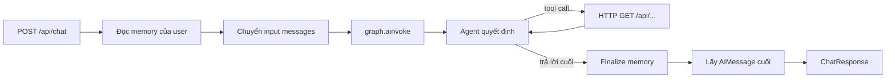

# Bài 06 — Tích hợp toàn bộ luồng chat: từ API tới agent và bộ nhớ

## 1. Tóm tắt

Khi đã có API, model, tools và database, vấn đề quan trọng nhất là **nối đúng thứ tự chạy**. Hàm `run_chat()` đóng vai trò cầu nối giữa `POST /api/chat` và LangGraph: đọc memory theo người dùng, chuyển request thành thông điệp LangChain, gọi graph, tìm câu trả lời cuối và trả về frontend.

## 2. Mục tiêu học tập

- Mô tả đường đi của một request chat từ HTTP đến database.
- Chuyển `ChatMessage` thành `HumanMessage`/`AIMessage`.
- Chạy `graph.ainvoke()` với trạng thái có `user_id`, `session_id`, `memory_context`.
- Lấy đúng thông điệp AI cuối, không nhầm với tool call.
- Xác định vị trí ghi memory qua `finalize_node`.

## 3. Luồng xử lý end-to-end



Mỗi đường dữ liệu có một nhiệm vụ độc lập. Đọc memory **trước** khi gọi graph giúp agent thấy được facts liên quan. Gọi tool **trong** graph cho phép model kiểm chứng thông tin nghiệp vụ. Ghi memory **sau** phản hồi cuối tránh lưu một tool call chưa hoàn thành như câu trả lời.

## 4. Chuyển định dạng hội thoại

Đầu vào Pydantic là một danh sách object gồm `role` và `content`, còn LangChain sử dụng các lớp message riêng:

```python
from langchain_core.messages import AIMessage, HumanMessage
from schemas import ChatMessage


def to_langchain_messages(messages: list[ChatMessage]):
    result = []
    for item in messages:
        if item.role == "user":
            result.append(HumanMessage(content=item.content))
        elif item.role == "assistant":
            result.append(AIMessage(content=item.content))
    return result
```

Không nên nhận `role='system'` tùy ý từ frontend trong ví dụ này: client không được phép tự viết system prompt. Trường hợp API hỗ trợ file hoặc nội dung đa phương thức, hàm chuyển đổi cần xử lý thêm các content blocks; ví dụ hiện tại giới hạn ở text.

## 5. Triển khai `run_chat()`

Trong file `agent.py`, sau phần graph và memory:

```python
from langchain_core.messages import AIMessage
from schemas import ChatMessage

async def run_chat(
    *, messages: list[ChatMessage], session_id: str, user_id: str
) -> str:
    facts = get_session_memories(user_id)
    memory_context = (
        "\n".join(f"- {fact}" for fact in facts)
        if facts else "Chưa có bộ nhớ được lưu."
    )

    result = await graph.ainvoke({
        "messages": to_langchain_messages(messages),
        "session_id": session_id,
        "user_id": user_id,
        "memory_context": memory_context,
    })

    for message in reversed(result["messages"]):
        if isinstance(message, AIMessage) and not message.tool_calls:
            return str(message.content)
    return "Tôi chưa thể trả lời yêu cầu này. Vui lòng thử lại."
```

Trong bản triển khai đầy đủ, node `finalize` (bài 05) thực hiện `save_session(...)` trước khi `graph.ainvoke()` hoàn tất. `run_chat()` chỉ chọn thông điệp trả lời sau cùng. Tránh trả về nội dung của tool call vì đó có thể là yêu cầu gọi hàm, không phải câu trả lời cho người dùng.

## 6. Ví dụ hai phiên cùng người dùng

**Phiên đầu tiên:**

```json
{
  "session_id": "demo-1",
  "user_id": "rahul",
  "messages": [{"role": "user", "content": "Tôi tên là Rahul."}]
}
```

Sau khi agent trả lời, `finalize_node` trích thông tin bền vững “Người dùng tên Rahul” và lưu vào bản ghi có `session_id='demo-1'`.

**Phiên thứ hai:**

```json
{
  "session_id": "demo-2",
  "user_id": "rahul",
  "messages": [{"role": "user", "content": "Tên tôi là gì?"}]
}
```

`run_chat()` đọc memory theo `user_id='rahul'`, đưa facts vào `memory_context`. Agent có thể trả lời “Bạn tên là Rahul” dù `session_id` mới và không có tin nhắn cũ ở payload. Kết quả phụ thuộc chất lượng trích xuất và lưu memory, nên cần kiểm tra database khi bot trả lời không đúng.

## 7. Phân biệt session history và persistent memory

Có hai nhóm ngữ cảnh cần quản lý:

- **Hội thoại phiên hiện tại:** danh sách `messages` mà frontend gửi vào request. Đây là ngữ cảnh ngắn hạn của lượt chạy hiện tại.
- **Bộ nhớ nhiều phiên:** facts đã được lưu trong SQLite theo `user_id`. Đây là ngữ cảnh dài hạn được backend bổ sung.

Một lỗi phổ biến là chỉ truyền tin nhắn cuối cùng nhưng lại không có checkpointer/hệ thống lưu history hiện tại; khi đó agent có memory facts nhưng mất trình tự hội thoại trong phiên đang dùng. Ví dụ bài học giả định frontend gửi lại các messages cần thiết của phiên hiện tại. Khi triển khai giao diện chính thức, cần có chiến lược lưu history riêng hoặc cơ chế state persistence phù hợp.

## 8. Độ tin cậy và giới hạn thực tế

- **Tính đúng danh tính:** `user_id` phải đến từ xác thực thực, không phải chuỗi tùy ý.
- **Giới hạn ngữ cảnh:** không gửi vô hạn facts; nên ưu tiên các fact liên quan, gần đây, đáng tin cậy.
- **Lỗi memory extractor:** nếu finalize thất bại, cần quyết định có trả lời chat trước và ghi memory sau hay báo lỗi; ví dụ đơn giản đặt cả hai trong một graph.
- **Thời gian chờ tool:** `httpx` timeout 15 giây có thể chặn tool quá lâu, cần handling rõ để người dùng nhận thông báo hợp lý.
- **Bảo mật dữ liệu:** mọi endpoint khách hàng/đơn hàng/tồn kho phải thực thi quyền của người gọi, thay vì coi chỉ agent mới dùng API.

**Bài thực hành ngắn:** viết kịch bản gọi `/api/chat` cho hai session; ghi lại thông điệp trả lời, `session_id`, records trong SQLite và quá trình tool calling. Cố ý thử gửi session thuộc người khác để xem hệ thống từ chối.

## 9. Câu hỏi ôn tập

**Câu 1.** Bước nào cần xảy ra trước `graph.ainvoke()`?  
A. Xóa history. B. Deploy frontend. C. Đọc memory theo user và chuyển messages. D. Xóa session.  
**Đáp án: C.** Agent cần cả hội thoại hiện tại và facts cũ khi bắt đầu.

**Câu 2.** Vì sao chỉ lấy AIMessage cuối không có `tool_calls`?  
A. Vì đó mới là ứng viên câu trả lời hoàn chỉnh. B. Vì tool không thể trả JSON. C. Vì Pydantic không hiểu AI. D. Vì SQLite không lưu được text.  
**Đáp án: A.** Tool-call message là thao tác trung gian.

**Câu 3.** Cặp nào làm bằng chứng nhớ xuyên phiên?  
A. Cùng session, khác user. B. Khác session, khác user. C. Cùng request. D. Khác session, cùng user.  
**Đáp án: D.** Các facts cũ được truy xuất bằng định danh người dùng bền vững.

**Câu 4.** Nếu frontend chỉ gửi tin nhắn cuối và backend không giữ history phiên hiện tại, vấn đề nào xảy ra?  
A. Session mới tự có đủ ngữ cảnh. B. Mất các lượt hội thoại ngắn hạn chưa được truyền lại. C. Graph tự sinh history vô hạn. D. SQLite biến mất.  
**Đáp án: B.** Memory facts không tương đương toàn bộ message history.

**Câu 5.** Tại sao không cho client gửi `system` role tùy ý?  
A. Vì system prompt không cần. B. Vì JSON không hỗ trợ. C. Vì sẽ cho người dùng nâng quyền chỉ dẫn trái phép. D. Vì HTTP chỉ có GET.  
**Đáp án: C.** Chính sách hệ thống phải được server kiểm soát.

## 10. Tổng kết

`run_chat()` là điểm ghép giữa HTTP, memory và agent. Một lượt xử lý đầy đủ phải nạp đúng memory, gọi đúng tools, lưu lại facts mới và trả câu trả lời cuối có thể sử dụng được. Tính xuyên phiên được kiểm chứng bằng **cùng `user_id` nhưng `session_id` khác nhau**.
