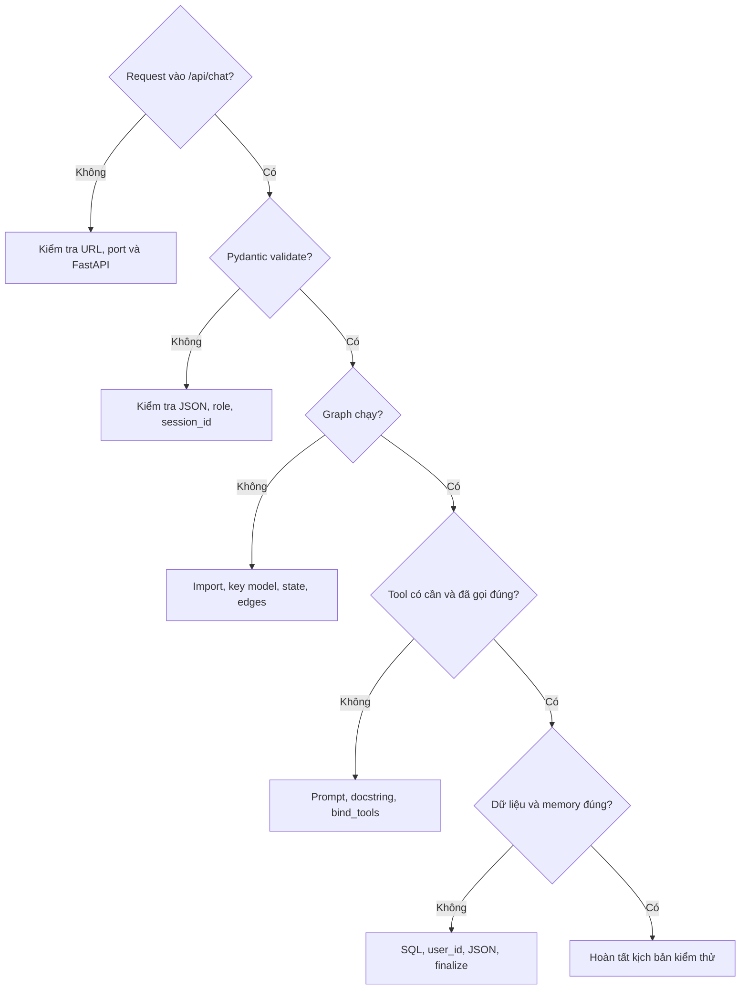

# Bài 07 — Kiểm thử AI chatbot và lựa chọn Tools, RAG hay Text-to-SQL

## 1. Tóm tắt

Để đánh giá chatbot đã hoạt động, không chỉ hỏi vài câu rồi quan sát lời đáp. Hệ thống có ba khả năng tách biệt cần kiểm thử: **trả lời trực tiếp**, **đọc đúng dữ liệu có cấu trúc**, và **ghi nhớ giữa các phiên**. Bên cạnh đó, phương pháp truy xuất dữ liệu cần phù hợp với dạng nguồn: bảng quan hệ, tài liệu phi cấu trúc hoặc cơ sở dữ liệu phức tạp nhiều bảng.

## 2. Mục tiêu học tập

- Xây bộ kịch bản kiểm thử FastAPI bằng Postman hoặc HTTP client.
- Kiểm tra đường gọi tool và so sánh câu trả lời với SQL thực tế.
- Kiểm tra memory xuyên phiên, ngăn trộn dữ liệu giữa người dùng.
- So sánh tool/API định sẵn, RAG và Text-to-SQL theo đặc điểm bài toán.
- Xác định những việc cần gia cố trước khi triển khai production.

## 3. Ba nhóm kiểm thử chức năng

| Nhóm | Ví dụ đầu vào | Điều cần chứng minh |
| --- | --- | --- |
| Trò chuyện thông thường | “Virat Kohli là ai?” | Có thể trả lời không cần gọi API nghiệp vụ |
| Truy vấn khách hàng | “Cho tôi hồ sơ khách ID 20” | Tool phù hợp được gọi; dữ liệu khớp database |
| Truy vấn tổng hợp | “Có bao nhiêu khách ở Delhi?” | Có truy vấn đếm chính xác, không dựa vào danh sách bị giới hạn |
| Bộ nhớ liên phiên | “Tên tôi là Rahul” rồi mở session mới hỏi “Tên tôi là gì?” | Ghi nhớ theo `user_id` và truy xuất lại |
| Cách ly người dùng | User B hỏi memory của user A | Không lộ dữ liệu của user A |

Các ví dụ địa danh, tên khách và số lượng cụ thể là tình huống kiểm thử. Một kết quả quan sát được trong một database demo không phải là số liệu chuẩn có thể tái sử dụng cho database khác.

## 4. Thử API với Postman

1. Chạy `uvicorn main:app --reload` trong thư mục backend.
2. Gọi `GET http://127.0.0.1:8000/api/health`, mong đợi JSON trạng thái `ok`.
3. Gọi `/api/customers?customer_id=20` để đọc dữ liệu nền.
4. Tạo request `POST http://127.0.0.1:8000/api/chat` với `Content-Type: application/json`.
5. Gửi payload cho một câu hỏi thường, một câu hỏi cần SQL và hai session khác nhau.
6. Mở SQLite để kiểm tra nội dung bảng `sessions`.

Payload cho một lượt yêu cầu truy vấn:

```json
{
  "session_id": "test-customer-20",
  "user_id": "rahul",
  "messages": [
    {"role": "user", "content": "Cho tôi thông tin khách hàng số 20"}
  ]
}
```

Phản hồi thành công có thể có dạng:

```json
{
  "message": "...Nội dung dựa trên kết quả truy vấn thực tế...",
  "session_id": "test-customer-20"
}
```

Không gán sẵn tên khách hoặc số lượng trong bài kiểm thử; phải đọc record thực tế trong database để có expected result.

## 5. Quy trình debug theo tầng



Nên lưu log cho từng tầng: request ID, tên tool được gọi, thời gian truy vấn, số lượng dòng trả về, token/latency nếu có và trạng thái lưu memory. **Không log nguyên API key hoặc thông tin cá nhân nhạy cảm**. Một phản hồi nghe hợp lý không thay cho đối chiếu bản ghi SQL.

## 6. Khi nào dùng tool, RAG hoặc Text-to-SQL?

| Cách tiếp cận | Dữ liệu phù hợp | Điểm mạnh | Giới hạn cần chú ý |
| --- | --- | --- | --- |
| API/tool định sẵn | Bảng quan hệ và nhóm nghiệp vụ rõ | Truy vấn chính xác, quyền hạn có thể giới hạn | Cần thiết kế endpoint/công cụ |
| RAG | PDF, tài liệu, văn bản, tri thức không cấu trúc | Tìm đoạn tài liệu liên quan và dùng trong prompt | Kết quả tìm kiếm có thể bỏ sót; không thay toán tử SQL chính xác |
| Text-to-SQL | Nhiều bảng và quan hệ động, câu hỏi đa dạng | Linh hoạt sinh câu SQL | Cần kiểm soát schema, quyền, validation và giới hạn truy vấn |

Với ba nhóm nghiệp vụ rõ ràng (`customers`, `orders`, `inventory`), một tập tools đã thiết kế sẵn thường dễ kiểm soát hơn để LLM tự viết SQL cho mọi câu hỏi. Nếu số bảng và câu hỏi tăng mạnh, Text-to-SQL có thể phù hợp, nhưng không được cho model tùy ý chạy SQL có quyền ghi/xóa.

**Điểm quan trọng:** RAG không bị giới hạn tuyệt đối chỉ cho dữ liệu phi cấu trúc. Có thể dùng retrieval để tìm tài liệu schema, metadata hay hướng dẫn SQL. Tuy vậy, với câu hỏi cần **tổng số, lọc chính xác, join và tính toán trên bảng**, truy vấn database có kiểm soát thường là nguồn sự thật đáng tin cậy hơn semantic search đơn thuần.

## 7. Checklist trước khi đưa vào môi trường thực

- Xác thực mọi request; không coi `user_id` tự khai là danh tính đáng tin.
- Phân quyền đọc bảng, record và dữ liệu nhạy cảm ở tầng API/database.
- Chỉ cho SQL read-only nếu dùng Text-to-SQL; giới hạn thời gian, số hàng, bảng được phép truy cập.
- Đặt timeout, retry có kiểm soát, rate limit, logging/monitoring, cảnh báo lỗi.
- Tránh gọi vòng lặp tools vô hạn; giới hạn số bước hoặc tổng thời gian agent.
- Lưu và xóa memory theo chính sách rõ ràng; bảo vệ khỏi prompt injection và memory poisoning.
- Không expose dữ liệu bí mật trong response hay log.
- Có test cho `COUNT` chính xác, bộ lọc và `limit`.
- Cân nhắc chi phí tóm tắt mỗi lượt, chỉ gửi facts liên quan thay vì tất cả.

## 8. Bài thực hành kiểm thử

Tạo bộ 6 ca kiểm thử gồm: health API, payload không hợp lệ, câu hỏi bình thường, câu hỏi tồn kho, hai session cùng user, và hai user độc lập. Với mỗi ca ghi **input, công cụ được kỳ vọng gọi, kết quả quan sát, kết quả đúng từ database, trạng thái pass/fail**. Sửa lỗi theo tầng thay vì chỉ chỉnh prompt cho đến khi thấy câu trả lời vừa ý.

## 9. Câu hỏi ôn tập

**Câu 1.** Cách đáng tin nhất để xác minh “Có bao nhiêu khách ở Delhi?” là gì?  
A. Đếm từ câu trả lời model. B. Chỉ nhìn 20 record đầu. C. Dùng truy vấn đếm đầy đủ trên database. D. Đoán theo trí nhớ.  
**Đáp án: C.** Câu hỏi tổng số cần query đếm chính xác.

**Câu 2.** Nguồn nào thích hợp để RAG tìm các đoạn ngữ nghĩa liên quan?  
A. Kho tài liệu hướng dẫn dạng văn bản. B. Mỗi row SQL cần tính tổng chính xác. C. API key. D. Session ID.  
**Đáp án: A.** Retrieval thường mạnh với nội dung tài liệu.

**Câu 3.** Đâu là biện pháp cần thiết nếu dùng Text-to-SQL?  
A. Cấp quyền `DROP TABLE`. B. Không cần kiểm soát query. C. Bỏ schema validation. D. Giới hạn bảng, quyền và chỉ cho phép truy vấn an toàn.  
**Đáp án: D.** SQL do model sinh không được tin cậy mặc định.

**Câu 4.** Vì sao test cùng `user_id` và hai `session_id`?  
A. Để đo FPS. B. Để xác minh nhớ được thông tin qua phiên khác. C. Để tạo database mới. D. Để thay model.  
**Đáp án: B.** Đây là phép thử trực tiếp của persistent memory.

**Câu 5.** Dấu hiệu nào chưa đủ để kết luận hệ thống đúng?  
A. API health trả OK. B. SQL trả đúng dòng. C. Câu trả lời LLM nghe hợp lý nhưng không so với dữ liệu. D. Tool có log thực thi.  
**Đáp án: C.** LLM có thể nói trôi chảy dù dữ liệu sai.

## 10. Tổng kết

Kiểm thử chatbot agent cần tách ba năng lực: **trò chuyện, truy vấn, ghi nhớ**. Tools phù hợp khi truy vấn nghiệp vụ có cấu trúc và rõ ràng; RAG hữu ích cho tài liệu; Text-to-SQL hỗ trợ các câu hỏi linh hoạt trên schema lớn nhưng cần kiểm soát truy cập nghiêm ngặt.
