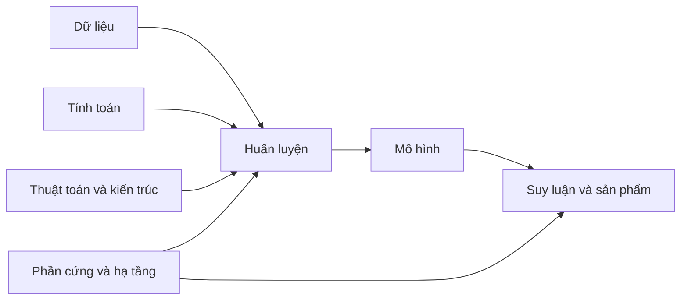

# Bài 01 — Vì sao AI tiến bộ nhanh: quy mô và thuật toán

> **Module 01: Nền tảng Deep Learning**  
> **Phạm vi bài giảng:** 03:35–05:05  
> **Hình thức:** Bài học lý thuyết kết hợp thực hành ngắn

## 1. Tổng quan

Bài học xây dựng nền tảng về **vì sao ai tiến bộ nhanh: quy mô và thuật toán** và cách áp dụng tư duy kỹ thuật vào việc thiết kế, đánh giá hoặc vận hành hệ thống AI.

## 2. Mục tiêu học tập

1. Giải thích được vì sao dữ liệu, tính toán và quy mô mô hình cùng ảnh hưởng chất lượng.
2. Phân biệt tiến bộ do scaling với tiến bộ do thuật toán và kiến trúc.
3. Phân tích được sự đánh đổi giữa năng lực và chi phí triển khai.

## 3. Kiến thức trọng tâm

### 3.1. Từ các chương trình chuyên biệt đến mô hình học từ dữ liệu
Trong cách xây dựng phần mềm truyền thống, lập trình viên phải viết ra phần lớn quy tắc. Với học máy, ta đưa vào các ví dụ và tối ưu tham số sao cho mô hình học được quy luật hữu ích. Nhờ đó, một hạ tầng học thống nhất có thể xử lý hình ảnh, giọng nói, văn bản và nhiều dạng dữ liệu khác nhau.

Chất lượng AI không đến từ một phát minh đơn lẻ. Nó là kết quả của nhiều tiến bộ nối tiếp trong **dữ liệu**, **năng lực tính toán**, **mô hình**, **thuật toán tối ưu** và **cơ sở hạ tầng**.

### 3.2. Quy mô không thay thế chất lượng thuật toán
Giả sử cải tiến năng lực tính toán và dữ liệu mang lại hệ số cải thiện giả định là $20$, còn thuật toán mới tăng hiệu quả học được trên mỗi phép tính lên $50$ lần. Nếu hai hiệu ứng tương đối độc lập, mức cải thiện kết hợp có thể đạt:

$$
20\times 50 = 1000.
$$

Đây là **ví dụ minh họa về hiệu ứng nhân**, không phải cam kết mọi hệ thống đều tốt hơn 1.000 lần. Trong thực tế, kết quả phụ thuộc cách đo, giới hạn phần cứng và chất lượng dữ liệu.

### 3.3. Ba góc nhìn khi thiết kế một hệ thống AI
- **Chất lượng:** mô hình có giải quyết đúng bài toán và dữ liệu thực tế hay không?
- **Khả năng mở rộng:** khi thêm tài nguyên, tốc độ và chất lượng cải thiện tới đâu?
- **Hiệu quả:** để phục vụ người dùng, hệ thống tốn bao nhiêu thời gian, bộ nhớ và năng lượng?

Một mô hình đạt điểm benchmark tốt nhưng chậm, tốn điện hoặc không đủ tài nguyên để triển khai chưa hẳn là phương án tốt cho sản phẩm.

### 3.4. Một sơ đồ tư duy tổng thể

Đầu vào huấn luyện và hạ tầng phục vụ đều quyết định giá trị cuối cùng của mô hình. Vì thế, AI Engineer cần nhìn **cả pipeline** thay vì chỉ thay đổi prompt.

## 4. Bài tập thực hành

1. Chọn một bài toán như nhận dạng cảm xúc hoặc phân loại ảnh.
2. Lập bảng ba phương án: tăng dữ liệu, tăng mô hình, cải tiến kiến trúc.
3. Với mỗi phương án, ghi kỳ vọng về chất lượng, tốc độ, GPU/RAM và rủi ro.
4. Đề xuất cách thử nghiệm nhỏ trước khi mở rộng.

**Kết quả cần có:** một bảng quyết định kỹ thuật với ít nhất ba thước đo và giải thích lựa chọn.

## 5. Câu hỏi ôn tập trắc nghiệm

**Câu 1. Vì sao tăng FLOPs chưa chắc tạo ra sản phẩm AI tốt hơn?**

A. Vì nhiều phép tính luôn làm kết quả kém hơn  
B. Vì thuật toán không ảnh hưởng chất lượng  
C. Vì còn phụ thuộc kiến trúc, dữ liệu, độ trễ và chi phí triển khai  
D. Vì benchmark luôn vô nghĩa  

**Đáp án: C.** Năng lực tính toán chỉ là một thành phần trong pipeline.

**Câu 2. Ý nghĩa của ví dụ 20 × 50 là gì?**

A. Mọi mô hình luôn nhanh hơn đúng 1.000 lần  
B. Chỉ cần tăng dữ liệu 50 lần  
C. Đây là công thức dự đoán độ chính xác  
D. Các nguồn cải tiến độc lập có thể nhân tác động  

**Đáp án: D.** Đây là ví dụ về sự bổ trợ giữa quy mô và thuật toán.

**Câu 3. Bộ chỉ số nào phù hợp khi so sánh hai mô hình đưa vào sản phẩm?**

A. Độ chính xác, độ trễ, bộ nhớ và năng lượng  
B. Chỉ số lượng tham số  
C. Chỉ số lần mô hình được nhắc trên mạng  
D. Chỉ độ dài tên mô hình  

**Đáp án: A.** Quyết định sản phẩm cần cả chất lượng và chi phí.

**Câu 4. Tư duy hệ thống AI yêu cầu nhìn vào đâu?**

A. Duy nhất prompt người dùng  
B. Toàn bộ quá trình từ dữ liệu đến suy luận  
C. Chỉ khối lượng dữ liệu  
D. Chỉ số lượng GPU khi train  

**Đáp án: B.** Nút thắt cổ chai có thể xuất hiện ở bất cứ giai đoạn nào.

**Câu 5. Khi ngân sách thấp, bước đầu hợp lý nhất là gì?**

A. Thuê ngay cụm GPU lớn nhất  
B. Bỏ qua baseline để tiết kiệm thời gian  
C. Làm thí nghiệm nhỏ có đo lường trước khi scale  
D. Chọn mô hình nhiều tham số nhất  

**Đáp án: C.** Thử nghiệm có kiểm soát cho bằng chứng về lợi ích của việc mở rộng.

## 6. Tổng kết

- Scaling, kiến trúc và thuật toán bổ trợ chứ không loại trừ nhau.
- Chất lượng và hiệu quả triển khai phải được đánh giá cùng lúc.
