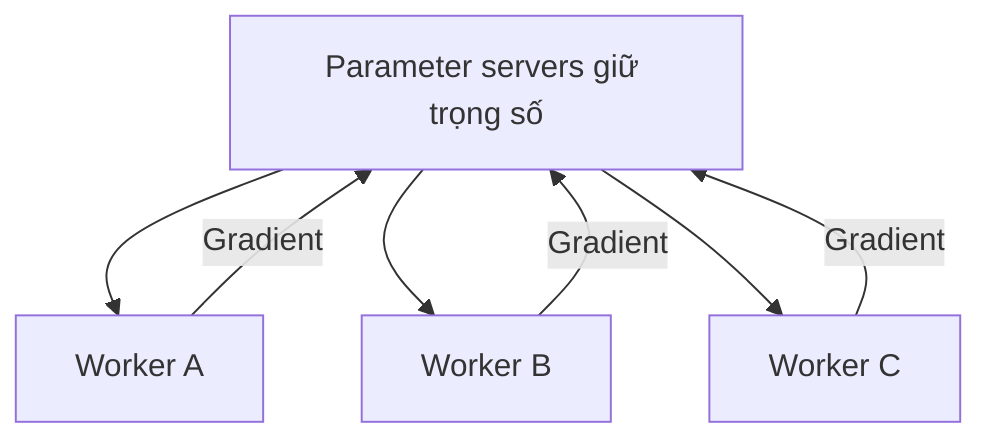

# Bài 03 — Huấn luyện phân tán: data parallel và model parallel

> **Module 01: Nền tảng Deep Learning**  
> **Phạm vi bài giảng:** 06:26–10:13  
> **Hình thức:** Bài học lý thuyết kết hợp thực hành ngắn

## 1. Tổng quan

Bài học xây dựng nền tảng về **huấn luyện phân tán: data parallel và model parallel** và cách áp dụng tư duy kỹ thuật vào việc thiết kế, đánh giá hoặc vận hành hệ thống AI.

## 2. Mục tiêu học tập

1. Phân biệt data parallel với model parallel.
2. Mô tả quy trình worker và parameter server không đồng bộ.
3. Nhận diện hiện tượng stale gradient và giới hạn tăng tốc.

## 3. Kiến thức trọng tâm

### 3.1. Khi một máy không đủ lớn
Huấn luyện nơ-ron từng bị giới hạn bởi bộ nhớ và khả năng tính toán. Có hai cách tổ chức công việc phổ biến:

| Phương án | Chia cái gì? | Mỗi máy làm gì? |
|---|---|---|
| **Data parallelism** | Các mẫu dữ liệu | Giữ bản sao mô hình và xử lý minibatch khác nhau |
| **Model parallelism** | Các phần của mô hình | Chỉ giữ, tính toán một phần mô hình |

Data parallel thường cần đồng bộ/tổng hợp gradient; model parallel đòi hỏi trao đổi activation hoặc tensor giữa các phần. Có thể kết hợp hai cách, nhưng phải cân đối băng thông và overhead.

### 3.2. Tăng tốc không tỉ lệ thuận số máy
Nếu mô hình và tập dữ liệu cố định, thêm máy thường làm hiệu năng **tăng chậm dần** vì giao tiếp, điều phối và đồng bộ. Đây là khác biệt giữa *strong scaling* (giữ bài toán cố định) và *weak scaling* (mở rộng bài toán cùng tài nguyên). Thử nghiệm dùng hàng chục máy cũng cho thấy muốn tận dụng thêm phần cứng, đôi lúc cần tăng quy mô mô hình hoặc dữ liệu.

### 3.3. Parameter server với cập nhật không đồng bộ
Trong một hệ thống huấn luyện phân tán thời kỳ đầu, nhiều worker giữ bản sao tham số. Worker lấy dữ liệu, tính gradient cục bộ và gửi đến các parameter server để cập nhật mô hình chung.

Khi worker A tính gradient dựa trên tham số cũ, worker B có thể đã cập nhật tham số chung. Ta gọi đó là **stale gradient**. Cách làm không đồng bộ có thể hiệu quả thực nghiệm, nhưng phức tạp về mặt hội tụ và độ tái lập.

### 3.4. Các chi phí cần đo
- Thời gian tính forward/backward một minibatch.
- Thời gian truyền dữ liệu, tensor, gradient.
- Thời gian chờ worker chậm nhất (nếu đồng bộ).
- Tỉ lệ tận dụng GPU/TPU.
- Chất lượng hội tụ sau cùng, không chỉ số bước trên giây.

**Lưu ý:** hiệu suất cao hơn mỗi giây không đồng nghĩa mô hình hội tụ nhanh hơn đến cùng độ chính xác.

## 4. Bài tập thực hành

Thiết kế một sơ đồ huấn luyện cho mô hình lớn hơn RAM của một GPU và dữ liệu gấp 10 lần RAM máy. Đánh dấu thành phần chia mô hình, chia minibatch, gửi gradient và checkpoint. Viết 2 kịch bản xử lý worker chậm.

## 5. Câu hỏi ôn tập trắc nghiệm

**Câu 1. Khi mỗi worker giữ một bản sao mô hình và xử lý minibatch khác nhau, đây là gì?**

A. Data parallelism  
B. Model parallelism thuần túy  
C. Speculative decoding  
D. Knowledge distillation  

**Đáp án: A.** Dữ liệu được chia giữa các worker nên là data parallel.

**Câu 2. Trường hợp nào bắt buộc phải cân nhắc model parallelism?**

A. Dữ liệu được lưu ở nhiều tệp  
B. Mô hình quá lớn để đặt trên một thiết bị  
C. Cần đánh giá bằng nhiều bộ test  
D. Chỉ cần rút ngắn câu trả lời  

**Đáp án: B.** Model parallel chia các phần mô hình/tensor giữa nhiều thiết bị.

**Câu 3. Stale gradient xuất hiện khi nào?**

A. Dữ liệu train bị thiếu nhãn  
B. GPU không có đủ ổ cứng  
C. Gradient được tính từ phiên bản tham số đã cũ  
D. Learning rate bằng không  

**Đáp án: C.** Asynchronous workers có thể nhìn thấy các trạng thái tham số khác nhau.

**Câu 4. Điều gì thường giới hạn strong scaling?**

A. Thêm GPU làm số nhãn giảm  
B. Mất khả năng tính toán song song hoàn toàn  
C. Mô hình tự động nhỏ hơn  
D. Chi phí giao tiếp và đồng bộ tăng tương đối  

**Đáp án: D.** Giữ kích thước bài toán cố định làm phần overhead nổi bật hơn.

**Câu 5. Để đánh giá hệ huấn luyện phân tán công bằng, nên xem gì?**

A. Thời gian đạt cùng chất lượng mục tiêu  
B. Chỉ số lượng máy  
C. Chỉ tốc độ mạng quảng cáo  
D. Chỉ số vòng lặp được in ra  

**Đáp án: A.** Tăng throughput nhưng hội tụ chậm có thể không đem lại lợi ích.

## 6. Tổng kết

- Data parallel chia dữ liệu; model parallel chia tính toán/khả năng chứa mô hình.
- Cập nhật không đồng bộ tăng tính linh hoạt nhưng gây độ trễ tham số.
