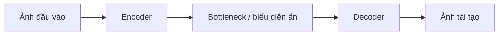

# Bài 04 — Học biểu diễn không giám sát qua hình ảnh

> **Module 01: Nền tảng Deep Learning**  
> **Phạm vi bài giảng:** 10:13–12:20  
> **Hình thức:** Bài học lý thuyết kết hợp thực hành ngắn

## 1. Tổng quan

Bài học xây dựng nền tảng về **học biểu diễn không giám sát qua hình ảnh** và cách áp dụng tư duy kỹ thuật vào việc thiết kế, đánh giá hoặc vận hành hệ thống AI.

## 2. Mục tiêu học tập

1. Giải thích reconstruction objective và lớp nút thắt.
2. Mô tả vì sao đặc trưng cấp cao xuất hiện dù không gán nhãn.
3. Phân biệt pretraining với fine-tuning trên bài toán có nhãn.

## 3. Kiến thức trọng tâm

### 3.1. Học từ ảnh không có nhãn
Nếu thu thập hàng triệu khung hình từ video, việc gán nhãn từng vật thể vừa tốn kém vừa không bao phủ hết hiện tượng. Một hướng đi là cho mô hình học cấu trúc của chính hình ảnh, không cần nhãn `mèo`, `mặt người` hoặc `bàn ghế`.

Hệ thống được mô tả dùng khoảng **10 triệu khung hình YouTube ngẫu nhiên** và một nhiệm vụ tái tạo: chuyển ảnh thành một biểu diễn ẩn, rồi khôi phục các pixel đầu vào.

### 3.2. Bottleneck tạo sức ép trừu tượng hóa

Mạng không thể đơn giản lưu mọi pixel khi biểu diễn ẩn có giới hạn phù hợp. Để tái tạo tốt, nó phải nắm được đặc điểm ổn định của cấu trúc ảnh. Trong một thử nghiệm, những neuron cấp cao nhạy với **mặt mèo, mặt người hoặc hình dáng người** dù không có nhãn đối tượng trong mục tiêu học.

Điểm quan trọng là: đây là ví dụ về **biểu diễn nổi lên** (*emergent representations*), không chứng minh rằng mọi neuron có thể diễn giải chính xác hay mô hình thực sự “hiểu” theo nghĩa con người.

### 3.3. Pretraining rồi fine-tuning
Một chiến lược có hai giai đoạn:
1. **Pretraining:** học từ ảnh chưa gán nhãn bằng reconstruction.
2. **Fine-tuning:** dùng trọng số học được làm khởi tạo, tiếp tục tối ưu cho phân loại có nhãn.

Trong ví dụ được trình bày, khởi tạo bằng học không giám sát rồi huấn luyện có giám sát đem lại mức cải thiện tương đối được báo cáo khoảng **70%** trên tác vụ liên quan **ImageNet-22K** thời kỳ đó. Đây là một kết quả lịch sử trong bối cảnh thử nghiệm cụ thể, không phải lợi ích chung áp dụng cho mọi dữ liệu hoặc mô hình.

### 3.4. Khi nào hướng học này hữu ích?
Nó đặc biệt đáng cân nhắc khi dữ liệu thô rất dồi dào nhưng nhãn chất lượng cao khan hiếm. Dù vậy, phải kiểm tra biểu diễn đã học có hữu ích với tác vụ đích và có gây lỗi *domain shift* khi đổi bộ dữ liệu hay không.

## 4. Bài tập thực hành

Tạo một bảng cho bộ dữ liệu ảnh chưa nhãn của anh: kích thước ảnh, số lượng, nguồn thu thập, quy tắc làm sạch, reconstruction loss và một tác vụ fine-tune có nhãn. Vẽ pipeline tiền huấn luyện → phân loại → đánh giá tập test độc lập.

## 5. Câu hỏi ôn tập trắc nghiệm

**Câu 1. Reconstruction objective huấn luyện mô hình làm gì?**

A. Dự đoán trực tiếp nhãn do người gán  
B. Tái tạo dữ liệu đầu vào từ biểu diễn học được  
C. Chọn câu trả lời yêu thích  
D. Tăng số GPU của cụm  

**Đáp án: B.** Mục tiêu tái tạo tạo tín hiệu lỗi ngay từ chính ảnh đầu vào.

**Câu 2. Vai trò của bottleneck là gì?**

A. Tạo thêm ảnh được gán nhãn thủ công  
B. Tự thay thế bộ dữ liệu  
C. Giới hạn biểu diễn và khuyến khích học đặc trưng hữu ích  
D. Loại bỏ hoàn toàn việc học  

**Đáp án: C.** Giới hạn thông tin buộc encoder nén các cấu trúc quan trọng.

**Câu 3. Quy trình nào là pretraining rồi fine-tuning?**

A. Chia test thành hai phần rồi đảo lại  
B. Train trực tiếp trên nhãn test  
C. Chỉ viết luật thủ công cho từng ảnh  
D. Học từ ảnh chưa nhãn rồi tối ưu cho tác vụ có nhãn  

**Đáp án: D.** Pretraining học biểu diễn trước, fine-tuning thích nghi tác vụ sau.

**Câu 4. Phát hiện neuron nhạy với mặt mèo chứng minh điều gì?**

A. Đặc trưng có thể nổi lên dù không có nhãn đối tượng  
B. Mô hình hiểu thế giới hệt như người  
C. Mọi neuron đều có tên ngữ nghĩa rõ ràng  
D. Không cần kiểm thử tác vụ đích  

**Đáp án: A.** Đặc trưng hữu ích có thể phát sinh từ tín hiệu học không giám sát.

**Câu 5. Mức cải thiện tương đối 70% nên được hiểu thế nào?**

A. Là quy luật với mọi mạng nơ-ron  
B. Là kết quả trong một thiết lập lịch sử cụ thể  
C. Là tốc độ GPU chắc chắn tăng 70%  
D. Là đảm bảo khi thu thập 10 triệu ảnh  

**Đáp án: B.** Không nên khái quát benchmark có điều kiện thành bảo đảm phổ quát.

## 6. Tổng kết

- Biểu diễn cấp cao có thể học được mà không cần nhãn lớp.
- Fine-tuning tận dụng biểu diễn chung nhưng phải đo tác vụ đích.
