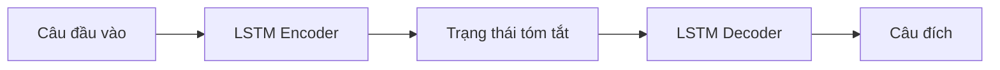

# Bài 06 — Seq2Seq và LSTM trong dịch máy

> **Module 02: Biểu diễn và kiến trúc mô hình**  
> **Phạm vi bài giảng:** 13:43–15:03  
> **Hình thức:** Bài học lý thuyết kết hợp thực hành ngắn

## 1. Tổng quan

Bài học xây dựng nền tảng về **seq2seq và lstm trong dịch máy** và cách áp dụng tư duy kỹ thuật vào việc thiết kế, đánh giá hoặc vận hành hệ thống AI.

## 2. Mục tiêu học tập

1. Mô tả vai trò encoder và decoder.
2. Giải thích state của LSTM dùng để chuyển thông tin qua chuỗi.
3. Nhận diện giới hạn của biểu diễn nén và tính toán tuần tự.

## 3. Kiến thức trọng tâm

### 3.1. Bài toán chuỗi sang chuỗi
Trong dịch máy, đầu vào có thể là một câu tiếng Anh dài $m$ từ và đầu ra là câu tiếng Pháp dài $n$ từ. Không nhất thiết $m=n$; vì thế ta cần hệ thống mô hình hóa **chuỗi đầu vào** và sinh ra **chuỗi đích**.

### 3.2. Encoder–decoder dựa trên LSTM

Encoder đọc lần lượt token và cập nhật trạng thái ẩn/cell state của LSTM. Decoder được khởi tạo từ thông tin encoder học được, sau đó dự đoán từng token đích. LSTM có cổng để kiểm soát thông tin giữ lại và bổ sung, giúp nhớ quan hệ qua nhiều bước tốt hơn RNN đơn giản.

### 3.3. Huấn luyện bằng cặp câu song song
Cặp câu có cùng nghĩa tạo tín hiệu giám sát ở mỗi bước dự đoán đầu ra. Trong huấn luyện, decoder có thể được cung cấp token đích đúng ở bước trước (teacher forcing). Trong suy luận, decoder phải dựa trên những token đã sinh.

Nếu đầu vào là `Good morning`, decoder có thể sinh `Bonjour` rồi token kết thúc. Điểm mạnh là có thể học ánh xạ giữa hai chuỗi khác độ dài mà không viết quy tắc dịch cho từng trường hợp.

### 3.4. Giới hạn của dạng nén cổ điển
Nếu toàn bộ câu dài bị nén vào một biểu diễn trạng thái cố định, mô hình dễ mất chi tiết; đồng thời bước $t+1$ của LSTM cần trạng thái từ bước $t$, hạn chế song song hóa. Đây là hai động lực quan trọng để nghiên cứu attention và Transformer.

**Lưu ý:** các hệ Seq2Seq về sau có thể thêm attention; ở đây tập trung vào kiến trúc encoder–decoder LSTM cơ bản.

## 4. Bài tập thực hành

Vẽ encoder–decoder cho cặp `I like cats` → `J'aime les chats`. Ghi rõ token bắt đầu, token kết thúc, thông tin state chuyển giữa hai mạng và trường hợp model dự đoán sai một token khi đang suy luận.

## 5. Câu hỏi ôn tập trắc nghiệm

**Câu 1. Encoder trong Seq2Seq LSTM làm gì?**

A. Tự gán nhãn ImageNet  
B. Gửi gradient đến TPU pod  
C. Chọn câu trả lời được con người thích  
D. Mã hóa thông tin của chuỗi đầu vào thành trạng thái  

**Đáp án: D.** Encoder xử lý chuỗi nguồn để decoder có ngữ cảnh sinh chuỗi đích.

**Câu 2. Vì sao decoder có thể tạo chuỗi dài khác đầu vào?**

A. Nó sinh token cho đến điều kiện dừng, không phụ thuộc một-một độ dài  
B. Vì mọi từ luôn dịch sang hai từ  
C. Vì LSTM không dùng trạng thái  
D. Vì nhãn ảnh tự thay đổi  

**Đáp án: A.** Độ dài đích là quá trình sinh chuỗi có điều kiện.

**Câu 3. Teacher forcing thường dùng trong giai đoạn nào?**

A. Chỉ sau khi xuất bản ứng dụng  
B. Huấn luyện, khi cho decoder token đích đúng ở bước trước  
C. Trong bảo trì chip  
D. Khi chuyển ảnh sang token trực tiếp  

**Đáp án: B.** Teacher forcing tạo ngữ cảnh chính xác khi tính loss huấn luyện.

**Câu 4. Hạn chế quan trọng của LSTM khi xử lý văn bản dài là gì?**

A. Không thể học từ bất kỳ dữ liệu nào  
B. Không biểu diễn được số thực  
C. Phụ thuộc tính toán tuần tự và khó giữ mọi chi tiết trong state  
D. Không dùng được trong dịch máy  

**Đáp án: C.** Cần cập nhật state nối tiếp và thường nén thông tin.

**Câu 5. Khi mô hình sinh token sai lúc inference, điều gì có thể xảy ra?**

A. Token sai tự biến mất khỏi chuỗi đích  
B. Encoder sẽ tự thu thập thêm GPU  
C. Dữ liệu huấn luyện lập tức được sửa  
D. Các bước sau bị ảnh hưởng bởi chính token sai đã sinh  

**Đáp án: D.** Autoregressive decoder phụ thuộc ngữ cảnh đã tạo.

## 6. Tổng kết

- Seq2Seq ánh xạ chuỗi đầu vào thành chuỗi đầu ra có độ dài linh hoạt.
- Giới hạn biểu diễn cố định và tính tuần tự thúc đẩy nghiên cứu attention.
