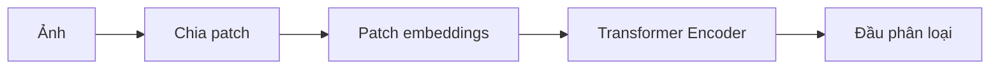

# Bài 09 — Vision Transformer và sự chuyển dịch từ CNN

> **Module 02: Biểu diễn và kiến trúc mô hình**  
> **Phạm vi bài giảng:** 27:06–28:13  
> **Hình thức:** Bài học lý thuyết kết hợp thực hành ngắn

## 1. Tổng quan

Bài học xây dựng nền tảng về **vision transformer và sự chuyển dịch từ cnn** và cách áp dụng tư duy kỹ thuật vào việc thiết kế, đánh giá hoặc vận hành hệ thống AI.

## 2. Mục tiêu học tập

1. So sánh CNN với cách xử lý ảnh của Vision Transformer.
2. Mô tả cách ảnh trở thành chuỗi biểu diễn.
3. Giải thích vì sao cần đo cả độ chính xác lẫn chi phí tính toán.

## 3. Kiến thức trọng tâm

### 3.1. CNN được xây dựng dựa trên tính cục bộ
Convolutional Neural Network (CNN) sử dụng bộ lọc trên vùng ảnh nhỏ. Bộ lọc được chia sẻ ở các vị trí khác nhau để khai thác những đặc điểm địa phương như cạnh, texture rồi kết hợp thành mẫu phức tạp hơn. Các mô hình như ResNet là những cột mốc quan trọng trong phân loại ảnh.

### 3.2. Đưa ảnh vào Transformer
Ý tưởng Vision Transformer (ViT) là chuyển ảnh thành các phần nhỏ (patch), biểu diễn mỗi patch bằng vector và xử lý dãy vector bằng Transformer. Có thể hình dung:

Thông tin vị trí được đưa vào để mô hình phân biệt các patch dù chúng có đặc điểm thị giác tương tự. Self-attention cho phép patch này tương tác với patch khác; khác với phép convolution chủ yếu xây dựng biểu diễn qua kết nối cục bộ từng lớp.

### 3.3. Đánh giá hiệu quả phù hợp phần cứng
Một hướng so sánh hữu ích là số ngày lõi TPU hoặc lượng tính toán cần thiết để đạt cùng độ chính xác, thay vì chỉ so số tham số. Trong kết quả được giới thiệu, ViT đạt trade-off độ chính xác–tính toán hấp dẫn so với một số CNN mạnh ở thời kỳ đó, bao gồm ResNet-152.

Không nên kết luận ViT luôn vượt CNN: kích thước dữ liệu, resolution, tiền huấn luyện, phần cứng và bài toán ảnh ảnh hưởng mạnh đến kết quả.

### 3.4. Attention map và giới hạn diễn giải
Có thể trực quan hóa mô hình chú ý đến các vùng gắn với đối tượng như máy bay khi phân loại. Tuy nhiên, bản đồ attention chỉ cung cấp tín hiệu quan sát, không phải lời giải thích hoàn chỉnh cho quyết định.

Khi đưa vào sản phẩm, cần thử dữ liệu thực, bao gồm ảnh mờ, góc nhìn mới, nhiễu và phân bố khác dữ liệu huấn luyện.

## 4. Bài tập thực hành

Lập thiết kế so sánh CNN và ViT cho phân loại 5 lớp ảnh: giữ cùng tập train/validation/test, chỉ số accuracy, inference latency và VRAM. Giải thích tại sao không được dùng tập test để chọn siêu tham số.

## 5. Câu hỏi ôn tập trắc nghiệm

**Câu 1. Đơn vị đầu vào phổ biến của ViT là gì?**

A. Chuỗi lời thoại đã gán nhãn cảm xúc  
B. Gradient từ TPU pod  
C. Các patch ảnh đã chuyển sang vector  
D. Một ID ảnh duy nhất không có biểu diễn  

**Đáp án: C.** ViT chia ảnh thành patch rồi xây embedding cho từng patch.

**Câu 2. CNN khai thác đặc tính gì qua convolution?**

A. Chỉ truy xuất token từ tài liệu  
B. Hoàn toàn không dùng bộ lọc  
C. Bỏ qua toàn bộ không gian ảnh  
D. Cấu trúc cục bộ và chia sẻ trọng số theo vị trí  

**Đáp án: D.** Convolution áp dụng cùng kernel lên các vùng cục bộ.

**Câu 3. Thông tin vị trí cần thiết với patch embedding vì sao?**

A. Để phân biệt trật tự/vị trí các vùng ảnh  
B. Để cấp thêm GPU  
C. Để thay nhãn bằng ngôn ngữ  
D. Để decoder chỉ sinh token âm thanh  

**Đáp án: A.** Attention đơn thuần cần cơ chế cho biết vị trí các patch.

**Câu 4. Chỉ số nào nên dùng khi đánh giá giải pháp triển khai?**

A. Chỉ số lượng lớp  
B. Accuracy, latency, bộ nhớ và lượng tính toán  
C. Chỉ tên tác giả paper  
D. Chỉ số lượt xem demo  

**Đáp án: B.** Chi phí sản phẩm và khả năng tổng quát là những biến quan trọng.

**Câu 5. Nhận định nào đúng về attention map ảnh?**

A. Luôn chứng minh nhãn đúng  
B. Chỉ có trong CNN không có ViT  
C. Có ích để quan sát nhưng không phải lời giải thích nhân quả đầy đủ  
D. Không thể trực quan hóa  

**Đáp án: C.** Attention map là một dấu hiệu quan sát có giới hạn.

## 6. Tổng kết

- ViT biến ảnh thành chuỗi patch embedding và dùng attention.
- Chọn mô hình dựa vào mục tiêu chất lượng–chi phí, không chỉ xu hướng kiến trúc.
