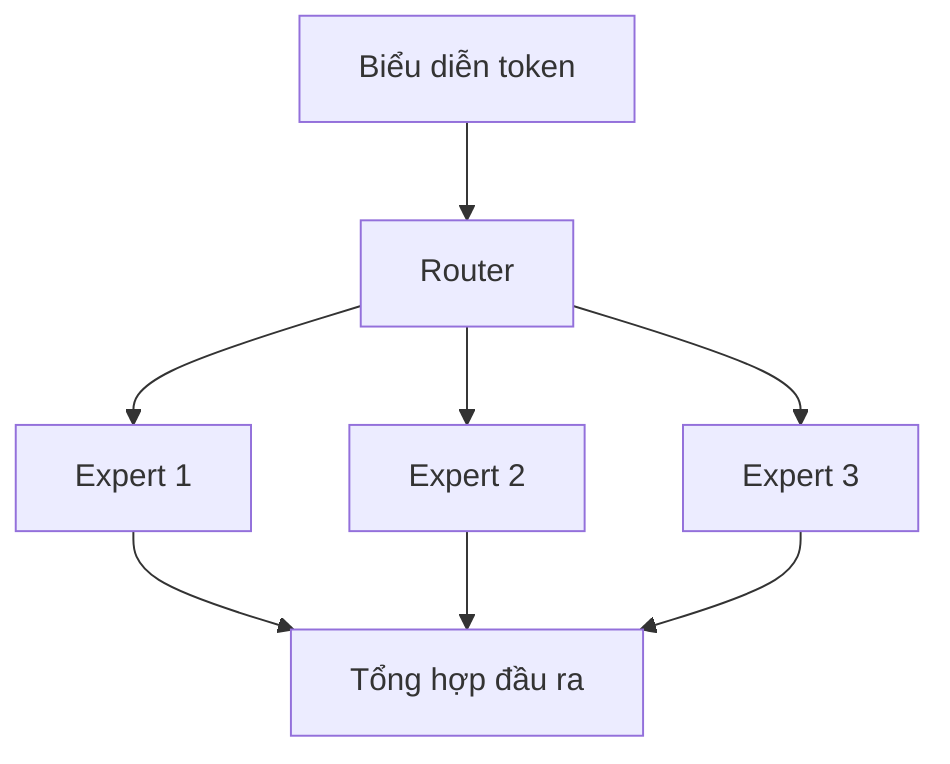

# Bài 10 — Mixture of Experts và mô hình thưa

> **Module 02: Biểu diễn và kiến trúc mô hình**  
> **Phạm vi bài giảng:** 28:13–30:16  
> **Hình thức:** Bài học lý thuyết kết hợp thực hành ngắn

## 1. Tổng quan

Bài học xây dựng nền tảng về **mixture of experts và mô hình thưa** và cách áp dụng tư duy kỹ thuật vào việc thiết kế, đánh giá hoặc vận hành hệ thống AI.

## 2. Mục tiêu học tập

1. Phân biệt mô hình dense và sparse.
2. Giải thích thành phần expert và router.
3. Phân tích lợi ích, giới hạn và hiện tượng lệch tải.

## 3. Kiến thức trọng tâm

### 3.1. Mô hình dense dùng toàn bộ tham số hoạt động
Trong một mạng dense, cùng các lớp tham số chính tham gia vào phần lớn lượt tính toán. Khi số lượng tham số tăng mạnh, chi phí trên mỗi token có thể tăng tương ứng.

### 3.2. Mixture of Experts (MoE)
MoE chia một phần mạng thành nhiều khối con gọi là **experts**. Router học cách chọn một số experts thích hợp cho mỗi token hoặc mẫu. Như vậy mô hình có thể chứa nhiều tham số tổng cộng nhưng **chỉ kích hoạt một phần tại mỗi lượt**.

Sơ đồ hiển thị ba expert tiềm năng; khi vận hành router thường chỉ chọn top-$k$ expert, không nhất thiết kích hoạt cả ba.

### 3.3. Tối ưu theo ràng buộc tính toán
Lợi ích cốt lõi là tăng năng lực biểu diễn trong khi giữ chi phí tính toán hoạt động trên mỗi token ở mức thấp hơn mạng dense cùng tổng tham số. Một số nghiên cứu được giới thiệu ghi nhận hiệu quả train tăng đáng kể, thậm chí ở thang nhiều lần trong thiết lập cụ thể; không thể áp con số này lên mọi MoE.

### 3.4. Bài toán khó trong kỹ thuật hệ thống
- **Load balancing:** mọi token dồn vào một expert làm GPU đó quá tải.
- **Communication:** token có thể phải chuyển đến expert nằm ở chip khác.
- **Capacity:** expert có giới hạn xử lý, cần chính sách quá tải.
- **Quality:** router chọn sai có thể giảm chất lượng dù số tham số tổng lớn.

### 3.5. Chọn dense hay sparse?
Dense có ưu điểm tính toán đều và dễ quản lý hơn; sparse có thể hiệu quả khi quy mô lớn nhưng yêu cầu router và giao tiếp tốt. Cần đo latency thực, chất lượng và mức dùng thiết bị để quyết định.

## 4. Bài tập thực hành

Giả sử 4 expert nhận lần lượt `[80, 5, 10, 5]` token. Tính tỉ lệ tải mỗi expert, đề xuất 2 cách giảm nghẽn router và 1 chỉ số giám sát. Không cần train mô hình thật.

## 5. Câu hỏi ôn tập trắc nghiệm

**Câu 1. Trong MoE, thành phần nào quyết định expert được kích hoạt?**

A. Tokenizer đơn thuần  
B. Bộ giải mã ảnh  
C. Hệ thống gán nhãn người dùng  
D. Router  

**Đáp án: D.** Router học ánh xạ token hoặc mẫu sang expert.

**Câu 2. Điểm khác giữa tổng tham số và tham số hoạt động là gì?**

A. MoE có thể có tổng rất lớn nhưng mỗi token chỉ dùng một phần  
B. Hai đại lượng luôn giống hệt nhau  
C. Tham số hoạt động là số máy chủ  
D. Tổng tham số là số token đầu vào  

**Đáp án: A.** Sparse activation cho phép chỉ chạy một số experts.

**Câu 3. Trường hợp nào cho thấy router bị lệch tải?**

A. Token được chia cân bằng trên các expert  
B. 80% token dồn vào một expert  
C. Mỗi expert có cùng mức bận  
D. Mô hình dùng batching hiệu quả  

**Đáp án: B.** Độ lệch tải lớn tạo ra nút thắt phần cứng.

**Câu 4. Chi phí nào có thể tăng trong MoE phân tán?**

A. Số lượng nhãn trên mỗi ảnh  
B. Số ký tự trong tên mô hình  
C. Trao đổi token giữa thiết bị và expert  
D. Bản quyền thư viện Python  

**Đáp án: C.** Các expert phân bố trên chip gây overhead giao tiếp.

**Câu 5. Khi nào không nên kết luận MoE vượt dense?**

A. Khi đã so sánh trên dữ liệu độc lập  
B. Khi router tải cân bằng  
C. Khi có dữ liệu thực tế của workload  
D. Khi chưa đo cùng chất lượng, độ trễ và ngân sách  

**Đáp án: D.** Không có mô hình nào luôn thắng trong mọi môi trường.

## 6. Tổng kết

- MoE khác mô hình dense ở số tham số hoạt động mỗi lượt.
- Hiệu quả thưa phụ thuộc chất lượng router và giao tiếp giữa thiết bị.
