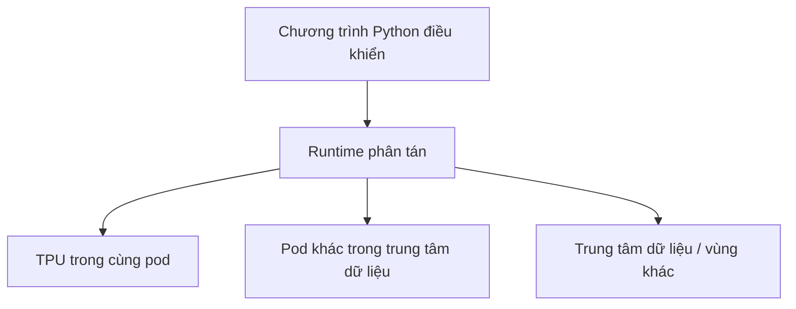

# Bài 13 — Pathways và lớp trừu tượng máy tính phân tán

> **Module 03: Hạ tầng AI quy mô lớn**  
> **Phạm vi bài giảng:** 30:16–32:03  
> **Hình thức:** Bài học lý thuyết kết hợp thực hành ngắn

## 1. Tổng quan

Bài học xây dựng nền tảng về **pathways và lớp trừu tượng máy tính phân tán** và cách áp dụng tư duy kỹ thuật vào việc thiết kế, đánh giá hoặc vận hành hệ thống AI.

## 2. Mục tiêu học tập

1. Giải thích vì sao runtime phải che giấu phức tạp hạ tầng.
2. Mô tả các cấp mạng giao tiếp và phạm vi lỗi.
3. Phân tích lợi ích điều phối từ một chương trình điều khiển.

## 3. Kiến thức trọng tâm

### 3.1. Bài toán hàng nghìn accelerator
Nhà nghiên cứu muốn nói: “Chạy phép tính này trên một mô hình lớn”, chứ không muốn tự định tuyến mọi tensor qua hàng nghìn chip, phân bố ở nhiều rack hoặc trung tâm dữ liệu.

**Pathways** là một lớp trừu tượng hệ thống hướng tới trải nghiệm tương tự sử dụng một máy tính rất lớn, trong khi bên dưới là nhiều accelerator và loại kết nối khác nhau.

### 3.2. Hai lớp trách nhiệm
- **Lớp thuật toán:** xây dựng mô hình, loss, các phép toán và cách phân phối tensor ở mức logic.
- **Lớp runtime:** lập lịch, truyền dữ liệu, điều phối tài nguyên, phát hiện sự cố và bố trí lại phần cứng khi phù hợp.

Cùng một phép tính logic có thể dùng interconnect TPU, mạng trung tâm dữ liệu hoặc kết nối diện rộng tùy các thiết bị nằm ở đâu.

### 3.3. Vì sao phải hiểu topology?
Mọi luồng truyền dữ liệu không có chi phí như nhau. Truyền một tensor giữa hai chip gần nhau có độ trễ và băng thông khác truyền qua trung tâm dữ liệu khác. Các hoạt động đồng bộ lặp đi lặp lại có thể khiến mạng trở thành nút thắt.

### 3.4. Khả năng chịu lỗi không tự nhiên có sẵn
Một runtime đáng tin phải tính toán có thể tiếp tục khi chip, cáp, card mạng hoặc rack hỏng. Tuy nhiên, thay thiết bị không đồng nghĩa tự động giữ nguyên tính chính xác; cần checkpoint, phát lại hoặc xác minh trạng thái học.

**Điểm dễ nhầm:** “một tiến trình Python điều khiển” không có nghĩa toàn bộ phép toán diễn ra trên một CPU. Đó là một điểm điều phối; tính toán thật nằm trên các accelerator phân tán.

## 4. Bài tập thực hành

Thiết kế sơ đồ cho 3 pod ở hai trung tâm dữ liệu. Liệt kê những luồng dữ liệu cần băng thông cao, tình huống lỗi ở cấp chip và cấp mạng, và hai câu hỏi cần hỏi nhóm hạ tầng trước khi mở rộng mô hình.

## 5. Câu hỏi ôn tập trắc nghiệm

**Câu 1. Pathways cố gắng trừu tượng hóa điều gì?**

A. Nhãn ImageNet thành văn bản  
B. Mọi câu trả lời trở thành âm thanh  
C. Nhiều accelerator và kết nối thành môi trường tính toán thống nhất  
D. Transformer thành mạng CNN  

**Đáp án: C.** Mục tiêu là ẩn độ phức tạp của hạ tầng phân tán khỏi luồng công việc.

**Câu 2. Vì sao topology ảnh hưởng training?**

A. Tên chip càng dài mạng càng nhanh  
B. Mọi kết nối có cùng độ trễ  
C. Topology chỉ liên quan thiết kế UI  
D. Chi phí truyền tensor phụ thuộc khoảng cách và loại kết nối  

**Đáp án: D.** Mạng khác nhau có băng thông, độ trễ và độ ổn định khác nhau.

**Câu 3. Một tiến trình Python điều khiển có nghĩa gì?**

A. Có thể điều phối nhiều thiết bị tính toán từ một điểm  
B. Tất cả gradient tính trên CPU của tiến trình đó  
C. Không cần accelerator  
D. Mạng không phải truyền dữ liệu  

**Đáp án: A.** Control plane tách biệt nơi thực thi tính toán.

**Câu 4. Vì sao thiết bị hỏng cần được xem xét sớm?**

A. Vì code luôn có cú pháp sai  
B. Xác suất lỗi tăng khi số thiết bị và thời gian chạy tăng  
C. Vì mô hình nhỏ luôn hỏng  
D. Vì các phép tính không dùng bộ nhớ  

**Đáp án: B.** Hệ thống lớn cần phát hiện, thay thế và phục hồi trạng thái.

**Câu 5. Bài toán nào do lớp runtime chịu trách nhiệm nhiều nhất?**

A. Chọn nhãn chính xác cho câu hỏi khảo sát  
B. Viết mục tiêu nghiên cứu  
C. Định tuyến trao đổi tensor và phân bố công việc  
D. Định nghĩa tiêu chí đạo đức của sản phẩm  

**Đáp án: C.** Runtime phụ trách quản trị hạ tầng thực thi phân tán.

## 6. Tổng kết

- Runtime cho phép nhà nghiên cứu tập trung vào phép tính logic.
- Topology và chịu lỗi quyết định hiệu quả thực tế khi scale.
