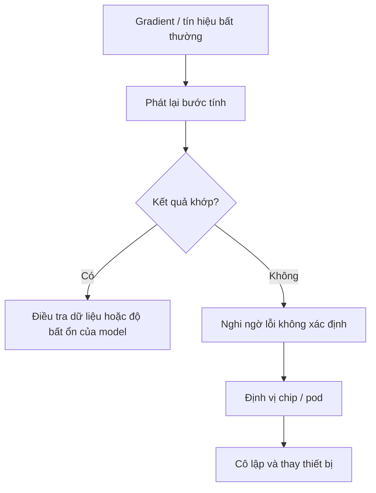

# Bài 14 — Silent Data Corruption và phục hồi huấn luyện

> **Module 03: Hạ tầng AI quy mô lớn**  
> **Phạm vi bài giảng:** 32:03–36:16  
> **Hình thức:** Bài học lý thuyết kết hợp thực hành ngắn

## 1. Tổng quan

Bài học xây dựng nền tảng về **silent data corruption và phục hồi huấn luyện** và cách áp dụng tư duy kỹ thuật vào việc thiết kế, đánh giá hoặc vận hành hệ thống AI.

## 2. Mục tiêu học tập

1. Phân biệt lỗi hỏng rõ ràng với kết quả sai âm thầm.
2. Giải thích gradient spike và deterministic replay.
3. Xây dựng quy trình giám sát, cô lập và thay thiết bị lỗi.

## 3. Kiến thức trọng tâm

### 3.1. Không phải lỗi phần cứng nào cũng làm chương trình dừng
Ở quy mô lớn, chip, card mạng hay bộ nhớ đôi khi phát sinh **silent data corruption (SDC)**: kết quả số bị sai mà không có thông báo lỗi. Một bit hỏng ở vùng số mũ của số thực có thể khiến gradient thay đổi theo cấp số mũ, làm ảnh hưởng cả quá trình tối ưu.

### 3.2. Phát hiện qua tín hiệu sức khỏe mô hình
Một thước đo hữu ích là **chuẩn gradient** theo lớp hoặc bước. Đỉnh bất thường có thể cảnh báo sự cố, nhưng không phải đỉnh nào cũng do phần cứng: minibatch khó, nhiễu dữ liệu hoặc instability của training cũng có thể gây gradient spike.

Ngược lại, SDC nhỏ có thể không tạo đỉnh rõ rệt. Vì vậy detector dựa ngưỡng duy nhất không đủ.

### 3.3. Deterministic replay
Khi gặp bất thường, hệ thống có thể phát lại cùng bước huấn luyện với trạng thái, dữ liệu và ngẫu nhiên đã kiểm soát:

Kết quả khác nhau là bằng chứng điều tra SDC **khi đã kiểm soát nguồn ngẫu nhiên và tính quyết định**; không thể coi mọi khác biệt là lỗi phần cứng vì nhiều kernel số có thể không hoàn toàn deterministic.

### 3.4. Hot spare và kiểm thử trước khi nhận việc
Hệ thống có thể chạy bài kiểm tra trên tài nguyên nhàn rỗi, giữ các phần cứng dự phòng nóng và chuyển workload khỏi pod bị nghi có lỗi. Cần kiểm chứng lại checkpoint và trạng thái training trước khi tiếp tục.

### 3.5. Chỉ số nên theo dõi
- Gradient norm, NaN/Inf và loss theo bước.
- Tần suất replay lệch, thiết bị/pod liên quan.
- Số lần khôi phục và thời gian gián đoạn.
- Tính nhất quán sau phục hồi và chất lượng checkpoint.

**Lưu ý:** training hoàn thành mà không crash không đồng nghĩa mô hình được huấn luyện hoàn toàn chính xác.

## 4. Bài tập thực hành

Viết checklist xử lý khi `loss` đột nhiên nhảy từ 2.3 lên `NaN`: lưu minibatch, random seed, checkpoint, gradient norm, replay trên cùng và khác thiết bị, rồi quyết định tiếp tục hay khôi phục. Không xóa log lỗi trước khi có nguyên nhân.

## 5. Câu hỏi ôn tập trắc nghiệm

**Câu 1. SDC khác lỗi crash ở điểm nào?**

A. Luôn gây tắt nguồn máy  
B. Chỉ xảy ra trong ứng dụng web  
C. Không liên quan phép tính số  
D. Có thể tạo kết quả tính toán sai nhưng chương trình vẫn chạy  

**Đáp án: D.** SDC là sai lệch kết quả không bị phát hiện tức thì.

**Câu 2. Một gradient spike có chứng minh SDC không?**

A. Không, nó còn có thể do dữ liệu hoặc bất ổn số  
B. Có, mọi spike đều là lỗi chip  
C. Có, nếu chạy trên GPU  
D. Không bao giờ liên quan phần cứng  

**Đáp án: A.** Tín hiệu bất thường chỉ là căn cứ điều tra.

**Câu 3. Deterministic replay giúp kiểm tra gì?**

A. GPU có bao nhiêu cổng HDMI  
B. Kết quả có tái lập với cùng trạng thái và đầu vào không  
C. Có thể tăng độ phân giải ảnh không  
D. Token đầu vào dài bao nhiêu  

**Đáp án: B.** Tái lập xác định giúp phân biệt một phần lỗi ngẫu nhiên với vấn đề dữ liệu.

**Câu 4. Vai trò của hot spare là gì?**

A. Sinh thêm nhãn huấn luyện  
B. Chuyển masked token thành next-token  
C. Sẵn sàng thay tài nguyên gặp sự cố  
D. Làm model không cần checkpoint  

**Đáp án: C.** Tài nguyên dự phòng giảm gián đoạn khi phải loại chip/pod lỗi.

**Câu 5. Vì sao còn cần checkpoint khi đã có detector SDC?**

A. Vì detector tự lưu mọi mô hình vĩnh viễn  
B. Vì checkpoint tự sửa dữ liệu đầu vào  
C. Vì nó làm loss luôn giảm  
D. Để có trạng thái đáng tin phục hồi nếu quá trình học bị ảnh hưởng  

**Đáp án: D.** Checkpoint là điểm quay lại sau phát hiện lỗi và khôi phục.

## 6. Tổng kết

- SDC nguy hiểm vì dữ liệu sai có thể lan truyền mà không có exception.
- Replay, telemetry và thay thiết bị bổ trợ nhau trong hệ thống đáng tin.
