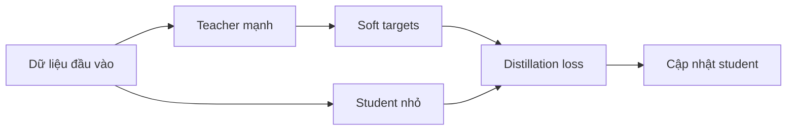

# Bài 16 — Knowledge Distillation: từ teacher sang student

> **Module 04: Tối ưu huấn luyện và suy luận**  
> **Phạm vi bài giảng:** 38:15–40:48  
> **Hình thức:** Bài học lý thuyết kết hợp thực hành ngắn

## 1. Tổng quan

Bài học xây dựng nền tảng về **knowledge distillation: từ teacher sang student** và cách áp dụng tư duy kỹ thuật vào việc thiết kế, đánh giá hoặc vận hành hệ thống AI.

## 2. Mục tiêu học tập

1. Phân biệt hard targets và soft targets.
2. Mô tả quy trình chuyển tri thức từ teacher sang student.
3. Phân tích cách cân bằng chất lượng, chi phí và dữ liệu.

## 3. Kiến thức trọng tâm

### 3.1. Một mô hình lớn có thể dạy mô hình nhỏ
**Knowledge distillation** dùng dự đoán của mô hình **teacher** mạnh hơn làm tín hiệu huấn luyện cho mô hình **student** gọn hơn. Đích đến thường là suy luận nhanh hoặc rẻ hơn trong khi giữ lại phần lớn chất lượng hữu ích.

### 3.2. Vì sao soft targets giàu thông tin?
Nếu câu cần hoàn thành là `The musician played a ...`, nhãn cứng có thể chỉ là `violin`. Nhưng teacher có thể phân phối xác suất lớn cho `violin`, `piano`, `trumpet` và rất thấp cho `airplane`. Các xác suất phản ánh sự liên quan giữa ứng viên, giàu thông tin hơn nhãn một-hot đơn lẻ.

Thông thường người ta dùng phân phối đã điều chỉnh nhiệt độ $T$, ký hiệu $p_T$ và $q_T$ lần lượt cho teacher và student. Một thành phần loss phổ biến là:

$$L_{KD}=T^2D_{KL}(p_T\Vert q_T).$$

Đây là **một cách triển khai điển hình để minh họa nguyên lý**, không phải công thức duy nhất hay công thức được trình bày đầy đủ ở mọi hệ thống.

### 3.3. Quy trình huấn luyện

Ta thường đóng băng teacher, chạy student trên dữ liệu tương ứng rồi tối ưu sao cho phân phối student gần teacher. Có thể kết hợp thêm loss từ nhãn thật, nếu có.

### 3.4. Ví dụ hiệu quả dữ liệu
Trong thí nghiệm nhận dạng giọng nói lịch sử được nêu, baseline huấn luyện với toàn bộ dữ liệu có accuracy khung kiểm thử khoảng **58,9%**; khi chỉ dùng **3% dữ liệu** theo cách thường, độ chính xác test giảm xuống khoảng **44,5%**. Distillation với soft targets giúp phục hồi đáng kể chất lượng dù dùng ít dữ liệu hơn.

Không suy luận rằng có thể luôn giảm dữ liệu xuống 3% cho mọi tác vụ. Hiệu quả phụ thuộc teacher, bộ dữ liệu và cách huấn luyện.

### 3.5. Ứng dụng trong phân tầng mô hình
Một họ mô hình có thể cung cấp phiên bản chất lượng cao cho tác vụ khó, đồng thời phát triển bản nhẹ hơn cho phần lớn lưu lượng. Quá trình chuyển năng lực từ bản lớn sang bản gọn là một chiến lược quan trọng; cần benchmark riêng sau khi distill.

## 4. Bài tập thực hành

Thiết kế distillation cho bộ phân loại cảm xúc gồm 7 lớp: ghi dữ liệu, teacher, student, phương pháp tạo logits, tiêu chí đo độ chính xác và latency. Đề xuất 2 thí nghiệm ablation để tách lợi ích soft targets khỏi lợi ích tăng dữ liệu.

## 5. Câu hỏi ôn tập trắc nghiệm

**Câu 1. Soft targets khác hard labels ở điểm nào?**

A. Chỉ chứa một nhãn đúng duy nhất  
B. Cho biết phân phối xác suất trên nhiều lớp hoặc token  
C. Không cần teacher  
D. Là phần cứng thay thế GPU  

**Đáp án: B.** Phân phối teacher truyền thêm thông tin so với nhãn một-hot.

**Câu 2. Mục tiêu thường gặp của distillation là gì?**

A. Làm teacher lớn hơn sau mỗi token  
B. Bỏ hoàn toàn đánh giá dữ liệu  
C. Tạo student nhỏ/rẻ giữ phần lớn năng lực của teacher  
D. Biến model thành trình biên dịch  

**Đáp án: C.** Distillation chuyển hành vi của teacher sang mô hình phù hợp triển khai.

**Câu 3. Vì sao phải kiểm thử student sau khi distill?**

A. Vì student chắc chắn tốt hơn teacher  
B. Vì distillation luôn làm lệch nhãn  
C. Vì mọi student đều không thể suy luận  
D. Vì student có thể không giữ hết năng lực và có trade-off mới  

**Đáp án: D.** Cần kiểm chứng trên tác vụ đích và điều kiện triển khai.

**Câu 4. Kết quả dùng 3% dữ liệu trong thí nghiệm nên hiểu thế nào?**

A. Minh họa khả năng tận dụng soft targets trong một thiết lập cụ thể  
B. Là quy luật mọi bài toán chỉ cần 3% dữ liệu  
C. Đảm bảo cùng accuracy trong mọi lĩnh vực  
D. Chứng minh không bao giờ cần thêm dữ liệu  

**Đáp án: A.** Kết quả thực nghiệm bị ràng buộc bởi teacher, data và task.

**Câu 5. Trong sơ đồ distillation cơ bản, thành phần nào nhận gradient cập nhật?**

A. Bộ dữ liệu test  
B. Student  
C. Phần cứng TPU  
D. Nhãn gốc luôn cố định  

**Đáp án: B.** Thường teacher cung cấp mục tiêu, student được tối ưu để bắt chước.

## 6. Tổng kết

- Soft targets chứa thông tin quan hệ giữa các khả năng dự đoán.
- Student nhỏ cần được kiểm tra chất lượng và hiệu suất độc lập sau distillation.
