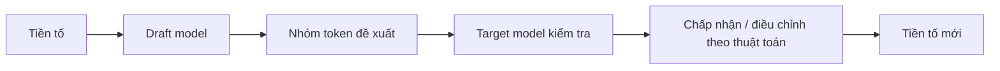

# Bài 18 — Speculative Decoding: tăng tốc sinh token

> **Module 04: Tối ưu huấn luyện và suy luận**  
> **Phạm vi bài giảng:** 43:55–47:12  
> **Hình thức:** Bài học lý thuyết kết hợp thực hành ngắn

## 1. Tổng quan

Bài học xây dựng nền tảng về **speculative decoding: tăng tốc sinh token** và cách áp dụng tư duy kỹ thuật vào việc thiết kế, đánh giá hoặc vận hành hệ thống AI.

## 2. Mục tiêu học tập

1. Mô tả draft model và target model.
2. Giải thích lý do giải mã tự hồi quy có thể memory-bound.
3. Phân biệt kiểm tra token gần đúng với thuật toán bảo toàn phân phối.

## 3. Kiến thức trọng tâm

### 3.1. Tại sao sinh token tuần tự trở thành nút thắt?
Với mô hình tự hồi quy, để sinh token $t+1$ cần biết kết quả token $t$. Khi mỗi bước phải đọc nhiều trọng số từ bộ nhớ, tốc độ sinh có thể bị giới hạn bởi **băng thông bộ nhớ** chứ không chỉ số FLOPs. Đây là vấn đề khi mô hình lớn tạo từng token riêng lẻ.

### 3.2. Ý tưởng mô hình phác thảo
Dùng một **draft model** nhỏ để dự đoán nhanh một nhóm token ứng viên, chẳng hạn 4–8 token. **Target model** lớn chạy bước đánh giá các ứng viên theo dạng có thể song song hóa tốt hơn, sau đó chấp nhận phần hợp lệ và tiếp tục sinh.

Trong ví dụ thuyết trình, nếu draft đề xuất tám token và nhiều token đầu tiên được target đồng ý, hệ thống có thể tiến xa hơn một token trong mỗi vòng đánh giá mô hình lớn.

### 3.3. “Cùng phân phối đầu ra” nghĩa là gì?
Một **thuật toán speculative decoding chính xác**, với bước chấp nhận và lấy mẫu bổ sung được thiết kế đúng, có thể giữ phân phối sinh của target model. Đây là thuộc tính thuật toán; không đúng nếu đơn giản lấy chuỗi draft rồi giữ những token có xác suất cao một cách tùy tiện.

### 3.4. Điều kiện tốc độ tăng thực sự
- Draft phải đủ nhanh so với target.
- Tỷ lệ chấp nhận phải đủ cao.
- Batch kiểm tra phải tận dụng phần cứng.
- Overhead điều phối và bộ nhớ KV-cache không xóa lợi ích.

Token dễ dự đoán có xác suất được chấp nhận cao hơn, còn đoạn đòi hỏi kiến thức hoặc tính toán khó có thể khiến quá trình phác thảo ít hiệu quả.

### 3.5. Đánh giá
Đo **tokens/second**, latency token đầu tiên, latency cuối, tỷ lệ chấp nhận và chất lượng/đặc tính phân phối. Tránh báo cáo duy nhất “tăng gấp X lần” mà không mô tả workload và thuật toán sampling.

## 4. Bài tập thực hành

Tạo bảng giả lập ba cấu hình: draft 2, 4 và 8 token; ghi thời gian draft, thời gian target, số token chấp nhận. Tính số token thu được trên một đơn vị thời gian và chọn cấu hình phù hợp. Đây là bài toán phân tích hiệu năng, chưa phải cài đặt thuật toán sampling chính xác.

## 5. Câu hỏi ôn tập trắc nghiệm

**Câu 1. Trong speculative decoding, vai trò draft model là gì?**

A. Huấn luyện lại toàn bộ target  
B. Thay thế nguồn dữ liệu học  
C. Vẽ sơ đồ TPU  
D. Dự đoán nhanh nhóm token ứng viên  

**Đáp án: D.** Draft model sinh token rẻ hơn để giảm số lượt gọi target tuần tự.

**Câu 2. Vì sao target có thể xử lý nhóm token hiệu quả?**

A. Có thể đánh giá nhiều vị trí song song hơn từng bước giải mã  
B. Vì nó không dùng trọng số  
C. Vì nó không cần attention  
D. Vì token không liên quan nhau  

**Đáp án: A.** Batch verification tận dụng phần cứng nhiều hơn mỗi lượt đọc trọng số.

**Câu 3. Điều gì khiến speculative decoding không tăng tốc?**

A. Draft rất nhanh và chấp nhận cao  
B. Draft chậm hoặc tỷ lệ chấp nhận thấp  
C. Overhead điều phối gần bằng không  
D. Phần cứng tận dụng tốt  

**Đáp án: B.** Tốc độ tổng phụ thuộc chi phí draft, target và tỷ lệ chấp nhận.

**Câu 4. Khi nào có thể nói phân phối đầu ra target được giữ nguyên?**

A. Khi giữ mọi token draft vô điều kiện  
B. Khi chỉ lấy top-1 của draft  
C. Khi dùng acceptance và sampling correction đúng thuật toán  
D. Khi bỏ qua target model  

**Đáp án: C.** Bảo toàn phân phối không tự động đến từ mọi cách xác minh xấp xỉ.

**Câu 5. Một metric hiệu năng cần đo là gì?**

A. Chỉ chiều dài tên mô hình  
B. Chỉ tổng số nhãn dataset  
C. Chỉ số chữ trong câu trả lời  
D. Tokens per second đi kèm workload và tỷ lệ chấp nhận  

**Đáp án: D.** Throughput kết hợp quality và latency mới phản ánh tăng tốc thực tế.

## 6. Tổng kết

- Draft model đề xuất nhanh; target model kiểm tra để tận dụng song song.
- Bảo toàn phân phối đòi hỏi thuật toán acceptance/sampling được thiết kế đúng.
