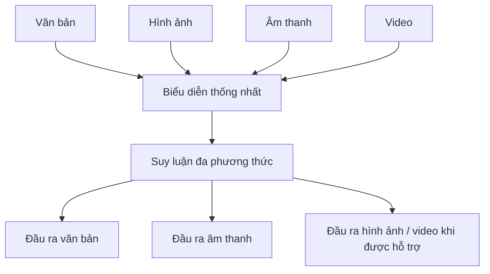

# Bài 19 — Gemini: mô hình đa phương thức thống nhất

> **Module 05: Gemini và ứng dụng đa phương thức**  
> **Phạm vi bài giảng:** 47:12–50:10  
> **Hình thức:** Bài học lý thuyết kết hợp thực hành ngắn

## 1. Tổng quan

Bài học xây dựng nền tảng về **gemini: mô hình đa phương thức thống nhất** và cách áp dụng tư duy kỹ thuật vào việc thiết kế, đánh giá hoặc vận hành hệ thống AI.

## 2. Mục tiêu học tập

1. Giải thích mục tiêu multimodal from the start.
2. Phân biệt encoder, decoder và chuỗi dữ liệu xen kẽ nhiều phương thức.
3. Vẽ được pipeline xử lý văn bản, hình ảnh, âm thanh, video.

## 3. Kiến thức trọng tâm

### 3.1. Từ các nhóm nghiên cứu rời rạc đến một mô hình thống nhất
Thay vì nghiên cứu các mô hình ngôn ngữ, hình ảnh và âm thanh hoàn toàn tách biệt, một hướng phát triển là tổ chức nỗ lực chung để xây **mô hình đa phương thức** ngay từ thiết kế đầu tiên.

Gemini được mô tả như một nỗ lực hợp tác nhiều nhóm tại Google và DeepMind, khởi đầu vào **tháng 2/2023**, hướng tới việc học trên nhiều kiểu dữ liệu và dùng rộng rãi ở các sản phẩm.

### 3.2. Các phương thức dữ liệu
- **Text:** câu hỏi, tài liệu, mã lập trình.
- **Image:** ảnh, sơ đồ, biểu đồ.
- **Audio:** giọng nói và tín hiệu âm thanh.
- **Video:** chuỗi khung hình và diễn biến theo thời gian.
- **Các kiểu đặc thù khác:** ví dụ mô tả cảm biến/điều khiển robot hoặc dữ liệu LiDAR trong một số nghiên cứu.

Một chuỗi đầu vào có thể xen kẽ: câu hỏi → ảnh minh họa → âm thanh → video. Mục tiêu không chỉ nhận dạng từng phần mà còn **liên hệ thông tin xuyên phương thức**.

### 3.3. Encoder và decoder đa phương thức

Khả năng sinh modality nào phụ thuộc thiết kế và phiên bản mô hình. “Đa phương thức” không có nghĩa mọi bản triển khai tự động nhận và xuất được tất cả modality.

### 3.4. Một model lớn là kết quả của nhiều tầng đổi mới
Các thành phần đóng góp được liệt kê gồm TPU, data/model parallelism, framework JAX, Pathways, Transformer, sparse/MoE, distillation, post-training bằng SFT/RL, suy luận nhiều bước và speculative decoding. Đây là kiến trúc **hệ thống nhiều tầng** thay vì một mẹo prompt.

### 3.5. Bài toán kiểm thử thực tế
Một hệ thống hiểu video học tập cần kiểm tra nhận diện lời nói, tương ứng giữa frame và lời nói, mốc thời gian, và việc kết luận có trùng khớp nguồn hay không. Nhiều modality cũng tạo thêm rủi ro đồng bộ dữ liệu và quyền riêng tư.

## 4. Bài tập thực hành

Thiết kế hệ thống hỏi đáp về một video hướng dẫn 3D: nguồn gồm âm thanh và khung hình. Vẽ pipeline trích xuất dữ liệu, tạo ngữ cảnh, hỏi đáp và trích mốc thời gian. Liệt kê 3 lỗi có thể xảy ra nếu âm thanh và hình ảnh không khớp.

## 5. Câu hỏi ôn tập trắc nghiệm

**Câu 1. Điểm đặc trưng của multimodal from the start là gì?**

A. Thiết kế học và liên hệ nhiều phương thức từ giai đoạn xây dựng  
B. Chỉ cho model một tập văn bản duy nhất  
C. Đổi tên tokenizer thành video  
D. Không cần dữ liệu huấn luyện  

**Đáp án: A.** Thiết kế mô hình phải tính đến modality và quan hệ xuyên modality.

**Câu 2. Phương thức nào liên quan trực tiếp đến chuỗi khung hình theo thời gian?**

A. Một token đơn lẻ  
B. Video  
C. Vector gradient  
D. Checkpoint  

**Đáp án: B.** Video có cả nội dung không gian và diễn biến theo thời gian.

**Câu 3. Một pipeline hỏi đáp video tốt cần gì?**

A. Chỉ đếm pixel trong ảnh đầu  
B. Bỏ qua toàn bộ lời nói  
C. Đồng bộ ngữ cảnh hình–tiếng và kiểm tra chứng cứ  
D. Chỉ dùng tên file làm câu trả lời  

**Đáp án: C.** Lập luận xuyên phương thức phụ thuộc dữ liệu được căn chỉnh.

**Câu 4. Có thể kết luận mọi model multimodal đều xuất video không?**

A. Có, nếu nhận được ảnh  
B. Có, vì có nhiều GPU  
C. Có, nếu prompt đủ dài  
D. Không, chức năng xuất phụ thuộc kiến trúc và phiên bản  

**Đáp án: D.** Khả năng nhận input khác với khả năng tạo output.

**Câu 5. Hạ tầng nào là một phần stack được trình bày?**

A. TPU, Pathways và JAX  
B. Chỉ một web form  
C. Chỉ thư viện CSS  
D. Chỉ bộ gõ tiếng Việt  

**Đáp án: A.** Hạ tầng tính toán, runtime và framework cùng hỗ trợ phát triển.

## 6. Tổng kết

- Mô hình đa phương thức thống nhất xử lý và liên kết nhiều kiểu dữ liệu.
- Năng lực hệ thống đến từ sự kết hợp kiến trúc, huấn luyện, hạ tầng và serving.
