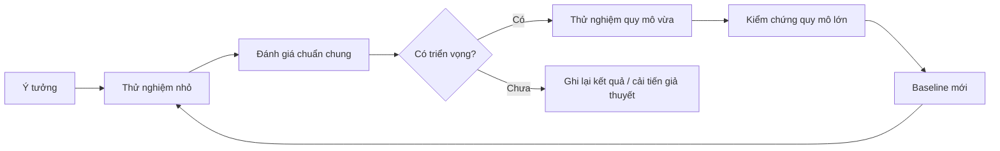

# Bài 23 — Tổ chức nghiên cứu và phát triển mô hình quy mô lớn

> **Module 06: Hệ thống agent và tương lai AI**  
> **Phạm vi bài giảng:** 61:28–65:30  
> **Hình thức:** Bài học lý thuyết kết hợp thực hành ngắn

## 1. Tổng quan

Bài học xây dựng nền tảng về **tổ chức nghiên cứu và phát triển mô hình quy mô lớn** và cách áp dụng tư duy kỹ thuật vào việc thiết kế, đánh giá hoặc vận hành hệ thống AI.

## 2. Mục tiêu học tập

1. Nhận diện các mảng công việc trong chương trình phát triển mô hình lớn.
2. Mô tả luồng idea → small experiment → shared evaluation → baseline.
3. Thiết kế tài liệu đánh giá nội bộ ngắn có thể tái lập.

## 3. Kiến thức trọng tâm

### 3.1. Một mô hình lớn không phải công trình của một người
Dự án phát triển mô hình quy mô cao phải phối hợp các nhóm: kiến trúc/huấn luyện, dữ liệu, hạ tầng training và serving, an toàn, âm thanh, hình ảnh, code, agent, quốc tế hóa, mô hình chạy thiết bị và nghiên cứu dài hạn. Đồng thời cần product/program management để duy trì ưu tiên và kết nối các nhóm.

### 3.2. Cấu trúc nghiên cứu có hai nhịp
**Nhịp ngắn hạn** tập trung đưa các cải tiến đã có bằng chứng vào mô hình kế tiếp. **Nhịp dài hạn** khám phá ý tưởng mới có thể chưa phù hợp đưa vào sản phẩm ngay, nhưng có tiềm năng cho nhiều thế hệ sau.

### 3.3. Làm việc đa múi giờ
Với thành viên ở nhiều châu lục, không thể dựa hoàn toàn vào họp trực tiếp. Các tài liệu ngắn, **request for comments**, nhật ký thí nghiệm và bảng đánh giá dùng chung giúp nhóm trao đổi bất đồng bộ.

Trong tổ chức nghiên cứu được mô tả, có **hàng nghìn** tài liệu đề xuất/phản hồi nội bộ, từ ý tưởng sơ khai đến báo cáo phân tích nhiều thí nghiệm. Số lượng lớn chỉ có ích khi tài liệu có cấu trúc và tìm lại được.

### 3.4. Một RFC kỹ thuật tối thiểu
- Vấn đề và giả thuyết cụ thể.
- Baseline, dữ liệu, seed và cấu hình huấn luyện.
- Chỉ số chính, ngân sách compute và điều kiện so sánh.
- Kết quả, biểu đồ và phân tích sai lệch.
- Rủi ro và quyết định bước tiếp.

### 3.5. Tránh hiệu ứng “chỉ thấy kết quả đẹp”
Không nên chỉ báo cáo cấu hình thắng. Những thử nghiệm âm tính, lỗi đo, regression trên các khả năng khác và thất bại ở quy mô lớn là tri thức giúp tổ chức tránh lặp lại sai lầm.

**Thông điệp quản trị:** tốc độ phát triển mạnh thường đến từ vòng lặp thực nghiệm đáng tin hơn là một lần cược lớn.

## 4. Bài tập thực hành

Viết RFC một trang đề xuất cải tiến phân loại ảnh hoặc chatbot: mục tiêu, baseline, 3 cấu hình thử, cách đánh giá, quyết định go/no-go. Sau đó tạo một mẫu experiment log gồm `commit`, `dataset_version`, `seed`, `result` và `notes`.

## 5. Câu hỏi ôn tập trắc nghiệm

**Câu 1. Tại sao dự án mô hình lớn cần nhiều nhóm chuyên môn?**

A. Vì dữ liệu, training, serving, an toàn và sản phẩm đều tác động kết quả  
B. Vì chỉ một nhóm được dùng Python  
C. Vì AI không cần hạ tầng  
D. Vì mô hình luôn có một tác giả  

**Đáp án: A.** Mô hình sản phẩm là kết quả của nhiều lĩnh vực phối hợp.

**Câu 2. Ý tưởng mới nên đi qua bước nào trước khi scale?**

A. Train lớn trực tiếp mà không đo  
B. Thử nhỏ và đánh giá chuẩn có baseline  
C. Phát hành ngay không kiểm thử  
D. Chỉ lấy ý kiến người viết đề xuất  

**Đáp án: B.** Thực nghiệm nhỏ giảm chi phí thất bại và kiểm chứng giả thuyết.

**Câu 3. RFC nội bộ hữu ích nhất ở điểm nào?**

A. Thay thế hoàn toàn mọi kiểm thử  
B. Dùng để bỏ lịch sử thất bại  
C. Ghi giả thuyết, bằng chứng và nhận phản hồi bất đồng bộ  
D. Chỉ để đếm số trang  

**Đáp án: C.** Tài liệu có cấu trúc cho phép đánh giá và tiếp nối nghiên cứu.

**Câu 4. Vì sao cần chung một bộ đánh giá cho nhiều nhóm?**

A. Để mọi người làm cùng một thí nghiệm vô hạn  
B. Để tất cả mã có cùng tên biến  
C. Để đo tốc độ gõ bàn phím  
D. Để so sánh kết quả và phát hiện regression theo cùng tiêu chí  

**Đáp án: D.** Tiêu chuẩn đo thống nhất giúp ra quyết định dựa dữ liệu.

**Câu 5. Điều nào là dấu hiệu nghiên cứu không đáng tin?**

A. Chỉ báo cáo thí nghiệm thắng và giấu regression  
B. Ghi seed và phiên bản dữ liệu  
C. Giữ lại baseline  
D. Công bố điều kiện đo  

**Đáp án: A.** Chọn lọc kết quả tạo thiên lệch và làm nhóm hiểu sai lợi ích.

## 6. Tổng kết

- Hệ thống nghiên cứu lớn cần hạ tầng ra quyết định, không chỉ hạ tầng GPU.
- RFC và shared evaluation giúp ý tưởng lan tỏa, được kiểm chứng và tái lập.
