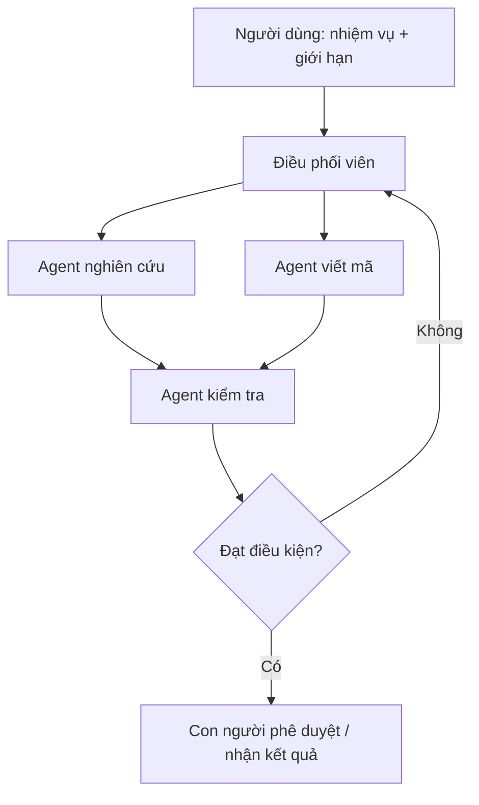

# Bài 24 — Multi-agent, retrieval và tương lai tối ưu suy luận

> **Module 06: Hệ thống agent và tương lai AI**  
> **Phạm vi bài giảng:** 65:30–68:46  
> **Hình thức:** Bài học lý thuyết kết hợp thực hành ngắn

## 1. Tổng quan

Bài học xây dựng nền tảng về **multi-agent, retrieval và tương lai tối ưu suy luận** và cách áp dụng tư duy kỹ thuật vào việc thiết kế, đánh giá hoặc vận hành hệ thống AI.

## 2. Mục tiêu học tập

1. Trình bày bài toán con người điều phối nhiều AI agents.
2. Mô tả hệ lai retrieval–ranking–long context.
3. Thiết kế ràng buộc độ trễ, chi phí và quyền truy cập cho hệ thống agent.

## 3. Kiến thức trọng tâm

### 3.1. Từ chatbot đơn lẻ sang tập hợp cộng tác
Một chatbot thực hiện một lượt yêu cầu. Trong một hệ thống nhiều agent, người dùng có thể giao nhiệm vụ ở mức cao, rồi các agent chuyên trách thực hiện nghiên cứu, viết mã, kiểm thử, kiểm tra kết quả hoặc tổng hợp báo cáo.

Câu hỏi kiến trúc cần giải quyết: giao việc thế nào, agent nào được phép truy cập công cụ, cách chia sẻ dữ liệu, cách phát hiện xung đột và khi nào cần con người phê duyệt.

### 3.2. Workflow điều phối có trạng thái

Đây là một **mô hình thực hành đề xuất** để học cách điều phối, không phải bản sao kiến trúc nội bộ của bất kỳ dự án nào. Tương lai có thể có hàng chục hoặc hàng trăm agent; nhưng tăng số agent không tự bảo đảm tốt hơn do overhead, vòng lặp lỗi và chi phí suy luận.

### 3.3. Long context cần đi cùng retrieval
Đưa nguyên một kho dữ liệu khổng lồ vào context là tốn kém và vượt giới hạn mô hình. Một hệ lai có thể:
1. Truy xuất lượng lớn tài liệu liên quan.
2. Dùng thuật toán hoặc mô hình nhẹ **rerank** danh sách.
3. Chọn một tập tài liệu chất lượng cao cho context.
4. Sinh câu trả lời với dẫn chứng từ phần đã truy xuất.
5. Đánh giá recall và tính chính xác của trích dẫn.

Thách thức được đặt ra là tìm kiếm hiệu quả trên kho dữ liệu quy mô vượt xa cửa sổ context, thậm chí ở mức hàng tỷ hoặc nghìn tỷ token lưu trữ.

### 3.4. Cá nhân hóa phải có quyền truy cập hợp lệ
Agent có thể hữu ích khi xử lý email, hình ảnh, mã nguồn hoặc lịch của người dùng **với sự cho phép**. Cần thiết kế phạm vi quyền, thời hạn truy cập, log hành động, cơ chế phê duyệt hành động nhạy cảm và chính sách xóa dữ liệu.

### 3.5. Tại sao inference efficiency quan trọng?
Agent có thể gọi mô hình lặp đi lặp lại và trao đổi với agent khác. Chi phí suy luận vì thế có thể tăng nhanh hơn một chatbot một lượt. Độ trễ thấp, routing thông minh, cache, batch và phần cứng tối ưu suy luận là các hướng quan trọng.

**Điểm mấu chốt:** hiệu quả của hệ agent phụ thuộc **quy trình + công cụ + kiểm chứng + quản trị quyền**, không chỉ trí thông minh từng agent.

## 4. Bài tập thực hành

Thiết kế một hệ hai agent tạo nội dung bài học: một agent soạn, một agent kiểm tra độ chính xác. Viết hợp đồng dữ liệu đầu ra gồm `task_id`, `sources`, `draft`, `checks`, `approved`. Thêm điều kiện dừng, giới hạn ngân sách và cơ chế xin phê duyệt khi cần gửi nội dung ra ngoài.

## 5. Câu hỏi ôn tập trắc nghiệm

**Câu 1. Nguy cơ khi tăng số agent không kiểm soát là gì?**

A. Chất lượng luôn tăng tuyến tính  
B. Overhead, chi phí, xung đột và lỗi lan truyền  
C. Toàn bộ agent tự động dùng ít token hơn  
D. Không còn nhu cầu đánh giá  

**Đáp án: B.** Điều phối cần giới hạn và cơ chế kiểm chứng.

**Câu 2. Reranking trong pipeline retrieval dùng để làm gì?**

A. Tạo GPU mới  
B. Thay model bằng phần mềm bảng tính  
C. Chọn lại tài liệu phù hợp hơn trước khi đưa vào context  
D. Đếm số token của toàn Internet  

**Đáp án: C.** Reranker giúp chọn nguồn tốt sau tìm kiếm rộng.

**Câu 3. Khi agent muốn xử lý email cá nhân, yêu cầu cơ bản là gì?**

A. Tự lấy mật khẩu của người dùng  
B. Chia sẻ mọi thư cho tất cả agents  
C. Không cần audit log  
D. Quyền truy cập hợp lệ và kiểm soát phạm vi hành động  

**Đáp án: D.** Dữ liệu cá nhân cần đồng ý, giới hạn quyền và theo dõi truy cập.

**Câu 4. Vì sao latency quan trọng hơn khi agent hoạt động chuỗi?**

A. Độ trễ mỗi bước cộng dồn qua nhiều lời gọi mô hình  
B. Agent không dùng inference  
C. Latency chỉ ảnh hưởng giao diện màu  
D. Nhiều agent không bao giờ chờ nhau  

**Đáp án: A.** Workflow nhiều bước có độ trễ tích lũy và chi phí lặp.

**Câu 5. Yếu tố nào nên có trong workflow multi-agent?**

A. Vòng lặp vô hạn không giới hạn chi phí  
B. Điều kiện dừng và kiểm chứng kết quả  
C. Quyền ghi dữ liệu không được quản lý  
D. Chỉ một prompt không có trạng thái  

**Đáp án: B.** Giới hạn vòng lặp và verifier giúp hệ an toàn, đo được và đáng tin.

## 6. Tổng kết

- Multi-agent là bài toán điều phối hành động có trạng thái và ràng buộc.
- Retrieval và model routing giúp dùng nguồn dữ liệu lớn mà không nhồi toàn bộ vào context.
