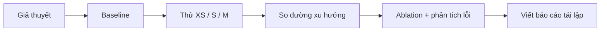

# Bài 26 — Nghiên cứu AI với tài nguyên nhỏ và tư duy khoa học

> **Module 06: Hệ thống agent và tương lai AI**  
> **Phạm vi bài giảng:** 76:04–78:32  
> **Hình thức:** Bài học lý thuyết kết hợp thực hành ngắn

## 1. Tổng quan

Bài học xây dựng nền tảng về **nghiên cứu ai với tài nguyên nhỏ và tư duy khoa học** và cách áp dụng tư duy kỹ thuật vào việc thiết kế, đánh giá hoặc vận hành hệ thống AI.

## 2. Mục tiêu học tập

1. Thiết kế thí nghiệm nhỏ có baseline và nhiều mức scale.
2. Đọc xu hướng learning curve thay vì chỉ một điểm số.
3. Đề xuất hướng nghiên cứu có giá trị khi không có cụm GPU lớn.

## 3. Kiến thức trọng tâm

### 3.1. Không có nghìn TPU vẫn làm được nghiên cứu có giá trị
Rất nhiều ý tưởng nghiên cứu bắt đầu ở quy mô nhỏ. Một phương án mới chưa vượt baseline tại cấu hình bé nhất vẫn đáng nghiên cứu nếu **xu hướng khi scale** cho thấy tốc độ cải thiện tốt. Ngược lại, một phương án thắng ở một điểm nhỏ nhưng nhanh chóng mất lợi thế khi tăng compute có thể kém triển vọng.

### 3.2. Đặt câu hỏi trước khi train
- Giả thuyết nào phân biệt phương pháp mới với baseline?
- Kết quả nào sẽ **bác bỏ** giả thuyết?
- Điều gì được giữ cố định: dữ liệu, số bước, seed, phần cứng?
- Cách đo có phản ánh đúng hiệu quả, không chỉ loss trên train?

### 3.3. Scaling curve đơn giản
Thử ba mức compute hoặc kích thước mô hình và đo chất lượng trên cùng bộ validation/test độc lập:

| Mức thử | Cấu hình | Chỉ số cần ghi |
|---|---|---|
| XS | Rất nhỏ, chạy nhanh | Loss, accuracy, thời gian |
| S | Nhỏ | Tương tự để so xu hướng |
| M | Vừa trong ngân sách | Tương tự và độ ổn định |

Khi xem biểu đồ, quan tâm **độ dốc và độ biến thiên**: phương pháp có vượt được khi scale không, mức tăng có đáng thêm chi phí không, có chỉ tốt với một seed không?

### 3.4. Nghiên cứu nên thưởng cho ý tưởng mới và bằng chứng tốt
Một cải tiến nhỏ trên benchmark hiện có có thể hữu ích, nhưng không phải mục tiêu duy nhất. Nghiên cứu có giá trị còn có thể là kiến trúc khác biệt, phương pháp kiểm thử mới, chiến lược tiết kiệm compute hoặc phát hiện một giới hạn quan trọng.

### 3.5. Workflow đề xuất cho AI Engineer

### 3.6. Phân biệt khám phá và khẳng định
Thử nghiệm nhỏ **gợi ý** tiềm năng nhưng chưa chứng minh hệ sẽ scale lên nghìn chip. Khi báo cáo, cần phân tách dữ liệu quan sát trực tiếp, giả thuyết và bước nghiên cứu tiếp theo.

**Thông điệp kết khóa:** kỹ năng nghiên cứu tốt là đặt câu hỏi sắc, thử nghiệm công bằng, đo đúng và tích lũy kết quả có thể kiểm chứng.

## 4. Bài tập thực hành

Chọn một hướng phù hợp laptop hoặc GPU thuê ngắn hạn: (a) so kiến trúc encoder nhỏ, (b) đo chất lượng retrieval–reranking, hoặc (c) đánh giá distillation. Viết proposal 1 trang gồm giả thuyết, baseline, 3 mức compute, metric, cách tránh leakage, giới hạn ngân sách và điều kiện dừng.

## 5. Câu hỏi ôn tập trắc nghiệm

**Câu 1. Với tài nguyên nhỏ, mục tiêu nghiên cứu hợp lý nhất là gì?**

A. Luôn đạt SOTA trên mọi benchmark  
B. Thuê phần cứng lớn nhất dù không có baseline  
C. Bỏ đo lường và chỉ tin trực giác  
D. Thử giả thuyết mới và đánh giá xu hướng ở nhiều quy mô nhỏ  

**Đáp án: D.** Nghiên cứu nhỏ vẫn cho bằng chứng về tiềm năng của ý tưởng.

**Câu 2. Hai phương án giao nhau khi scale cho thấy điều gì?**

A. Xếp hạng ở quy mô nhỏ không nhất thiết giữ ở quy mô lớn  
B. Một phương án chắc chắn bị lỗi cú pháp  
C. Cả hai đều không dùng GPU  
D. Số lượng tham số vô nghĩa trong mọi trường hợp  

**Đáp án: A.** Phải quan sát xu hướng thay vì so một điểm.

**Câu 3. Một thí nghiệm công bằng cần kiểm soát điều gì?**

A. Chỉ màu nền của biểu đồ  
B. Dữ liệu, seed, ngân sách và cách đánh giá  
C. Chỉ số chữ trong tên file  
D. Chỉ lời nhận xét của người viết  

**Đáp án: B.** Kiểm soát biến giúp quy kết cải thiện cho phương pháp thử.

**Câu 4. Vì sao cần ablation?**

A. Để tăng số người dùng ứng dụng  
B. Để bỏ hết baseline  
C. Để xác định thành phần nào tạo ra cải thiện  
D. Để tự tăng kích thước batch vô hạn  

**Đáp án: C.** Ablation loại bỏ/thay từng thành phần nhằm đánh giá đóng góp.

**Câu 5. Đâu là cách trình bày có trách nhiệm về thử nghiệm nhỏ?**

A. Khẳng định chắc chắn sẽ thắng với nghìn TPU  
B. Chỉ chia sẻ seed cho lần thử tốt nhất  
C. Không nhắc tới kết quả thất bại  
D. Nêu rõ kết quả quan sát, giới hạn và giả thuyết khi scale  

**Đáp án: D.** Bằng chứng nhỏ không cho phép suy rộng không điều kiện.

## 6. Tổng kết

- Xu hướng khi scale quan trọng hơn một điểm benchmark đơn lẻ.
- Thí nghiệm tái lập và phân tích thất bại là đóng góp nghiên cứu thiết thực.
