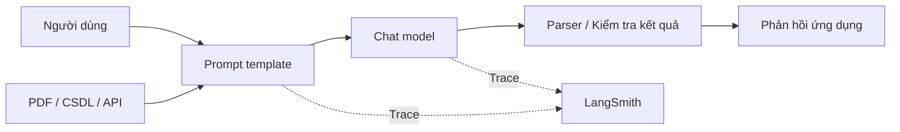

# Bài 01 — LangChain là gì?

## 1. Tóm tắt

**LangChain** là framework mã nguồn mở giúp xây dựng ứng dụng dựa trên mô hình ngôn ngữ lớn (LLM). Điểm mạnh không phải tạo hoặc huấn luyện LLM, mà là tổ chức các thành phần xung quanh LLM: mẫu lời nhắc, kết nối mô hình, tài liệu, công cụ, luồng xử lý và khả năng giám sát. Nhờ vậy, nhà phát triển có thể dùng LLM như một dịch vụ, tập trung vào logic sản phẩm và tích hợp dữ liệu.

## 2. Mục tiêu học tập

- Giải thích được vai trò của LangChain và các trường hợp nên dùng.
- Phân biệt được LLM, LangChain, LangGraph và LangSmith.
- Mô tả được luồng dữ liệu của ứng dụng tóm tắt văn bản và của hệ thống RAG ở mức khái quát.

## 3. Vấn đề mà LangChain giải quyết

Một cuộc gọi API đơn lẻ thường chỉ gồm nhập prompt rồi nhận văn bản. Tuy nhiên, sản phẩm thực tế cần thêm dữ liệu riêng (PDF, email, Notion hoặc database), ghép biến do người dùng nhập, lưu trạng thái hội thoại, đổi model khi cần, kết nối API và theo dõi lỗi. Nếu mỗi bước viết thủ công, hệ thống nhanh chóng trở nên khó kiểm thử và bảo trì.

LangChain cung cấp những giao diện nhất quán và thành phần tái sử dụng. Bạn vẫn phải xử lý bảo mật, nguồn dữ liệu, quản lý token, độ tin cậy câu trả lời và quyền truy cập công cụ; framework không tự giải quyết những vấn đề này.

Sơ đồ thể hiện các lớp có thể kết hợp. Một bài toán chỉ có prompt và model có thể không cần PDF hay parser; một sản phẩm lớn sẽ có thêm truy xuất dữ liệu, kiểm soát công cụ và các nhánh xử lý.

## 4. Các khái niệm cốt lõi

| Khái niệm | Vai trò | Ví dụ |
| --- | --- | --- |
| Chat model | Giao diện gọi mô hình hội thoại | `ChatOpenAI`, `ChatOllama` |
| Prompt template | Khuôn lời nhắc có biến đầu vào | `ChatPromptTemplate` |
| Document loader | Đưa nội dung từ nguồn ngoài về dạng tài liệu chuẩn | PDF, web, dịch vụ lưu trữ |
| Runnable / chain | Ghép các bước để đầu ra bước trước thành đầu vào bước sau | `prompt \| model` |
| Tool | Hàm/API được hệ thống cho phép gọi | tìm kiếm, truy vấn CSDL |
| Agent | Chọn hành động và công cụ dựa trên ngữ cảnh | trợ lý phân tích dữ liệu |
| LangGraph | Xây workflow có trạng thái, nhánh và kiểm soát thực thi | agent nhiều bước |
| LangSmith | Quan sát trace, đánh giá và gỡ lỗi ứng dụng | latency, token, lỗi |

### 4.1. RAG là gì?

**Retrieval-Augmented Generation** bổ sung dữ liệu được truy xuất vào ngữ cảnh của LLM trước khi sinh câu trả lời. Ví dụ: tìm những đoạn phù hợp trong tài liệu nội bộ rồi cho mô hình trả lời dựa trên các đoạn đó. Đây là một kiến trúc ứng dụng, không phải mặc định được kích hoạt chỉ bằng cách cài LangChain.

### 4.2. Agent khác chain cố định như thế nào?

**Chain cố định** xác định thứ tự bước trước khi chạy. **Agent** có thể quyết định sử dụng công cụ nào và khi nào, trong các giới hạn mà ứng dụng thiết lập. Khi agent được cấp quyền gửi email hoặc sửa dữ liệu, ứng dụng cần bước xác thực, phân quyền và cơ chế xác nhận phù hợp.

## 5. Ví dụ ứng dụng

Một hệ thống hỗ trợ học tập có thể nhận bài ghi chép, tạo 3 ý chính, rồi xuất kết quả thành văn bản. Kết cấu đầu tiên chỉ cần `ChatPromptTemplate`, một chat model và `StrOutputParser`. Khi tăng phạm vi, bạn mới thêm retriever, lịch sử hội thoại, đánh giá kết quả hay agent. Chiến lược xây từ nhỏ đến lớn này giúp giảm độ phức tạp.

## 6. Thực hành ngắn

1. Mở `thuc-hanh/app/prompts.py` và chỉ ra biến `{information}`.
2. Vẽ lại sơ đồ ứng dụng khi chỉ có prompt, model và parser.
3. Trả lời: với một API call đơn giản không có workflow, dùng SDK trực tiếp có đủ không? Giải thích lý do.

## 7. Câu hỏi ôn tập

**Câu 1.** Khi nào LangChain mang lại lợi ích rõ nhất?  
A. Chỉ cần cộng hai số.  
B. Cần ghép prompt, model, tài liệu và nhiều bước xử lý.  
C. Cần thay Python bằng ngôn ngữ mới.  
D. Muốn huấn luyện một LLM từ đầu.  
**Đáp án: B.** LangChain tập trung vào ghép và vận hành các thành phần ứng dụng LLM.

**Câu 2.** Công cụ nào phù hợp để quan sát trace của chain?  
A. LangSmith.  
B. `git init`.  
C. `uv init`.  
D. Ollama.  
**Đáp án: A.** LangSmith được thiết kế cho tracing và đánh giá ứng dụng LLM.

**Câu 3.** Một agent được cấp quyền gọi API ghi dữ liệu. Bước quan trọng cần bổ sung là gì?  
A. Bỏ mọi kiểm tra đầu vào.  
B. Dùng prompt dài hơn là đủ.  
C. Tăng temperature.  
D. Kiểm soát quyền và phê duyệt thao tác có tác dụng phụ.  
**Đáp án: D.** LLM không phải lớp bảo mật thay cho ứng dụng.

**Câu 4.** RAG khác huấn luyện lại mô hình ở điểm nào?  
A. RAG chỉ dùng cho hình ảnh.  
B. RAG không cần dữ liệu.  
C. RAG truy xuất thông tin để bổ sung ngữ cảnh khi trả lời.  
D. RAG bắt buộc dùng agent.  
**Đáp án: C.** RAG cung cấp bằng chứng bên ngoài trong quá trình suy luận.

**Câu 5.** Phát biểu nào đúng về LangChain?  
A. Tự khiến mọi model chính xác tuyệt đối.  
B. Cung cấp giao diện kết hợp nhưng không loại bỏ việc thiết kế kiểm thử.  
C. Luôn thay thế cơ sở dữ liệu.  
D. Chỉ dùng được model OpenAI.  
**Đáp án: B.** Tích hợp nhanh không đồng nghĩa bài toán chất lượng và an toàn đã được giải quyết.

## 8. Tổng kết

LangChain giúp tổ chức phần mềm xung quanh LLM. Hãy bắt đầu với pipeline đơn giản, hiểu kiểu dữ liệu của từng bước, rồi chỉ bổ sung thành phần khi bài toán thật sự cần.
