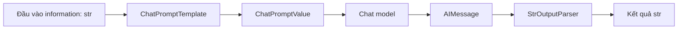

# Bài 02 — Thiết kế ứng dụng Hello World Chain

## 1. Tóm tắt

Ứng dụng đầu tiên nhận thông tin về một người hoặc một chủ đề, gửi đến LLM và yêu cầu tạo bản tóm tắt ngắn cùng các chi tiết thú vị. Ví dụ về Elon Musk chỉ đóng vai trò dữ liệu đầu vào; mô hình phải tóm tắt dựa trên nội dung thực sự được cung cấp, không tự bổ sung sự kiện thiếu bằng chứng.

## 2. Mục tiêu học tập

- Xác định được input, output và trách nhiệm của từng thành phần.
- Vẽ được pipeline `input → prompt → model → parser → output`.
- Thiết kế được tiêu chí kiểm thử và kế hoạch đổi provider.

## 3. Thiết kế luồng xử lý

**Giải thích:** Template thay `{information}` bằng văn bản đầu vào và tạo thông điệp hệ thống/người dùng. Chat model gọi nhà cung cấp tương ứng rồi nhận lại `AIMessage`. Parser lấy phần văn bản để ứng dụng in, lưu hoặc gửi cho bước tiếp theo. Việc tách vai trò khiến pipeline dễ kiểm thử mà không cần gọi model thật trong mọi test.

## 4. Yêu cầu chức năng

| Yêu cầu | Cách kiểm tra |
| --- | --- |
| Nhập văn bản bằng chuỗi hoặc tệp UTF-8 | CLI đọc được cả `--text` và `--file` |
| Trả kết quả tiếng Việt | Xem đầu ra với dữ liệu thử |
| Đổi provider | Sửa `.env` hoặc cờ `--provider` |
| Không có văn bản | Ứng dụng báo lỗi đầu vào rõ ràng |
| Theo dõi chain | Cấu hình LangSmith và kiểm tra trace |
| Kiểm thử không tốn API | Dùng `RunnableLambda` giả lập model |

Cần phân biệt *đầu ra đúng định dạng* với *đầu ra đúng sự thật*. Một phản hồi chứa đủ 3 ý vẫn có thể bịa dữ kiện; vì thế prompt yêu cầu bám sát nội dung nhưng phải có bước kiểm chứng ở các ứng dụng quan trọng.

## 5. Mô hình mã nguồn

Dự án tổ chức thành `app/prompts.py`, `app/models.py`, `app/chains.py` và `main.py`. File `prompts.py` quản lý nội dung hướng dẫn, `models.py` tạo đối tượng phù hợp với nhà cung cấp, `chains.py` kết hợp các `Runnable`; file `main.py` nhận tham số CLI, báo lỗi và in kết quả.

Nhờ cách chia này, có thể thay `ChatOllama` bằng `ChatOpenAI` mà không chỉnh `SUMMARY_PROMPT` hoặc `summarize()`.

## 6. Thực hành ngắn

Chạy `uv run python main.py --file data/van-ban-mau.txt` trong `thuc-hanh/` sau khi hoàn thành cấu hình. Thử đổi văn bản thành 2 câu không liên quan tới con người, quan sát xem output có bịa danh tính hay không. Ghi ít nhất một hạn chế của model đang sử dụng.

## 7. Câu hỏi ôn tập

**Câu 1.** Sau khi đi qua `StrOutputParser`, dữ liệu thường ở dạng nào?  
A. Danh sách token ID.  
B. `dict` metadata.  
C. `str`.  
D. Một connection tới server.  
**Đáp án: C.** Parser này lấy nội dung văn bản của thông điệp.

**Câu 2.** Vì sao nên tách `models.py` khỏi `chains.py`?  
A. Để việc đổi provider ít ảnh hưởng đến workflow.  
B. Để không cần kiểm thử.  
C. Để tự huấn luyện model.  
D. Để loại bỏ mọi dependency.  
**Đáp án: A.** Factory mô hình là lớp thay đổi thường xuyên hơn cấu trúc pipeline.

**Câu 3.** Dữ liệu nguồn thiếu thông tin về năm sinh, ứng dụng nên làm gì?  
A. Suy ra từ tên.  
B. Tạo con số hợp lý.  
C. Gọi API không được cấp quyền.  
D. Nêu thiếu dữ kiện thay vì khẳng định.  
**Đáp án: D.** Không có chứng cứ thì không nên đưa sự kiện chắc chắn.

**Câu 4.** Kiểu đầu ra phổ biến của chat model trong ví dụ là gì?  
A. File `.pdf`.  
B. `AIMessage`.  
C. `uv.lock`.  
D. `PromptValue` rỗng.  
**Đáp án: B.** Chat model trả thông điệp AI có nội dung và metadata.

**Câu 5.** Để unit test pipeline mà không gửi request mạng, cách nào phù hợp nhất?  
A. Xóa toàn bộ prompt.  
B. Vô hiệu hóa parser.  
C. Truyền fake runnable làm model.  
D. Dùng ngẫu nhiên model khác.  
**Đáp án: C.** Fake runnable giữ hành vi đầu vào/đầu ra có thể kiểm thử độc lập.

## 8. Tổng kết

Định nghĩa rõ dữ liệu đi qua từng bước giúp triển khai, đổi model và debug dễ dàng hơn. Ứng dụng đầu tiên nên nhỏ nhưng có cấu trúc đủ tốt để mở rộng.
