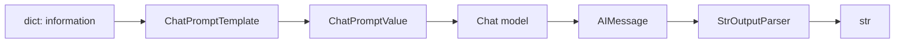

# Bài 04 — Prompt Template, Chat Model và LCEL

## 1. Tóm tắt

Ba khái niệm cơ bản nhất của LangChain là **prompt** (đầu vào hướng dẫn mô hình), **chat model** (thành phần giao tiếp với LLM) và **chain** (quy trình ghép các thành phần). LangChain Expression Language, viết tắt là **LCEL**, dùng toán tử `|` để nối những đối tượng `Runnable` với nhau.

## 2. Mục tiêu học tập

- Tạo và gọi `ChatPromptTemplate` với biến đầu vào.
- Phân biệt `SystemMessage`, `HumanMessage`, `AIMessage`, `ChatPromptValue` và chuỗi văn bản.
- Diễn giải `prompt | model | StrOutputParser()` cùng `.invoke()`.

## 3. Prompt và template

Một prompt như “Giới thiệu thức ăn cho mèo” có thể thay đổi phần tên sản phẩm và đối tượng khách hàng. Thay vì nối chuỗi thủ công nhiều nơi, có thể tạo template với `{product}` và `{audience}`.

```python
from langchain_core.prompts import ChatPromptTemplate

prompt = ChatPromptTemplate.from_messages([
    ("system", "Viết lời giới thiệu ngắn gọn bằng tiếng Việt."),
    ("human", "Sản phẩm: {product}; dành cho: {audience}."),
])
value = prompt.invoke({"product": "đàn piano", "audience": "người mới học"})
print(value.to_messages()[-1].content)
```

Nếu bỏ biến `audience`, template sẽ báo lỗi thiếu đầu vào thay vì âm thầm gửi một prompt chưa hoàn chỉnh. Template giúp cấu trúc prompt và tái sử dụng, nhưng **không tự bảo vệ khỏi prompt injection** trong văn bản không đáng tin: cần tách chỉ dẫn đáng tin khỏi dữ liệu, giới hạn công cụ và kiểm tra đầu ra.

## 4. Chat model và messages

Một chat model thường nhận danh sách thông điệp có vai trò, sau đó trả về `AIMessage`. `SystemMessage` đặt hướng dẫn ở tầng hệ thống, `HumanMessage` biểu diễn câu hỏi hoặc dữ liệu người dùng, `AIMessage` là phản hồi của mô hình.

`AIMessage` có `content` chứa nội dung trả lời. Tùy tích hợp và model, đối tượng còn có `usage_metadata`, `response_metadata`, `tool_calls` hoặc thông tin khác. Không nên giả định mọi nhà cung cấp luôn trả đủ tất cả các trường.

## 5. LCEL và giao diện Runnable



`|` không phải phép OR logic ở đây mà là phép ghép pipeline do `Runnable` hỗ trợ. Kết quả bên trái được chuyển làm đầu vào cho đối tượng bên phải. `chain.invoke({...})` chạy đồng bộ một lần; `.stream({...})` có thể đưa ra các phần kết quả dần dần, tùy khả năng của model và thành phần đi kèm.

```python
from langchain_core.output_parsers import StrOutputParser
from langchain_openai import ChatOpenAI

model = ChatOpenAI(model="gpt-4o-mini")  # cần OPENAI_API_KEY hợp lệ
chain = prompt | model | StrOutputParser()
print(chain.invoke({"product": "thức ăn cho mèo", "audience": "người nuôi mèo"}))
```

Không cần parser nếu muốn đọc toàn bộ `AIMessage` và metadata của nó. Thêm `StrOutputParser` khi downstream chỉ cần chuỗi. Với dữ liệu JSON có cấu trúc nghiêm ngặt, có thể dùng cơ chế structured output được model hỗ trợ thay vì giả định parser chuỗi đủ bảo đảm schema.

## 6. Thực hành ngắn

Chạy `uv run python -m examples.01_prompt_template`, thử hai sản phẩm khác nhau, rồi cố ý bỏ một biến để quan sát lỗi. Tiếp đó đọc `app/chains.py`, xác định kiểu đầu ra mỗi thành phần; nếu đã có model hoạt động, chạy `examples.02_first_chain`.

## 7. Câu hỏi ôn tập

**Câu 1.** `ChatPromptTemplate.invoke()` nhận một dict hợp lệ thường trả gì?  
A. `ChatPromptValue`.  
B. `uv.lock`.  
C. `AIMessage`.  
D. Một file JSON.  
**Đáp án: A.** Template định dạng các message, chưa gọi model.

**Câu 2.** Trong `prompt | model`, toán tử `|` làm gì?  
A. So sánh tính bằng nhau.  
B. Nối chuỗi ký tự thô.  
C. Ghép hai Runnable theo thứ tự.  
D. Cấp quyền mạng.  
**Đáp án: C.** Nó chuyển đầu ra của thành phần trước cho thành phần sau.

**Câu 3.** Tại sao có thể bỏ `StrOutputParser` khi đang debug?  
A. Vì parser tự tắt API.  
B. Vì giữ `AIMessage` để xem metadata.  
C. Vì model không cần prompt.  
D. Vì parser lưu lịch sử.  
**Đáp án: B.** Thông tin metadata thường nằm trong đối tượng message.

**Câu 4.** Một template chứa `{product}` và `{audience}` nhưng chỉ được truyền `{product}`. Kết quả hợp lý là gì?  
A. Tự điền `audience` tùy ý.  
B. Gọi model rồi hỏi bổ sung.  
C. Tạo database mới.  
D. Báo lỗi thiếu biến.  
**Đáp án: D.** Template cần đủ biến bắt buộc để định dạng.

**Câu 5.** Prompt template có tự ngăn mọi prompt injection không?  
A. Có, vì dùng dấu ngoặc nhọn.  
B. Có, nếu thêm 2 biến.  
C. Không; vẫn phải thiết kế ranh giới dữ liệu và quyền.  
D. Chỉ với Ollama thì có.  
**Đáp án: C.** Template tổ chức nội dung, không thay thế biện pháp bảo mật.

## 8. Tổng kết

Hãy ghi nhớ chuỗi kiểu dữ liệu: `dict → ChatPromptValue → AIMessage → str`. Đây là cách đọc nhanh nhất một chain LCEL và cách phát hiện bước nào làm sai kiểu dữ liệu.
