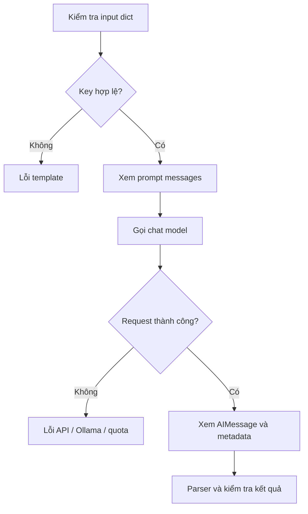

# Bài 06 — Gỡ lỗi chain và đọc AIMessage

## 1. Tóm tắt

Debug LangChain không chỉ là xem văn bản do mô hình sinh ra. Cần kiểm tra từng giai đoạn: biến đầu vào, prompt đã định dạng, tên model, thông điệp đầu ra, thời gian chạy và metadata. Quan sát `AIMessage` giúp phát hiện lỗi trước khi thêm parser hoặc UI.

## 2. Mục tiêu học tập

- Đặt breakpoint ở đầu ra prompt/model.
- Đọc được `content`, `usage_metadata` và `response_metadata` khi có.
- Phân biệt lỗi của template, lỗi model và lỗi sau xử lý.

## 3. Kỹ thuật debug theo bước



Lỗi có thể xảy ra ở nhiều lớp khác nhau. Một `KeyError` thường có nguyên nhân ở biến prompt; lỗi kết nối có thể do Ollama chưa chạy; lỗi 401/429 liên quan đến xác thực, giới hạn hoặc quota; kết quả đúng kiểu nhưng thiếu ý có thể do khả năng model và thiết kế prompt.

## 4. Quan sát đối tượng

```python
from dotenv import load_dotenv
from app.models import make_model
from app.prompts import SUMMARY_PROMPT

load_dotenv()
model = make_model()
value = SUMMARY_PROMPT.invoke({"information": "Dữ liệu để debug"})
print(type(value).__name__)
print(value.to_messages())

response = model.invoke(value)
print(type(response).__name__)
print(response.content)
print(getattr(response, "usage_metadata", None))
print(getattr(response, "response_metadata", None))
```

Đặt breakpoint sau `model.invoke(value)`. Trong VS Code/PyCharm, kiểm tra đối tượng `response`. Khi dùng `StrOutputParser`, đầu ra là chuỗi, do đó không còn các trường metadata như trong `AIMessage` nguyên bản.

## 5. Metadata để làm gì?

`usage_metadata` có thể chứa token đầu vào, đầu ra và tổng số token nếu provider báo cáo. `response_metadata` có thể cho biết model, lý do kết thúc hoặc thông số phụ trợ. Dữ liệu token và chi phí không nhất thiết đồng nhất giữa các nhà cung cấp; không tự suy ra chi phí nếu thiếu bảng giá tương ứng.

Ở môi trường phát triển, có thể log loại đối tượng, trạng thái và thời gian. Tránh ghi API key, nội dung nhạy cảm hay toàn bộ message người dùng vào log nếu chưa được phép.

## 6. Thực hành ngắn

Chạy `uv run python -m examples.03_debug_message`. So sánh đối tượng `AIMessage` với kết quả trả từ `chain = prompt | model | StrOutputParser()`. Tiếp đó chạy `uv run pytest -q` để quan sát kiểm thử dùng fake model, không phụ thuộc mạng.

## 7. Câu hỏi ôn tập

**Câu 1.** Muốn biết model trả thêm metadata gì, bạn nên kiểm tra đối tượng nào trước parser?  
A. `.gitignore`.  
B. `.env.example`.  
C. `AIMessage`.  
D. `uv.lock`.  
**Đáp án: C.** `AIMessage` giữ nội dung cùng metadata nếu tích hợp cung cấp.

**Câu 2.** Lỗi do thiếu `information` trong `.invoke()` nên debug ở đâu?  
A. Input dict và prompt template.  
B. GPU và VRAM.  
C. LangSmith endpoint.  
D. Token pricing.  
**Đáp án: A.** Lỗi key xảy ra trước bước gọi mô hình.

**Câu 3.** `usage_metadata` có đảm bảo chứa giá tiền chính xác không?  
A. Có với mọi provider.  
B. Chỉ khi có Ollama.  
C. Chỉ khi temperature=0.  
D. Không; thường phản ánh token, giá cần tính riêng và có thể thiếu.  
**Đáp án: D.** Cần xét khả năng báo cáo của nhà cung cấp.

**Câu 4.** Vì sao unit test nên dùng fake model cho logic pipeline?  
A. Để tăng phí API.  
B. Để chạy ổn định mà không phụ thuộc mạng/model thật.  
C. Để tự động nâng version.  
D. Để thay thế mọi thử nghiệm thực tế.  
**Đáp án: B.** Fake model cô lập luồng xử lý; vẫn cần integration test riêng.

**Câu 5.** Một phản hồi có đủ 3 dòng nhưng bịa thêm chi tiết. Vấn đề chính là gì?  
A. Thiếu `.venv`.  
B. `git status` sai.  
C. Chất lượng/grounding của nội dung, không chỉ định dạng.  
D. Mô hình không có tên.  
**Đáp án: C.** Kiểm định nội dung là yêu cầu khác kiểm tra kiểu dữ liệu.

## 8. Tổng kết

Debug hiệu quả bắt đầu từ quan sát kiểu dữ liệu ở từng bước. Dùng breakpoint, metadata và fake tests để khoanh vùng lỗi trước khi tối ưu prompt hoặc đổi mô hình.
