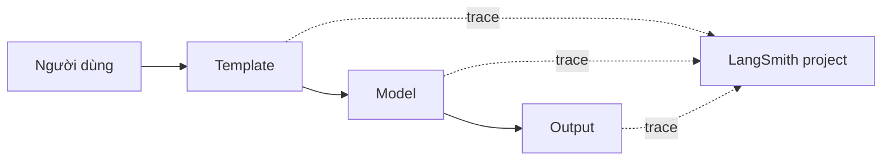

# Bài 08 — Theo dõi ứng dụng bằng LangSmith

## 1. Tóm tắt

Ứng dụng LLM gồm nhiều bước có thể sinh lỗi hoặc mất nhiều thời gian ở những vị trí khó nhìn thấy. **LangSmith** cung cấp tracing để quan sát lần chạy, đầu vào/đầu ra của các thành phần và các chỉ số được tích hợp hỗ trợ. Khi đã bật tracing đúng cách, các chain LangChain có thể gửi dấu vết thực thi tới một project LangSmith.

## 2. Mục tiêu học tập

- Thiết lập biến môi trường LangSmith mà không lộ API key.
- Tìm trace của chain và đọc thời gian, trạng thái, bước chạy.
- Phân biệt tracing, log ứng dụng và đánh giá chất lượng mô hình.

## 3. Vì sao cần tracing?

Khi pipeline `prompt | model | parser` trả ra nội dung không mong đợi, log `print()` ở cuối thường không cho thấy có sai prompt hay không. Tracing có thể hiển thị từng bước, hỗ trợ điều tra latency, lỗi và số token nếu model báo cáo. Với workflow agent nhiều nhánh, dấu vết càng quan trọng vì cần biết model đã dùng công cụ nào và với tham số gì.



Trace giúp kiểm tra đường đi của yêu cầu, nhưng **không chứng minh** câu trả lời đúng sự thật. Muốn đánh giá chất lượng cần thêm bộ câu hỏi mẫu, tiêu chí chấm và phân tích lỗi.

## 4. Cấu hình cơ bản

Tạo project và API key trong https://smith.langchain.com/. Trong `thuc-hanh/.env`:

```dotenv
LANGSMITH_TRACING=true
LANGSMITH_API_KEY=YOUR_SECRET_KEY
LANGSMITH_PROJECT=langchain-hello-world-vi
```

Để kiểm tra cấu hình, chạy `uv run python -m examples.05_trace_langsmith`. Truy cập LangSmith, chọn project vừa khai báo rồi xem trace. Nếu tài khoản chọn khu vực EU, dùng endpoint do giao diện LangSmith hướng dẫn, chẳng hạn:

```dotenv
LANGSMITH_ENDPOINT=https://eu.api.smith.langchain.com
```

**Endpoint phụ thuộc khu vực lưu trữ/workspace của LangSmith, không phụ thuộc việc máy tính đang ở Việt Nam hay ngoài Hoa Kỳ.** Không thiết lập EU endpoint chỉ vì vị trí địa lý.

## 5. Đọc trace

Các trường hữu ích có thể gồm tên runnable, model, đầu vào/đầu ra, timestamp, tổng thời gian, trạng thái lỗi và số token. Các thống kê độ trễ như P50/P90 thường giúp nhìn mức độ ổn định khi có nhiều lần chạy. Chỉ so sánh trong điều kiện tương tự (cùng dữ liệu thử, cùng model, cùng cấu hình) nếu muốn rút ra kết luận.

Có thể gắn nhãn chạy:

```python
result = chain.invoke(
    {"information": "Nội dung cần tóm tắt"},
    config={"run_name": "summarize-demo", "tags": ["module-02", "test"]},
)
```

Các thẻ hữu ích khi lọc theo môi trường hoặc tính năng. Không để email thật, số điện thoại, token truy cập hoặc dữ liệu mật trong thẻ và trace chia sẻ công khai.

## 6. Thực hành ngắn

1. Tạo LangSmith project riêng, bật tracing và chạy chain 2 lần với input khác nhau.
2. Tìm trace mới; ghi model, thời gian, lỗi và các bước đã chạy.
3. Tạm đặt một key prompt sai để tạo lỗi, quan sát khác biệt giữa lỗi ở ứng dụng và lỗi khi gọi model.
4. Tắt `LANGSMITH_TRACING` khi không cần chia sẻ dữ liệu đến dịch vụ tracing.

## 7. Câu hỏi ôn tập

**Câu 1.** Biến nào bật tracing?  
A. `OPENAI_MODEL=true`.  
B. `UV_TRACING=true`.  
C. `OLLAMA_LIST=true`.  
D. `LANGSMITH_TRACING=true`.  
**Đáp án: D.** Đây là biến cấu hình tracing của LangSmith.

**Câu 2.** Đâu là lý do đúng để chọn EU endpoint?  
A. Máy đang dùng tiếng Việt.  
B. Workspace LangSmith được tạo ở khu vực EU.  
C. Thấy model chạy chậm.  
D. Nhà cung cấp model là Google.  
**Đáp án: B.** Endpoint theo khu vực dịch vụ được chọn, không theo nơi người dùng đang ngồi.

**Câu 3.** Tracing giúp trả lời tốt nhất câu hỏi nào?  
A. Bước nào lỗi hoặc tốn thời gian?  
B. LLM có thật sự thông minh?  
C. Tất cả dữ kiện đều đúng?  
D. Tài liệu có bản quyền không?  
**Đáp án: A.** Trace quan sát hoạt động từng bước.

**Câu 4.** Khi chia sẻ trace công khai, rủi ro nào đáng lưu ý nhất?  
A. Thay đổi Python version.  
B. Mất file Git.  
C. Lộ prompt, dữ liệu người dùng hoặc nội dung nhạy cảm.  
D. Tự bật GPU.  
**Đáp án: C.** Dấu vết có thể chứa dữ liệu đầu vào và kết quả chi tiết.

**Câu 5.** Một trace không có lỗi nhưng model bịa thông tin. Nên làm gì tiếp?  
A. Xóa tất cả trace.  
B. Kiểm thử chất lượng với dữ liệu và tiêu chí đánh giá riêng.  
C. Tắt parser để chắc chắn đúng.  
D. Chỉ tăng timeout.  
**Đáp án: B.** Tracing và đánh giá chất lượng phục vụ hai mục tiêu khác nhau.

## 8. Tổng kết

LangSmith giúp quan sát và gỡ lỗi chain, đặc biệt khi workflow lớn dần. Chỉ bật tracing với dữ liệu đã được xem xét quyền riêng tư và đọc kết quả trong ngữ cảnh thử nghiệm phù hợp.
