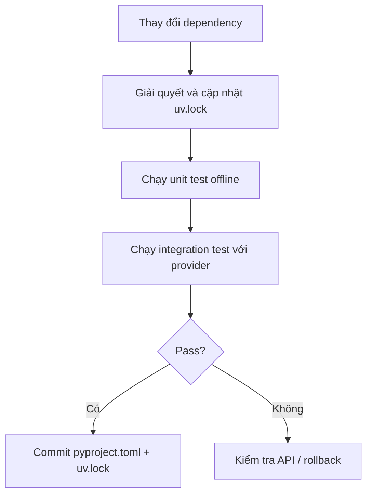

# Bài 11 — Semantic Versioning và quản lý phiên bản LangChain

## 1. Tóm tắt

Framework và các package tích hợp thay đổi theo thời gian. Để giảm lỗi “mã trong bài không chạy”, cần biết cách đọc số phiên bản theo **Semantic Versioning**, quản lý dependency bằng `uv` và ghi lại môi trường trong lockfile.

## 2. Mục tiêu học tập

- Giải thích mô hình số phiên bản `MAJOR.MINOR.PATCH`.
- Phân biệt khai báo phiên bản cho phép và phiên bản đã khóa.
- Đọc `pyproject.toml`, `uv.lock` và tái tạo môi trường bằng `uv sync`.

## 3. Semantic Versioning hoạt động thế nào?

Giả sử phiên bản được viết là `1.0.2`:

```text
1 . 0 . 2
|   |   |
|   |   +-- PATCH: thường là sửa lỗi tương thích
|   +------ MINOR: thường là bổ sung tính năng tương thích
+---------- MAJOR: thay đổi có thể phá tương thích API
```

Theo cam kết SemVer, **PATCH** dành cho sửa lỗi tương thích, **MINOR** bổ sung chức năng tương thích ngược, **MAJOR** có thể thay đổi API không tương thích. Đây là chính sách phiên bản mà tác giả package hướng tới, không phải lời bảo đảm tuyệt đối rằng mọi bản phát hành đều không có regression. Với gói đang ở `0.x`, cách diễn giải mức ổn định có thể khác.

`1.0.2` là phiên bản được dùng trong một giai đoạn của khóa học; **không được coi đó là phiên bản mới nhất hiện tại**. Các package `langchain`, `langchain-core`, `langchain-openai`, `langchain-ollama`, `langchain-groq` có lịch phát hành độc lập nên cũng cần xem quan hệ phụ thuộc của chúng.

## 4. Xem dependency thực tế

Ví dụ một phần `pyproject.toml`:

```toml
[project]
requires-python = ">=3.11"
dependencies = [
    "langchain>=1.0,<2.0",
    "langchain-openai>=1.0,<2.0",
]
```

Đây là ràng buộc cho phép trong project, không có nghĩa máy đang cài đúng phiên bản `1.0.2`. `uv.lock` là kết quả khóa các gói cụ thể mà resolver chọn, giúp tái lập môi trường sau khi cài đặt.

```bash
uv sync
uv tree
uv pip list
uv lock --upgrade-package langchain
```

Chỉ nâng cấp khi cần và luôn chạy unit test + integration test sau khi cập nhật. Việc cập nhật một gói có thể khiến các dependency liên quan thay đổi.

## 5. Quy trình làm việc an toàn



Sơ đồ nhấn mạnh hai lớp kiểm tra. Unit test xác nhận workflow nội bộ; integration test phát hiện các thay đổi trong API/provider. Khi báo lỗi, đính kèm Python version, phiên bản các package, traceback đã loại secret và input thử đã ẩn danh.

## 6. Thực hành ngắn

1. Chạy `uv sync` và `uv tree` trong `thuc-hanh/`.
2. Tìm version cụ thể trong `uv.lock` được tạo sau lần sync.
3. Chạy `uv run pytest -q`; ghi phiên bản Python cùng trạng thái bài kiểm thử.
4. Thử cập nhật một package trong nhánh Git mới, so sánh diff của `pyproject.toml` và `uv.lock` trước khi quyết định giữ.

## 7. Câu hỏi ôn tập

**Câu 1.** Trong `1.0.2`, số `2` biểu thị gì?  
A. MAJOR.  
B. MINOR.  
C. PATCH.  
D. Python version.  
**Đáp án: C.** Vị trí thứ ba là PATCH.

**Câu 2.** Vì sao `pyproject.toml` và `uv.lock` có mục đích khác nhau?  
A. Một tệp khai báo ràng buộc, tệp còn lại khóa dependency đã chọn.  
B. Cả hai lưu API key.  
C. Một tệp lưu hình ảnh, một tệp lưu video.  
D. `uv.lock` không liên quan Python.  
**Đáp án: A.** Khai báo phạm vi phiên bản và chốt bộ phiên bản là hai vai trò khác nhau.

**Câu 3.** Sau khi nâng cấp LangChain, bước nào hợp lý nhất?  
A. Xóa mọi unit test.  
B. Chạy tests và kiểm tra các tích hợp model đang dùng.  
C. Tự kết luận không có thay đổi vì chỉ nâng PATCH.  
D. Đăng API key lên issue tracker.  
**Đáp án: B.** Bản nâng cấp có thể gây regression hoặc thay đổi tương tác provider.

**Câu 4.** `langchain-ollama` và `langchain-openai` có nhất thiết cùng số phiên bản không?  
A. Có, luôn bằng phiên bản Python.  
B. Có, cùng ngày phát hành.  
C. Có, do `uv` tự đổi tên.  
D. Không, chúng là các package được quản lý riêng.  
**Đáp án: D.** Mỗi integration có vòng đời và các yêu cầu dependency riêng.

**Câu 5.** Nhận định nào về `1.0.2` trong giáo trình là đúng?  
A. Mãi mãi là bản mới nhất.  
B. Đồng nghĩa mọi package cùng `1.0.2`.  
C. Đó là mốc phiên bản lịch sử để hiểu SemVer, không phải đảm bảo phiên bản hiện tại.  
D. Chỉ chạy được trên macOS.  
**Đáp án: C.** Cần đối chiếu môi trường hiện tại và lockfile khi học.

## 8. Tổng kết

Số phiên bản giúp dự đoán mức độ thay đổi, còn lockfile và kiểm thử mới là cơ sở để thực tế tái tạo và xác nhận một môi trường hoạt động.
