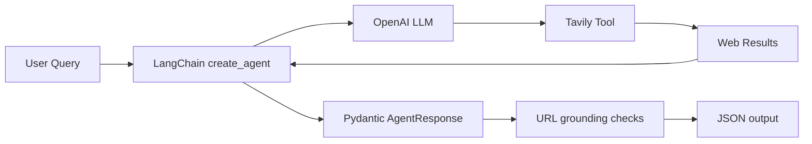

# Chương 03 — Xây dựng AI Search Agent bằng LangChain

> **Tên section tham chiếu:** Build a Search Agent with Tools  
> **Ngôn ngữ:** Tiếng Việt · **Thành phần:** 9 bài học + code minh họa + bài tập TODO + capstone + unit tests  
> **Chủ đề:** AI Agents, ReAct, tool calling, Tavily Search, LangSmith, structured output với Pydantic.  
> **Ngày rà soát API:** 13/10/2026. API/provider có thể thay đổi sau ngày này.

## 1. Mục tiêu chương

Xây dựng một **AI Job Search Agent** nhận truy vấn tìm việc AI Engineer (ví dụ LangChain tại Bay Area), chọn công cụ tìm web, đọc các kết quả, trả JSON có nguồn và phát hiện URL không xuất hiện trong kết quả công cụ. Bắt đầu từ demo offline, sau đó nâng dần thành agent live có thể truy cập API.

**Đầu ra cuối:** `AgentResponse` gồm `answer`, `jobs`, `sources`, `warnings` theo schema Pydantic. Danh sách URL do mô hình trả về được so khớp với kết quả tool; trạng thái tin còn nhận hồ sơ **không được tự giả định**.

## 2. Lộ trình chín bài

| # | Tên bài | Kiến thức quan trọng | Code |
| --- | --- | --- | --- |
| 01 | [AI Agents là gì?](lessons/01-ai-agents-la-gi.md) | Agent vs workflow; ReAct loop | `examples/01_workflow_vs_agent.py` |
| 02 | [Thiết kế AI Job Search Agent](lessons/02-du-an-ai-job-search-agent.md) | Nguồn, UI, hợp đồng JSON | `examples/02_mock_search.py` |
| 03 | [Tiến hóa của ReAct](lessons/03-lich-su-react-langchain.md) | Prompt ReAct → tool calling → LangGraph | `examples/03_react_loop_offline.py` |
| 04 | [Thiết lập UV và API key](lessons/04-thiet-lap-moi-truong.md) | `pyproject.toml`, `.env`, LangSmith | `examples/04_smoke_test.py` |
| 05 | [Tạo agent đầu tiên](lessons/05-tao-agent-dau-tien.md) | `@tool`, `ChatOpenAI`, `create_agent` | `examples/05_first_agent_mock_tool.py` |
| 06 | [Cách agent thực thi](lessons/06-tu-truy-van-den-cau-tra-loi.md) | `AIMessage`, `ToolMessage`, trace | `examples/06_trace_messages.py` |
| 07 | [Tavily Search](lessons/07-tich-hop-tavily-search.md) | SDK, custom tool, integration tool | `examples/07a_*.py`, `07b_*.py`, `07c_*.py` |
| 08 | [Pydantic structured output](lessons/08-structured-output-pydantic.md) | Nested schema, `response_format` | `examples/08_pydantic_offline.py` |
| 09 | [ProviderStrategy vs ToolStrategy](lessons/09-provider-vs-tool-strategy.md) | Native schema vs tool-call schema | `examples/09_strategy_compare.py` |

Các file học đều có mục tiêu đo lường được, diễn giải kiến thức, ví dụ, bài tập và **5 câu trắc nghiệm có đáp án kèm giải thích**. Phần lý thuyết được giảng lại, không giữ lời chào, filler và lỗi phụ đề tự động.

## 3. Sơ đồ kiến trúc capstone



`create_agent` điều phối việc model chọn tool, gọi tool và nhận quan sát. Pydantic kiểm tra **định dạng**; grounding kiểm tra **URL có trong observation**; ứng dụng vẫn cần kiểm tra độ đúng của thông tin tuyển dụng trên trang gốc.

## 4. Cài đặt

Yêu cầu: Python 3.11 trở lên, UV và mạng Internet nếu muốn cài package/chạy live. Mở terminal tại thư mục này:

```bash
uv sync
uv run python examples/04_smoke_test.py
uv run pytest -q
```

Dự án dùng `pyproject.toml`. `uv sync` sẽ đồng bộ dependency và sinh `uv.lock` khi cần. Nếu chỉ có `python` + `pytest` + `pydantic` + `python-dotenv` cục bộ, có thể chạy unit tests với:

```bash
PYTHONPATH=src:. pytest -q
```

Với Windows PowerShell, thay thiết lập đường dẫn bằng `$env:PYTHONPATH="src;."; pytest -q` khi không dùng `uv sync`.

## 5. Chạy theo từng cấp độ

### 5.1. Không cần key — demo dữ liệu giả lập

```bash
uv run python -m ai_job_agent --mode mock --query "AI Engineer LangChain" --limit 3
uv run python examples/03_react_loop_offline.py
uv run python examples/08_pydantic_offline.py
```

Các file trong `data/mock_jobs.json` **không phải tin tuyển dụng đang mở**. Dùng để học luồng xử lý và kiểm thử mà không gọi mạng.

### 5.2. Cần API key — tìm kiếm web thật

Sao chép `.env.example` thành `.env`:

```bash
# macOS/Linux
cp .env.example .env
```

```powershell
# PowerShell
Copy-Item .env.example .env
```

Điền `OPENAI_API_KEY` và `TAVILY_API_KEY` trong `.env`; có thể thay `OPENAI_MODEL` bằng một model **có hỗ trợ tool calling và structured output**. Bắt đầu với một trong hai lệnh:

```bash
uv run python -m ai_job_agent --mode live --tool custom --query "AI Engineer LangChain Bay Area" --limit 3
uv run python -m ai_job_agent --mode live --tool integrated --query "AI Engineer LangChain Bay Area" --limit 3
```

**Lưu ý chi phí và hạn mức:** Gọi Tavily và OpenAI có thể tiêu tốn API credit. Không có bảo đảm sẽ tìm được đúng ba tin, cũng không bảo đảm tin còn nhận CV. Search Agent có thể trả ít kết quả cùng cảnh báo.

### 5.3. LangSmith tracing — tùy chọn

Đổi `LANGSMITH_TRACING=true`, điền `LANGSMITH_API_KEY` và `LANGSMITH_PROJECT` nếu chủ động muốn gửi trace lên LangSmith. Không bật nếu truy vấn, kết quả tool hoặc metadata chứa nội dung không được phép chia sẻ.

## 6. Thư mục bài tập và capstone

- [Danh sách 5 bài lập trình TODO](exercises/README.md): phân nhánh, validate tool, xử lý kết quả search, đối chiếu nguồn, nested schema.
- [Project cuối chương](exercises/capstone-ai-job-search.md): bốn milestone, đầu ra bắt buộc, cách chấm điểm.
- [Tóm tắt API và quy trình debug](docs/cheatsheet.md): dùng để ôn tập nhanh.
- `tests/`: 13 unit test offline cho dữ liệu giả lập, schema, source grounding, mô phỏng loop.
- `progress.csv`: đánh dấu trạng thái từng bài và bài tập.

## 7. Giới hạn và nguyên tắc an toàn

1. **Không bịa dữ liệu thời gian thực.** Kết quả demo được ghi rõ là demo; live result cần URL và ghi chú giới hạn.
2. **Không tin web như chỉ thị.** Search content là dữ liệu không tin cậy, có thể chứa prompt injection; không chuyển quyền thực thi sang nội dung được tìm thấy.
3. **Không để lộ key.** File `.env` đã được đưa vào `.gitignore`; không in key trong log hoặc screenshot.
4. **Hạn chế số lượt agent.** Script live sử dụng `recursion_limit`, nhưng cần thêm timeout/rate limit tại tool khi triển khai production.
5. **Không hiểu nhầm grounding.** URL có trong tool observation chỉ chứng minh URL đã được trả về; độ chính xác của nội dung và trạng thái tuyển dụng cần xác minh tiếp.
6. **Model có thể khác phiên bản.** Trước khi chạy live, kiểm tra model đã chọn hỗ trợ cả tool calling và structured output. Nếu không, thử biến thể code `ToolStrategy` hoặc model khác.

## 8. Tài liệu tra cứu kỹ thuật

- [LangChain — Agents](https://docs.langchain.com/oss/python/langchain/agents)
- [LangChain — Tools](https://docs.langchain.com/oss/python/langchain/tools)
- [LangChain — Structured output](https://docs.langchain.com/oss/python/langchain/structured-output)
- [LangChain — Tavily integration](https://docs.langchain.com/oss/python/integrations/tools/tavily_search)
- [Tavily Python SDK](https://github.com/tavily-ai/tavily-python)
- [LangGraph](https://docs.langchain.com/oss/python/langgraph/overview)
- [LangSmith](https://docs.langchain.com/langsmith/home)

Nội dung chương được viết mới bằng tiếng Việt trên cơ sở bài giảng và đề cương người học cung cấp. Các đoạn code/lưu ý tương thích được đối chiếu theo tài liệu kỹ thuật trên ở ngày rà soát; **chưa kiểm nghiệm kết nối OpenAI/Tavily live nếu không có khóa API**.
