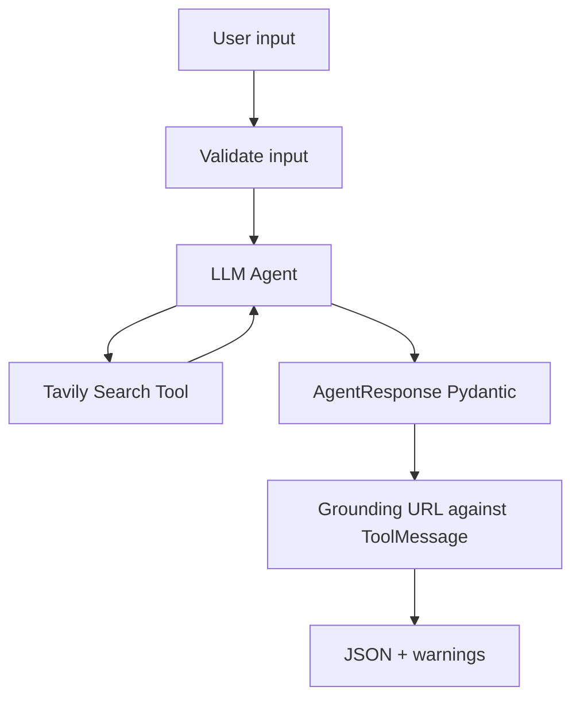

# Capstone — Xây dựng AI Job Search Agent có bằng chứng

> **Loại tài liệu:** Project cuối Chương 03 · **Ứng dụng tham chiếu:** `../src/ai_job_agent/`

## 1. Bài toán

Xây AI Agent nhận câu hỏi tìm tối đa ba vị trí AI Engineer/LangChain ở Bay Area từ nguồn công khai (ưu tiên LinkedIn), tìm kiếm web bằng Tavily và trả JSON đã kiểm tra schema. Mỗi vị trí cần có URL; không suy đoán chắc chắn trạng thái nhận hồ sơ.

## 2. Yêu cầu sản phẩm

**Đầu vào:** `query: str`, `limit: int` (1–10), `mode: mock|live`, `tool: integrated|custom`.

**Đầu ra:** object có trường `answer`, `jobs`, `sources`, `warnings`; URL cấu trúc hợp lệ và đã được trả về bởi công cụ. Nếu không tìm được tin, output có thể là danh sách trống.

**Ràng buộc:** không hard-code API key, không chạy mã sinh từ web, không dùng `eval`, không tuyên bố mock là dữ liệu thực. Phải có log/error handling tối thiểu và 5 test (trong bộ đóng gói đã có 13 test làm mẫu).

## 3. Kiến trúc

Bộ kiểm tra URL so sánh output với URL đã quan sát. Hãy mở rộng bằng cơ chế phát hiện job trùng URL, kiểm tra role/location và lập báo cáo lỗi cho tool timeout.

## 4. Milestones

### 4.1. M1 — Offline mode

Chạy `uv run python -m ai_job_agent --mode mock`. Sửa bộ mock để có tình huống **không kết quả** và kiểm tra trả về `jobs=[]` cùng cảnh báo. Không gọi API.

### 4.2. M2 — Live search

Chạy `--mode live --tool custom`; sau đó `--tool integrated`. Theo dõi các truy vấn đã gọi, số URL nhận được, mức liên quan của mỗi kết quả và vấn đề LinkedIn không mở được.

### 4.3. M3 — Structured output

Bổ sung schema Pydantic lồng nhau, đầu ra JSON và test thiếu dữ liệu. Đoạn mã hoàn chỉnh mẫu nằm trong `../src/ai_job_agent/schemas.py` và `cli.py`.

### 4.4. M4 — Robustness và đánh giá

Chặn URL không có trong tool observation. Thiết kế ít nhất một trường hợp thử cho quota lỗi, tool trả rỗng, kết quả không đúng Bay Area và nguồn tự sinh. Trình bày kết quả vào bảng kiểm.

## 5. Definition of Done

- [ ] README và `.env.example` đủ để chạy tái lập.
- [ ] Mock mode chạy không key và không giả làm tin thật.
- [ ] Live mode có thể cấu hình model và chọn loại tool.
- [ ] JSON hợp lệ theo Pydantic schema.
- [ ] URL không có trong observation bị loại hoặc gắn cờ.
- [ ] Test ít nhất 5 trường hợp, có trường hợp lỗi và rỗng.
- [ ] Không in API key hay dữ liệu nhạy cảm trong trace được chia sẻ.
- [ ] Có cảnh báo khi trạng thái nhận hồ sơ chưa được kiểm chứng.

## 6. Thang điểm 10

| Tiêu chí | Điểm |
| --- | ---: |
| Kiến trúc agent/tool đúng và giải thích được | 2 |
| Tìm web thật qua SDK hoặc tích hợp LangChain | 2 |
| Structured output, nested Pydantic | 2 |
| URL grounding, hạn chế hallucination | 2 |
| Test lỗi, báo cáo và hướng dẫn chạy | 2 |

**Tự đánh giá:** Chạy `uv run pytest -q` để kiểm tra logic offline; live search phải được đánh giá riêng với API key trên máy của người học.

## 7. Câu hỏi ôn tập

### Câu 1
Dự án mock mode khác live mode ở điểm nào?

A. Dùng API web thật.  
B. Không có JSON.  
C. Chỉ đọc dữ liệu giả lập cục bộ.  
D. Không thể kiểm thử.

**Đáp án: C.** **Giải thích:** Mock mode chạy không mạng để kiểm tra luồng dữ liệu.

### Câu 2
Khi model tự đưa URL chưa có trong ToolMessage, hành động nào phù hợp nhất?

A. Loại hoặc báo không có căn cứ.  
B. Đánh dấu đã xác minh.  
C. Tự tạo website tương tự.  
D. Gửi thông tin ứng tuyển.

**Đáp án: A.** **Giải thích:** Chỉ trả nguồn đã quan sát được từ tool.

### Câu 3
Pydantic đóng vai trò nào?

A. Tìm kiếm Internet.  
B. Tự chạy tool.  
C. Tự thu hồi API key.  
D. Kiểm tra và tuần tự hóa hợp đồng dữ liệu.

**Đáp án: D.** **Giải thích:** Pydantic xử lý schema chứ không phải tìm kiếm hay xác minh job.

### Câu 4
Để tránh lặp API không giới hạn cần có gì?

A. Nhiều ví dụ hơn trong README.  
B. Giới hạn số bước và chính sách runtime.  
C. Một URL LinkedIn ngẫu nhiên.  
D. Câu trả lời dài hơn.

**Đáp án: B.** **Giải thích:** Giới hạn giúp kiểm soát chi phí, thời gian và vòng lặp.

### Câu 5
Tại sao cần test trường hợp thiếu nguồn?

A. Vì mọi model đều trả lỗi đó.  
B. Để bài kiểm tra trông dài.  
C. Để bảo đảm output không bịa thông tin khi tool trả rỗng.  
D. Vì test không cần assert.

**Đáp án: C.** **Giải thích:** Agent phải xử lý tình huống không đủ bằng chứng một cách an toàn.
