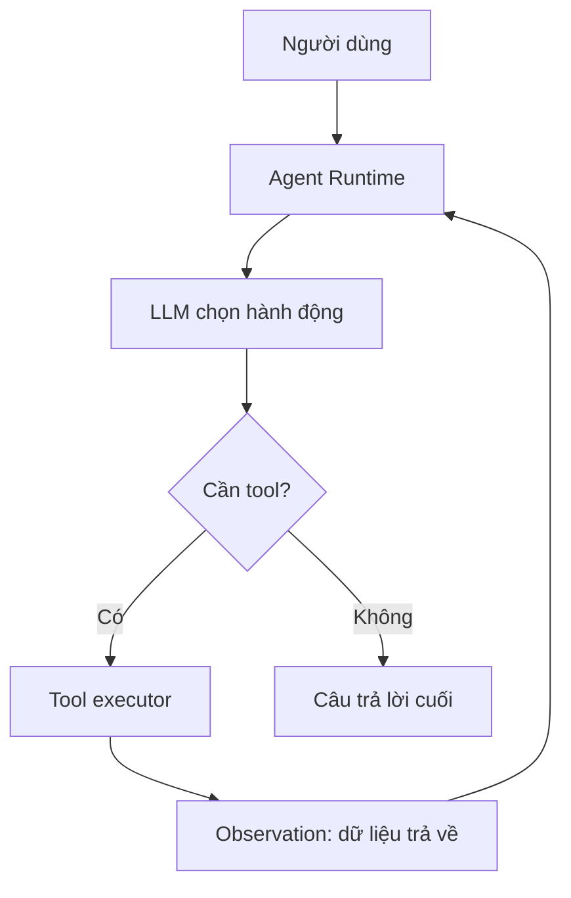

# Bài 01 — Tác nhân AI là gì? Tổng quan và kiến trúc ReAct

> **Chương 03:** Xây dựng Search Agent bằng LangChain · **Loại:** Lý thuyết kết hợp thực hành · **Thực hành:** `../examples/01_workflow_vs_agent.py`

## 1. Tóm tắt

**AI Agent (tác nhân AI)** là hệ thống phần mềm sử dụng mô hình ngôn ngữ lớn (LLM) để lựa chọn hành động, nhận kết quả từ môi trường và quyết định có cần hành động tiếp hay không. Trong ứng dụng thực tế, LLM đóng vai trò **ra quyết định**; chương trình Python, dịch vụ API và agent runtime mới là bên **thực thi**. Cấu trúc này biến mô hình chỉ biết trả lời từ ngữ cảnh thành một hệ thống có khả năng tra cứu web, truy vấn dữ liệu, gọi API và hoàn thành nhiệm vụ nhiều bước.

## 2. Mục tiêu học tập

- Định nghĩa AI Agent bằng mô hình `LLM + Tools + Runtime + Control Loop`.
- Phân biệt workflow định sẵn với agent tự lựa chọn công cụ.
- Mô tả chu kỳ hành động và quan sát của ReAct.
- Nêu ba giới hạn cần kiểm soát khi cấp công cụ cho LLM.

## 3. Từ LLM thông thường đến AI Agent

Một LLM thuần có thể nhận câu hỏi và sinh nội dung từ ngữ cảnh được đưa vào. Nếu được hỏi về những vị trí tuyển dụng đang mở hôm nay, mô hình không thể tự bảo đảm câu trả lời cập nhật, vì dữ liệu huấn luyện không phải cơ sở dữ liệu công việc theo thời gian thực. Cần một công cụ truy cập nguồn bên ngoài rồi đưa bằng chứng trở lại mô hình.

Chẳng hạn, yêu cầu **“Tìm ba việc làm AI Engineer có sử dụng LangChain tại Bay Area”** cần nhiều hành động: xác định từ khóa, tìm kiếm web, đọc mô tả, loại bản trùng, kiểm tra URL và tóm tắt. Người phát triển có thể viết từng bước theo thứ tự cố định, hoặc cung cấp công cụ để LLM tự chọn bước cần làm tùy theo câu hỏi.

| Tiêu chí | Workflow cố định | AI Agent |
| --- | --- | --- |
| Chọn bước tiếp theo | Lập trình viên định nghĩa trước | Mô hình đề xuất dựa trên ngữ cảnh |
| Khả năng thay đổi quy trình | Ít linh hoạt | Linh hoạt hơn với nhiệm vụ mở |
| Dự đoán chi phí và thời gian | Thường dễ hơn | Cần giới hạn số lần gọi tool |
| Trường hợp phù hợp | ETL, gửi email đã phê duyệt | Nghiên cứu thông tin, tìm kiếm đa bước |
| Rủi ro | Quy trình cứng, thiếu nhánh | Gọi tool sai, vòng lặp, nguồn không tin cậy |

Điểm phân biệt không nằm ở việc **có dùng LLM hay không**, mà nằm ở việc **ai điều khiển hành động tiếp theo**. Một workflow cố định có thể gọi LLM ở bước tóm tắt mà vẫn không phải agent.

## 4. Thành phần của một tác nhân



- **LLM:** chọn công cụ và đối số, hoặc quyết định dừng và trả lời.
- **Tool:** hàm có giao diện được mô tả rõ ràng, ví dụ `search_jobs(query: str)`.
- **Runtime:** xác thực đối số, thực thi hàm, lưu lịch sử, xử lý lỗi và giới hạn vòng lặp.
- **Observation:** kết quả tool trả về. Đây là *dữ liệu*, không phải chỉ thị đáng tin cậy.

Nếu LLM muốn gọi `search_jobs(query="LangChain AI Engineer Bay Area")`, lời gọi chỉ là **yêu cầu có cấu trúc**. Tool executor mới thực sự gửi truy vấn tới API. Không nên xem mô hình có quyền truy cập máy chủ, file hay mạng vô hạn chỉ vì nó “có tool”.

## 5. ReAct: Reasoning and Acting

**ReAct** kết hợp suy luận để chọn hành động với khả năng quan sát kết quả trước khi quyết định bước kế tiếp. Một chu kỳ nhìn từ bên ngoài có dạng:

1. Nhận câu hỏi và các công cụ được phép gọi.
2. Mô hình xuất quyết định hành động: tên công cụ và tham số.
3. Runtime kiểm tra và gọi công cụ.
4. Kết quả công cụ trở thành `ToolMessage` hoặc observation.
5. Mô hình tiếp tục hoặc trả lời cuối cùng.

Không cần yêu cầu LLM in toàn bộ suy nghĩ nội bộ. Trong hệ thống hiện đại, dấu vết hữu ích để debug là **tool name, arguments, observations, thời gian và kết quả**, không phải một bản độc thoại suy luận tự do.

Tác nhân không nhất thiết luôn dùng công cụ. Với câu hỏi định nghĩa đơn giản, LLM có thể trả lời ngay; với câu hỏi về thời tiết hoặc tuyển dụng *hiện tại*, nó nên tìm nguồn cập nhật.

## 6. Minh họa bằng Python

Chạy `python examples/01_workflow_vs_agent.py` từ thư mục gốc dự án:

```python
def fixed_workflow(query: str):
    return ["summarize", "translate", "save"]


def agent_like_router(query: str):
    if "tuyển" in query.lower():
        return ["web_search", "summarize"]
    return ["answer_from_context"]
```

Hàm `agent_like_router` là **mô phỏng chọn nhánh bằng luật**, không phải AI Agent thật. Điểm cần quan sát là cùng một hàm có đường đi khác nhau tùy truy vấn. Ở bài sử dụng `create_agent`, phần chọn nhánh này sẽ được chuyển cho LLM.

## 7. Những giới hạn không thể bỏ qua

**Quyền thực thi:** không cấp lệnh xóa dữ liệu hoặc chạy mã tùy ý cho công cụ tìm kiếm chỉ cần đọc web. Áp dụng allowlist công cụ và xác thực ở runtime. **Chất lượng dữ liệu:** mô hình có thể tóm tắt sai hoặc bị chỉ dẫn độc hại nằm trong trang web đánh lừa; cần xử lý nội dung tìm kiếm như dữ liệu không tin cậy. **Chi phí và thời gian:** một truy vấn có thể tạo nhiều tool call, vì vậy cần giới hạn bước, timeout và log.

## 8. Bài tập thực hành

**A — Phân loại (cơ bản):** Với ba nhiệm vụ “tính tổng từ hóa đơn”, “tìm tuyển dụng mới”, “gửi báo cáo đã duyệt”, hãy quyết định nhiệm vụ nào dùng workflow và nhiệm vụ nào dùng agent. Giải thích theo tiêu chí ai chọn bước.

**B — Thay đổi code (trung bình):** Sửa `agent_like_router` để nhận diện các từ khóa `mới nhất`, `hôm nay`, `tìm kiếm`. Ghi kết quả cho ít nhất bốn câu hỏi và nêu hạn chế của cách định tuyến bằng từ khóa.

**C — Thiết kế (nâng cao):** Viết đặc tả cho một agent có `web_search`, `read_database` và `answer`. Với từng tool, ghi đầu vào, đầu ra, mức quyền, lỗi có thể xảy ra và điểm dừng tối đa.

**Hoàn thành khi:** vẽ được vòng lặp ReAct, giải thích ai thực thi Python và nêu một trường hợp agent không nên gọi tool.

## 9. Câu hỏi ôn tập

### Câu 1
Một hệ thống luôn gọi LLM để tóm tắt rồi dịch, bất kể người dùng hỏi gì. Đó là gì?

A. Một agent tự chủ.  
B. Một workflow định sẵn có dùng LLM.  
C. Một agent có nhiều tool call.  
D. Một tool executor độc lập.

**Đáp án: B.** **Giải thích:** LLM không lựa chọn bước tiếp theo; thứ tự xử lý đã được lập trình.

### Câu 2
Thành phần nào thực sự chạy hàm Python khi LLM đề nghị gọi tool?

A. Agent runtime/tool executor.  
B. Tokenizer của mô hình.  
C. Cơ sở dữ liệu huấn luyện.  
D. Trình hiển thị Markdown.

**Đáp án: A.** **Giải thích:** LLM trả về yêu cầu; runtime thực thi sau khi kiểm soát quyền và đối số.

### Câu 3
Observation trong vòng lặp ReAct thường là gì?

A. Prompt khởi tạo.  
B. Tên lớp `Agent`.  
C. Kết quả thực thi công cụ.  
D. Tệp Python trước khi chạy.

**Đáp án: C.** **Giải thích:** Agent dùng thông tin trả về của công cụ để quyết định tiếp tục hoặc kết thúc.

### Câu 4
Vì sao tìm việc đang tuyển cần công cụ tìm kiếm bên ngoài?

A. Vì LLM không hiểu tiếng Việt.  
B. Vì mọi câu hỏi đều cần năm công cụ.  
C. Vì mô hình không thể đọc JSON.  
D. Vì dữ liệu về việc làm thay đổi và phải kiểm tra nguồn hiện tại.

**Đáp án: D.** **Giải thích:** Kiến thức đã học không bảo đảm phản ánh các trang tuyển dụng tại thời điểm truy vấn.

### Câu 5
Biện pháp nào phù hợp khi cấp thêm tool cho agent?

A. Cho phép thực thi mọi lệnh shell.  
B. Giới hạn công cụ, quyền và số bước thực thi.  
C. Tin tuyệt đối mọi văn bản từ web.  
D. Bỏ kiểm tra đầu vào để mô hình linh hoạt.

**Đáp án: B.** **Giải thích:** Agent có thể đề nghị hành động ngoài mong đợi nên cần kiểm soát runtime.

## 10. Tổng kết

AI Agent là **vòng lặp lựa chọn hành động dựa trên LLM**, không phải mọi phần mềm “có AI”. ReAct giúp kết hợp quyết định và quan sát; tool calling cung cấp giao diện có cấu trúc để runtime thực hiện hành động. Khi thiết kế agent, cần đồng thời nghĩ tới **khả năng, giới hạn quyền và bằng chứng**.
