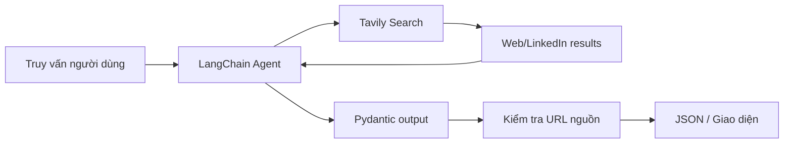

# Bài 02 — Thiết kế AI Job Search Agent và tiêu chuẩn nguồn trích dẫn

> **Chương 03:** Xây dựng Search Agent bằng LangChain · **Loại:** Bài thiết kế dự án · **Thực hành:** `../examples/02_mock_search.py`

## 1. Tóm tắt

Một Search Agent tốt không chỉ đưa ra ba dòng tên công việc, mà cần trả **tiêu đề, công ty, địa điểm, thông tin liên quan và URL có thể kiểm tra được**. Dự án của chương này là AI Job Search Agent cho truy vấn: *“Tìm ba vị trí AI Engineer có LangChain ở San Francisco Bay Area, ưu tiên kết quả LinkedIn”*. Trước khi gọi web thật, cần thiết kế **hợp đồng dữ liệu** và thử trên bộ dữ liệu giả lập.

## 2. Mục tiêu học tập

- Định nghĩa tiêu chí thành công cho một agent tìm việc.
- Phân biệt kết quả tìm kiếm, thông tin đã xác minh và kết luận do mô hình tổng hợp.
- Thiết kế đầu vào/đầu ra có nguồn minh bạch.
- Chạy bản tìm kiếm offline có thể kiểm thử mà không tốn API credit.

## 3. Phân tích yêu cầu sản phẩm

Người dùng không yêu cầu bài viết về cách tìm việc, mà yêu cầu **ba tin tuyển dụng cụ thể**. Vì vậy, đầu vào nên có: vai trò, kỹ năng, địa điểm, nguồn ưu tiên và số kết quả tối đa. Số ba là *giới hạn mong muốn*, không phải lý do để bịa thêm khi chỉ có một nguồn phù hợp.

Một kết quả đủ dùng có thể biểu diễn bằng JSON:

```json
{
  "title": "AI Engineer",
  "company": "Example Company",
  "location": "San Francisco Bay Area",
  "url": "https://example.org/jobs/demo-ai-001",
  "skills": ["Python", "LangChain"],
  "status": null
}
```

Đây là **dữ liệu minh họa**, không phải tin tuyển dụng thực. `status: null` diễn đạt rằng chưa xác minh công việc còn nhận hồ sơ hay không. Trong ứng dụng thật, nên phân biệt **ngày tìm thấy tin**, **ngày đăng tin** và **ngày đã kiểm tra trạng thái**, nếu có dữ liệu.

## 4. Kiến trúc tối thiểu



Công cụ tìm kiếm nhận từ khóa và trả các trang. LLM đọc nội dung trả về rồi trích xuất dữ liệu. Pydantic kiểm tra cấu trúc; bước xác minh độc lập so sánh URL do mô hình sinh với URL thực sự có trong observation. Nếu URL mới không khớp bất cứ kết quả công cụ nào, hệ thống phải loại hoặc gắn cờ, chứ không lặng lẽ hiển thị như bằng chứng.

Việc có URL **chưa chứng minh** tin còn hiệu lực, và một trang LinkedIn có thể bị giới hạn truy cập. Search Agent vì thế phải diễn đạt rõ những gì chưa kiểm chứng.

## 5. Giao diện người dùng và niềm tin

Một giao diện phù hợp hiển thị thẻ kết quả theo `title`, `company`, `location`, `skills` và đường dẫn nguồn. Phần tóm tắt cần dẫn tới đúng URL. Với kết quả không còn nhận hồ sơ, không nên giấu đi hoặc tự suy ra rằng còn tuyển. Trong bản trả lời có cấu trúc, lưu cảnh báo `warnings` giúp UI quyết định có cần gắn nhãn **Chưa xác minh trạng thái**.

**Generative UI** ở đây là cách trình bày dữ liệu của agent thành thành phần giao diện, không phải lời hứa rằng agent đã xác minh mọi nguồn. Có thể dựng UI bằng web frontend bất kỳ miễn là có dữ liệu đầu ra ổn định.

## 6. Chạy bản offline

Tại thư mục dự án sau khi cài phụ thuộc:

```bash
uv run python examples/02_mock_search.py
uv run python -m ai_job_agent --mode mock --query "LangChain AI Engineer" --limit 3
```

Các kết quả được lấy từ `data/mock_jobs.json`; tên công ty và địa chỉ `example.org` **hoàn toàn giả lập**. Lệnh không truy cập mạng. Bộ dữ liệu này giúp học được hợp đồng JSON, lỗi đầu vào và trường hợp thiếu kết quả trước khi trả tiền cho API.

## 7. Kiểm chứng chất lượng kết quả

| Kiểm tra | Ý nghĩa | Khi thất bại |
| --- | --- | --- |
| Có URL HTTPS hợp lệ | Cấu trúc đường dẫn không sai | Loại hoặc báo lỗi schema |
| URL có trong tool observations | Không tự bịa nguồn | Bỏ URL khỏi kết quả |
| Tin đúng vai trò, địa điểm | Phù hợp truy vấn | Gắn nhãn không phù hợp |
| Số kết quả không vượt yêu cầu | UI không quá tải | Cắt theo giới hạn |
| Có thể kiểm tra trạng thái nhận hồ sơ | Tránh giới thiệu tin hết hạn | Ghi rõ chưa xác minh |

**Lưu ý:** URL cú pháp hợp lệ chưa phải URL truy cập được; thậm chí URL truy cập được cũng chưa đồng nghĩa nội dung chính xác.

## 8. Bài tập thực hành

**A — Product design:** Viết 5 user stories cho người tìm việc. Chọn hai trường `required` và ba trường cho phép `null` trong schema.

**B — Data contract:** Mở `src/ai_job_agent/schemas.py`, giải thích vai trò của `AgentResponse`, `JobPosting`, `Source`, `warnings`. Đề xuất thêm một trường `salary` nhưng không bịa mức lương nếu nguồn không có.

**C — Failure cases:** Sửa file dữ liệu giả lập để (1) không có kết quả, (2) trả hai tin trùng URL, (3) mất địa điểm. Thiết kế cách xử lý và thử lại lệnh mock.

**Hoàn thành khi:** phân biệt được **nguồn tìm kiếm** với **kết luận agent**, tạo được câu trả lời JSON có nguồn, không khẳng định dữ liệu demo là tin thật.

## 9. Câu hỏi ôn tập

### Câu 1
Khi chỉ tìm được hai nguồn phù hợp nhưng yêu cầu là ba tin, cách làm đúng nhất là gì?

A. Tạo tin thứ ba để đủ số lượng.  
B. Lặp một tin để đủ ba thẻ.  
C. Trả hai tin và nói rõ thiếu kết quả.  
D. Bỏ toàn bộ nguồn.

**Đáp án: C.** **Giải thích:** Số kết quả yêu cầu không cho phép bịa dữ liệu.

### Câu 2
`status: null` hợp lý nhất khi nào?

A. Trạng thái nhận hồ sơ chưa được xác minh.  
B. Công việc chắc chắn đã đóng.  
C. Công việc chắc chắn còn tuyển.  
D. URL không phải HTTPS.

**Đáp án: A.** **Giải thích:** `null` đại diện cho trạng thái không biết, tránh khẳng định tùy tiện.

### Câu 3
Vai trò chính của trường `warnings` là gì?

A. Chứa API key.  
B. Lưu nội dung prompt hệ thống.  
C. Chứa toàn bộ HTML.  
D. Thể hiện giới hạn và sự không chắc chắn của kết quả.

**Đáp án: D.** **Giải thích:** UI có thể dùng cảnh báo để nêu thông tin chưa kiểm chứng.

### Câu 4
Biện pháp nào giúp phát hiện URL nguồn do mô hình tự sáng tạo?

A. Chỉ kiểm tra chữ hoa chữ thường.  
B. So khớp URL trả về với URL trong kết quả tool.  
C. In câu trả lời dài hơn.  
D. Tăng nhiệt độ mô hình.

**Đáp án: B.** **Giải thích:** Grounding bắt nguồn từ nguồn thực sự quan sát được, không chỉ từ chuỗi URL hợp lệ.

### Câu 5
Vì sao demo offline cần ghi rõ dữ liệu giả?

A. Vì Pydantic không xử lý dữ liệu thật.  
B. Vì URL demo tự động hết hạn.  
C. Để người học không hiểu nhầm kết quả minh họa là tin còn tuyển.  
D. Vì file JSON không thể được dùng làm fixture.

**Đáp án: C.** **Giải thích:** Mock data dành cho test, không chứng minh sự kiện thực tế.

## 10. Tổng kết

Search Agent là bài toán **thu thập bằng chứng và trả lời có cấu trúc**, không chỉ là sinh văn bản. Thiết kế nguồn, trạng thái chưa rõ và trường hợp không có kết quả từ đầu giúp ứng dụng dễ kiểm thử và đáng tin cậy hơn.
