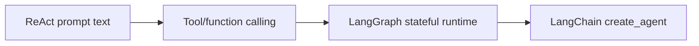
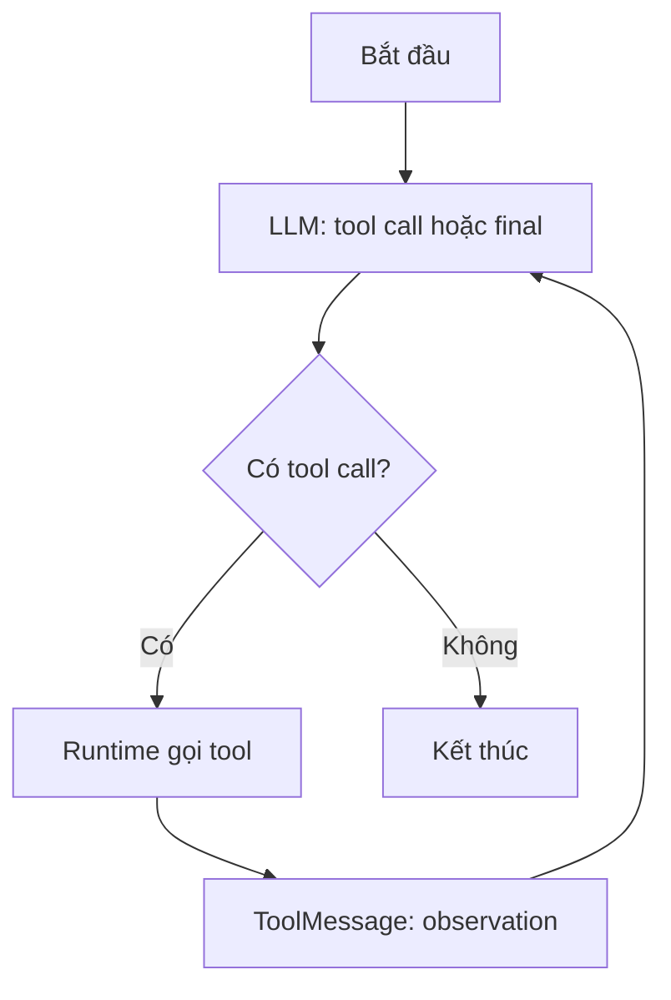

# Bài 03 — Sự tiến hóa của ReAct Agent: từ prompt đến LangChain 1.x

> **Chương 03:** Xây dựng Search Agent bằng LangChain · **Loại:** Lý thuyết kiến trúc · **Thực hành:** `../examples/03_react_loop_offline.py`

## 1. Tóm tắt

ReAct (Reasoning and Acting) là mẫu thiết kế kết hợp **quyết định hành động** và **phản hồi từ môi trường**. Các thư viện xây agent đã đi từ cú pháp text trong prompt, sang **tool/function calling có cấu trúc**, rồi sang runtime đồ thị có khả năng quản lý trạng thái. Trong LangChain hiện đại, `create_agent` là giao diện cấp cao để triển khai vòng lặp đó, được xây trên nền LangGraph.

## 2. Mục tiêu học tập

- Giải thích hạn chế của cách tự phân tích chuỗi `Action:` và `Observation:`.
- Phân biệt ReAct pattern, tool calling và LangGraph runtime.
- Mô tả tiến trình chuyển đổi sang `create_agent` ở LangChain 1.x.
- Tự viết một vòng lặp action–observation tối giản và xác định điều kiện dừng.

## 3. Bước đầu: ReAct dựa trên prompt

Những ví dụ ReAct đầu tiên dựa nhiều vào văn bản theo quy ước, chẳng hạn `Thought`, `Action`, `Action Input`, `Observation`. LLM sinh văn bản thể hiện yêu cầu hành động; phần mềm phải dùng parser để nhận diện tên công cụ và tham số. Cách tiếp cận này dễ minh họa nhưng khó duy trì khi mô hình xuất sai dấu ngoặc, thiếu nhãn hoặc trộn thêm lời giải thích.

Khi mô hình hỗ trợ **function/tool calling**, hệ thống có thể nhận đối tượng có cấu trúc như `{"name":"search","args":{"query":"..."}}`. Runtime không cần dựa vào parser của văn bản tự do để biết phải thực thi hàm nào. **ReAct vẫn là ý tưởng điều khiển**, còn tool calling là **định dạng và cơ chế giao tiếp** giúp triển khai đáng tin cậy hơn.

## 4. Từ agent executor đến LangGraph



Sơ đồ mô tả **sự thay đổi cách triển khai**, không phải các công nghệ loại trừ nhau. `create_agent` sử dụng LangGraph ở bên trong để quản lý mô hình, công cụ và trạng thái. LangGraph là lớp orchestration linh hoạt cho những luồng phức tạp cần phân nhánh, tạm dừng, khôi phục hoặc lưu trạng thái. LangChain cung cấp API ở mức ứng dụng giúp khởi đầu nhanh hơn.

Các mốc quan trọng cần phân biệt:

| Giai đoạn | Cơ chế | Hạn chế hoặc điểm mạnh |
| --- | --- | --- |
| ReAct bằng prompt | Sinh text theo định dạng quy ước | Parser dễ hỏng khi text sai cấu trúc |
| Tool-calling agent | LLM trả tên tool và `args` có cấu trúc | Đầu vào/đầu ra rõ ràng hơn |
| LangGraph ReAct agent | Node, edge, state, checkpoint | Quan sát, điều phối và lưu trạng thái tốt hơn |
| LangChain `create_agent` | API gọn, runtime đồ thị bên dưới | Bắt đầu nhanh, có thể mở rộng middleware |

Không phải mọi agent đều cần triển khai LangGraph thủ công. Nếu nhiệm vụ là tìm thông tin với vài công cụ, `create_agent` là điểm bắt đầu hợp lý. Nếu cần kiểm soát nhánh phức tạp hoặc quy trình phê duyệt, mới cân nhắc thiết kế graph chi tiết hơn.

## 5. Vòng lặp thực thi và thông tin quan sát



Một agent có thể phát sinh nhiều yêu cầu tool trong một lượt gọi mô hình. Runtime đôi khi xử lý chúng song song tùy cấu hình và công cụ. Tuy nhiên, tính song song **không phải quy luật bắt buộc**: tool có phụ thuộc lẫn nhau hoặc có tác dụng phụ cần được kiểm soát thứ tự.

Trạng thái tối thiểu của agent chứa danh sách `messages`; với ứng dụng nhiều lượt, có thể thêm checkpointer và `thread_id`. Một lời gọi mới không tự động nhớ cuộc trò chuyện cũ nếu không cấu hình lưu trạng thái phù hợp.

## 6. Demo vòng lặp offline

```bash
uv run python examples/03_react_loop_offline.py
```

Script chỉ mô phỏng logic hành động; nó **không có LLM**. Quan sát output gồm `action`, `observation_count` và `final`. Đây là những trường có thể log an toàn để hiểu agent hoạt động, không yêu cầu lộ suy luận nội bộ.

Trong agent thật, có thể thiết lập giới hạn bằng cấu hình runtime:

```python
result = agent.invoke(
    {"messages": [{"role": "user", "content": "Tìm việc AI Engineer"}]},
    config={"recursion_limit": 14},
)
```

Giới hạn trên là ví dụ cấu hình số bước trong đồ thị; **không đồng nhất** với số lần gọi web và không tự tạo timeout cho từng API. Hạn chế tài nguyên cần được thiết kế ở nhiều tầng.

## 7. Lỗi thiết kế thường gặp

Một là nhầm ReAct với việc buộc mô hình in những đoạn suy nghĩ dài. Hai là nghĩ rằng trả về `tool_calls` đồng nghĩa công cụ đã chạy; thực tế phải có tool executor. Ba là cho rằng `create_agent` tự giải quyết mọi yêu cầu bền vững: persistence, retry, giới hạn chi phí và quyền truy cập vẫn cần cấu hình tùy môi trường.

## 8. Bài tập thực hành

**A — So sánh:** Viết bảng mô tả lỗi parser text và cách tool calling có cấu trúc xử lý. Nêu một lỗi mà tool calling vẫn không giải quyết (ví dụ: dữ liệu nguồn sai).

**B — Lập trình:** Thêm bộ đếm số lần quan sát vào `03_react_loop_offline.py`. Nếu sau hai lượt không có kết quả, dừng với danh sách rỗng và lý do rõ ràng.

**C — Kiến trúc:** Phác thảo một graph gồm `agent → search → validate → agent`. Giải thích khi nào từ chối URL chưa được kiểm chứng, khi nào gọi lại công cụ.

**Hoàn thành khi:** phân biệt được *ReAct pattern* với *tool-calling transport* và *LangGraph runtime*; mô phỏng đúng điều kiện dừng.

## 9. Câu hỏi ôn tập

### Câu 1
Vấn đề đặc trưng của ReAct dựa hoàn toàn vào text là gì?

A. Không có LLM nào viết được chữ.  
B. Có thể sai định dạng và làm parser khó nhận diện action.  
C. Không thể gọi API trong Python.  
D. Luôn không thể trả lời người dùng.

**Đáp án: B.** **Giải thích:** Việc phân tích `Action:` từ văn bản sinh tự do dễ gặp lỗi cấu trúc.

### Câu 2
Tool calling đóng góp quan trọng nhất là gì?

A. Đảm bảo nguồn web đúng 100%.  
B. Thay thế hoàn toàn runtime.  
C. Loại bỏ chi phí LLM.  
D. Biểu diễn tên tool và đối số theo cấu trúc dễ xử lý.

**Đáp án: D.** **Giải thích:** Giao thức gọi công cụ giúp runtime xác định hành động có cấu trúc.

### Câu 3
`create_agent` hiện đại của LangChain dùng thành phần nào phía dưới để điều phối?

A. LangGraph.  
B. SQLite bắt buộc.  
C. Bộ parser HTML của trình duyệt.  
D. Excel.

**Đáp án: A.** **Giải thích:** LangChain agent API được xây trên runtime LangGraph.

### Câu 4
Tại sao cần điều kiện dừng?

A. Để cấm mọi ToolMessage.  
B. Để có ít câu trả lời đúng hơn.  
C. Để hạn chế vòng lặp và tài nguyên khi chưa đạt kết quả.  
D. Vì Python không có vòng lặp.

**Đáp án: C.** **Giải thích:** Agent có thể lặp tìm kiếm hoặc hành động không hữu ích nếu không giới hạn.

### Câu 5
Thông điệp `ToolMessage` thường biểu diễn điều gì?

A. Lịch sử cài đặt package.  
B. Quan sát sau khi tool được thực thi.  
C. API key được mã hóa.  
D. Yêu cầu chọn phiên bản Python.

**Đáp án: B.** **Giải thích:** Kết quả tool được đưa lại vào ngữ cảnh để agent xử lý.

## 10. Tổng kết

ReAct mô tả **động học của quyết định và quan sát**. Tool calling định dạng quyết định để hệ thống xử lý ổn định. LangGraph cung cấp bộ máy điều phối; `create_agent` giúp sử dụng bộ máy ấy mà không phải tự lắp từng node từ đầu.
