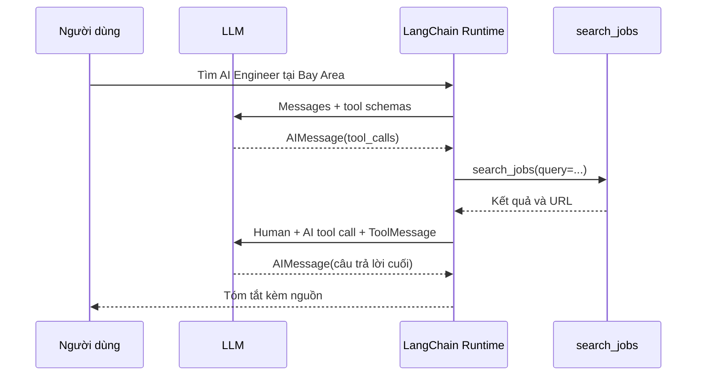

# Bài 06 — Agent thực thi ra sao? Messages, Tool Calls, Observations và LangSmith

> **Chương 03:** Xây dựng Search Agent bằng LangChain · **Loại:** Phân tích runtime và debugging · **Thực hành:** `../examples/06_trace_messages.py`

## 1. Tóm tắt

Một tác nhân dùng công cụ thường tạo ra **nhiều thông điệp**, không chỉ một câu trả lời. Bản ghi tối thiểu có `HumanMessage` (câu hỏi), `AIMessage` (yêu cầu gọi công cụ), `ToolMessage` (kết quả hàm) và `AIMessage` cuối (trả lời). Đọc được chuỗi thông điệp giúp kiểm tra model **đã định làm gì**, runtime **đã chạy gì** và dữ liệu nào được dùng để trả lời.

## 2. Mục tiêu học tập

- Xác định `tool_calls` và đối số trong một `AIMessage`.
- Nối `tool_call_id` với kết quả `ToolMessage` tương ứng.
- Kiểm tra agent có thật sự dùng dữ liệu công cụ hay chỉ trả lời từ model.
- Biết cách bật LangSmith tracing có kiểm soát và xử lý tool call bất thường.

## 3. Luồng dữ liệu của một truy vấn



Ở bước đầu, runtime đưa câu hỏi và **metadata của công cụ** vào lời gọi mô hình. Nếu mô hình muốn dùng `search_jobs`, nó phát yêu cầu có cấu trúc gồm `name`, `args`, `id`. Runtime tìm công cụ theo danh sách được cho phép và thực thi. Sau đó, observation được chuyển về dưới dạng `ToolMessage`. Một lượt gọi mô hình tiếp theo dùng observation để tạo kết luận.

Có thể có **nhiều `tool_calls` trong cùng một AIMessage**, ví dụ nhiều truy vấn LinkedIn khác nhau. Runtime có khả năng thực thi song song tùy công cụ và cấu hình; điều này có thể tăng chi phí API và tạo kết quả trùng nhau nên cần giới hạn và dedup.

## 4. Cấu trúc message minh họa

```text
messages[0]  HumanMessage   content="Tìm việc AI Engineer"
messages[1]  AIMessage      tool_calls=[{"name": "search_jobs", "args": {"query": "..."}, "id": "call_..."}]
messages[2]  ToolMessage    tool_call_id="call_...", content="{...results...}"
messages[3]  AIMessage      content="Tìm thấy hai việc phù hợp..."
```

Đây là **ví dụ cấu trúc**, không phải kết quả chạy thật. `tool_call_id` rất quan trọng khi nhiều công cụ được gọi trong một lượt: nó giúp hệ thống gắn đúng observation với yêu cầu tương ứng. Không được nghĩ rằng `AIMessage` chứa `tool_calls` là tool đã thực thi thành công; chỉ có observation hoặc trace của executor mới là bằng chứng thực thi.

## 5. In nhật ký có chọn lọc

```python
for i, message in enumerate(result["messages"], 1):
    print(i, message.type)
    for call in getattr(message, "tool_calls", []) or []:
        print("Tool:", call["name"], "Args:", call["args"], "ID:", call["id"])
```

Thay vì in cả object trả về rất dài, ví dụ này chỉ tập trung vào **đầu vào tool**, tên công cụ và ID. Nếu kết quả web có dữ liệu cá nhân hoặc bí mật, phải lọc nội dung log. Trong môi trường phát triển, có thể in tối đa vài trăm ký tự của observation để tìm lỗi, nhưng không log thông tin bí mật.

## 6. Chạy thực hành và đọc trace

```bash
uv run python examples/06_trace_messages.py
```

Script dùng tool tĩnh để **mô phỏng** kết quả thời tiết Tokyo. Quan sát xem mô hình gọi `look_up_demo` rồi sinh câu trả lời như thế nào. Đây là dữ liệu không thật, không được dùng để kết luận thời tiết hiện tại.

Nếu đã cấu hình LangSmith trong `.env` và chủ động cho phép tracing, mở project được chỉ định bởi `LANGSMITH_PROJECT` để xem từng bước thực thi, metadata, độ trễ và công cụ. Một trace điển hình thể hiện **LLM call → Tool call → LLM call**. Nếu không thấy Tool call, có thể mô hình đã quyết định trả lời trực tiếp.

## 7. Chiến lược debug

| Hiện tượng | Điều cần kiểm tra | Cách cải thiện |
| --- | --- | --- |
| Agent không gọi tìm kiếm | `AIMessage.tool_calls` có rỗng không? | Sửa mô tả tool, kiểm tra system prompt |
| Tool bị gọi với query quá mơ hồ | `args["query"]` là gì? | Giải thích mục tiêu, địa điểm và nguồn |
| API trả rỗng | `ToolMessage.content` có `results` không? | Tăng độ bao phủ truy vấn hoặc báo thiếu nguồn |
| Lặp gọi API nhiều lần | Số tool messages, recursion limit | Đặt ngân sách bước và điều kiện dừng |
| URL trong câu trả lời không có trong kết quả | So `structured_response` với observation | Loại URL chưa được chứng minh |

Điều nên tránh: dựa duy nhất vào “agent nói đã tìm” để khẳng định tool đã chạy. Muốn đánh giá chắc chắn, phải kiểm tra sự tồn tại của `ToolMessage` liên quan và dữ liệu trong đó.

## 8. Bài tập thực hành

**A — Truy vết:** Với ví dụ bốn message ở mục 4, chỉ ra message nào là input, quyết định, observation và kết luận.

**B — Instrumentation:** Trong `06_trace_messages.py`, đếm số `tool_calls` và số `ToolMessage`. Kiểm tra xem mỗi call ID được nối với observation nào, không log API key.

**C — Quan sát lỗi:** Cho tool trả chuỗi rỗng hoặc JSON có `results: []`. Ghi lại phản ứng agent. Thiết kế câu trả lời trung thực khi không có bằng chứng.

**Hoàn thành khi:** phân tích được một trace và phân biệt “đã yêu cầu tool” với “đã nhận kết quả tool”.

## 9. Câu hỏi ôn tập

### Câu 1
Message đầu tiên ghi câu hỏi của người dùng thuộc loại nào?

A. `ToolMessage`.  
B. `SystemMessage` bắt buộc.  
C. `HumanMessage`.  
D. `AIMessage`.

**Đáp án: C.** **Giải thích:** Người dùng là nguồn của thông điệp đầu vào trong ví dụ.

### Câu 2
`tool_calls` trong `AIMessage` chứng minh điều gì?

A. LLM đã đề nghị sử dụng công cụ với đối số.  
B. API bên ngoài chắc chắn thành công.  
C. URL nguồn đã kiểm chứng.  
D. Tracing đã bật.

**Đáp án: A.** **Giải thích:** `tool_calls` mô tả yêu cầu; còn thực thi cần runtime và observation.

### Câu 3
Vì sao có `tool_call_id`?

A. Để thay thế URL.  
B. Để chứa API key.  
C. Để đếm số token.  
D. Để nối đúng lời gọi công cụ với kết quả tương ứng.

**Đáp án: D.** **Giải thích:** Nhiều tool call trong cùng một lượt cần ID để đối chiếu.

### Câu 4
Kiểm tra tốt nhất khi agent nói có tin tuyển dụng nhưng không tìm thấy URL trong tool result là gì?

A. Tin vì câu trả lời trôi chảy.  
B. Gắn cờ hoặc loại nguồn không có bằng chứng.  
C. Tăng số từ trong câu trả lời.  
D. Xóa history để ẩn lỗi.

**Đáp án: B.** **Giải thích:** Nguồn cần khớp observation, tránh dẫn sai đường.

### Câu 5
LangSmith trace hỗ trợ công việc nào rõ nhất?

A. Viết nội dung việc làm cho nhà tuyển dụng.  
B. Xác minh tất cả LinkedIn URL còn nhận CV.  
C. Quan sát trình tự gọi model/tool để debug.  
D. Tự tạo key API miễn phí.

**Đáp án: C.** **Giải thích:** Tracing cung cấp dấu vết và metadata thực thi; không thay thế xác minh nguồn.

## 10. Tổng kết

Đọc `messages` là kỹ năng cốt lõi để debug AI Agents. Mô hình **chọn tool**, runtime **thực thi**, observation **cung cấp bằng chứng**, và lượt mô hình tiếp theo **trả lời**. Công cụ tracing làm rõ quan hệ này nhưng phải dùng có ý thức về quyền riêng tư và dữ liệu log.
