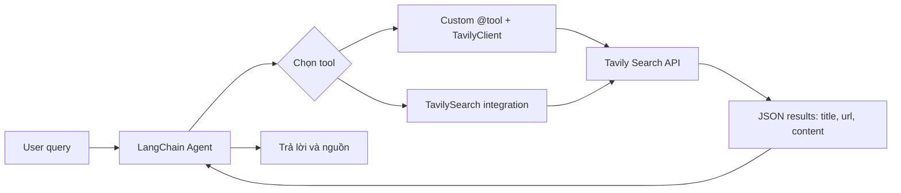

# Bài 07 — Tìm kiếm web thật với Tavily SDK và LangChain TavilySearch

> **Chương 03:** Xây dựng Search Agent bằng LangChain · **Loại:** Lab tích hợp API · **Thực hành:** `../examples/07a_tavily_sdk.py`, `07b_tavily_integrated.py`, `07c_tavily_custom_tool.py`

## 1. Tổng quan

Để agent có quyền tra cứu thông tin bên ngoài, ta gắn một công cụ tìm kiếm web. **Tavily** cung cấp API tìm kiếm trả danh sách trang, `title`, `url`, nội dung trích và metadata liên quan. Ta có thể dùng **SDK `TavilyClient` trong một `@tool` tự viết**, hoặc sử dụng **`TavilySearch` từ package `langchain-tavily`**. Hai cách giải quyết cùng một nhu cầu nhưng khác mức độ trừu tượng.

## 2. Mục tiêu học tập

- Gọi `TavilyClient.search(query=...)` và đọc danh sách `results`.
- Viết tool tùy chỉnh bọc Tavily và trả JSON gọn.
- Sử dụng `TavilySearch` với `create_agent`.
- Phân tích `include_domains`, `search_depth`, chi phí tool calls và giới hạn độ tin cậy.

## 3. Luồng tích hợp



Hai nhánh là **hai lựa chọn triển khai**, không phải yêu cầu gọi cả hai cùng lúc. SDK tự viết hữu ích khi cần biến đổi output, lọc dữ liệu theo nghiệp vụ hoặc thêm logic riêng. Tool tích hợp giúp tiết kiệm mã và cung cấp các tham số mà model có thể sử dụng theo schema sẵn có.

## 4. Cách A — Gọi SDK trực tiếp

```python
from tavily import TavilyClient

client = TavilyClient()  # Tìm TAVILY_API_KEY từ môi trường
response = client.search(
    query="AI Engineer LangChain Bay Area site:linkedin.com/jobs",
    max_results=3,
    search_depth="basic",
    include_domains=["linkedin.com"],
)

for item in response.get("results", []):
    print(item.get("title"), item.get("url"))
```

`response` là một dictionary, không phải object có thuộc tính `.results`. Truy cập `response.get("results", [])` để tránh lỗi nếu thiếu trường. Trong dự án thực tế, nên giới hạn lượng nội dung trả về để không gửi văn bản web quá dài vào context model.

Chạy thử:

```bash
uv run python examples/07a_tavily_sdk.py
```

Lệnh này gọi mạng thật, cần tài khoản/API key phù hợp và có thể sử dụng hạn mức/credit. Mọi bài đăng tìm được cần được mở kiểm tra lại, vì công cụ tìm kiếm không đảm bảo trạng thái nhận CV còn hiệu lực.

## 5. Cách B — Viết `@tool` tùy chỉnh

```python
from langchain.tools import tool
from tavily import TavilyClient
import json

client = TavilyClient()

@tool
def search_jobs_web(query: str) -> str:
    """Tìm công việc AI Engineer trên LinkedIn và trả tiêu đề cùng URL nguồn."""
    response = client.search(query=query, max_results=5, include_domains=["linkedin.com"])
    return json.dumps(response, ensure_ascii=False)
```

Lợi thế: ta biết chính xác dữ liệu trả về có các trường nào; có thể thêm retry, timeout, bộ lọc hoặc caching. Bất lợi: đội phát triển phải tự bảo trì mô tả tool và xử lý lỗi SDK. Tool này vẫn có thể bị model gọi nhiều lần, vì vậy nên bổ sung hạn mức truy vấn và cơ chế phát hiện trùng lặp ở production.

Chạy dự án với custom tool:

```bash
uv run python -m ai_job_agent --mode live --tool custom \
  --query "AI Engineer LangChain Bay Area" --limit 3
```

Trên PowerShell, dùng cùng lệnh **trên một dòng** hoặc ký tự nối dòng PowerShell thay vì `\`.

## 6. Cách C — Công cụ `TavilySearch` tích hợp

```python
from langchain_tavily import TavilySearch
from langchain.agents import create_agent

search_tool = TavilySearch(max_results=5, search_depth="basic", include_domains=["linkedin.com"])
agent = create_agent(model, tools=[search_tool])
```

Công cụ tích hợp đã mang metadata/schemas để mô hình đề xuất `query`, và theo cấu hình có thể đề xuất thêm một số tham số tìm kiếm. Lợi ích là giảm code adapter; đổi lại cần hiểu **phạm vi tham số có thể bị model ghi đè**. Nếu chính sách bảo mật yêu cầu khóa cứng domain, hãy enforce lại phía runtime hoặc wrapper thay vì chỉ dựa vào lời nhắc.

Chạy:

```bash
uv run python -m ai_job_agent --mode live --tool integrated \
  --query "AI Engineer LangChain Bay Area" --limit 3
```

Trong code này, URL xuất hiện ở câu trả lời có cấu trúc được đối chiếu lại với URL từ các `ToolMessage` thu thập được. Các URL không khớp sẽ bị loại; đây là **bước kiểm tra hậu xử lý**, không phải năng lực xác minh việc làm còn tuyển.

## 7. Kết quả tìm kiếm và sự thật

Tavily có thể cung cấp các API khác ngoài Search như Extract, Crawl hay Map tùy sản phẩm và quyền tài khoản, nhưng chương này dùng **Search**. `include_domains=["linkedin.com"]` giúp tìm đúng domain; tuy nhiên trang có thể bị hạn chế quyền đọc, kết quả có thể lỗi thời và mô tả có thể thiếu một số thuộc tính.

Không yêu cầu agent tổng hợp lương, địa chỉ hoặc trạng thái công việc nếu nguồn không cung cấp. Nếu một trang là hướng dẫn SEO thay vì bài tuyển dụng thực tế, loại khỏi output. Những nguồn xuất hiện trong kết quả tìm kiếm nên được xem là **đầu mối để kiểm tra**, chứ chưa phải kết luận đã được xác thực.

## 8. Lab so sánh và debugging

**Checkpoint 1:** `07a_tavily_sdk.py` trả JSON có tối đa ba result. **Checkpoint 2:** hai lệnh `--tool custom` và `--tool integrated` cho kết quả có cấu trúc và URL. **Checkpoint 3:** nếu hai cách cho kết quả khác nhau, so danh sách query, tham số tìm kiếm, số tool call, chứ không kết luận cách nào luôn tốt hơn chỉ dựa một lần thử.

**Các lỗi phổ biến:** thiếu `TAVILY_API_KEY`, hết quota, không có result phù hợp, URL bị chặn khi mở, dữ liệu tìm kiếm trả về nhưng model không trích đúng thuộc tính. Trong môi trường production nên giới hạn thời gian, số result và số lần gọi search theo mỗi yêu cầu.

## 9. Bài tập thực hành

**A — SDK:** Đổi `max_results` từ 3 sang 5 và ghi sự thay đổi; không giả định API luôn trả đúng số lượng yêu cầu.

**B — Custom tool:** Viết công cụ chỉ trả `[{"title", "url", "snippet"}]`, cắt `snippet` ở số ký tự hợp lý. So độ dài JSON với bản SDK đầy đủ.

**C — Nguồn và độ tin cậy:** So hai cách tích hợp trên cùng một truy vấn. Ghi số URL, số URL trùng, tin nào không kiểm tra được trạng thái, và giải thích nguyên nhân.

**Hoàn thành khi:** agent truy xuất được thông tin có URL; phân biệt được SDK, công cụ tùy chỉnh và công cụ LangChain tích hợp.

## 10. Câu hỏi ôn tập

### Câu 1
Class nào được dùng khi trực tiếp gọi Tavily Python SDK?

A. `ToolStrategy`.  
B. `HumanMessage`.  
C. `TavilySearch` từ Pydantic.  
D. `TavilyClient`.

**Đáp án: D.** **Giải thích:** `TavilyClient` thuộc SDK Tavily, không phụ thuộc agent runtime.

### Câu 2
`include_domains=["linkedin.com"]` nhằm mục tiêu gì?

A. Tạo tài khoản LinkedIn tự động.  
B. Giới hạn hoặc ưu tiên tìm kiếm các nguồn thuộc domain chỉ định.  
C. Tự động xác nhận job còn tuyển.  
D. Bỏ qua mọi trường JSON.

**Đáp án: B.** **Giải thích:** Đây là tham số lọc phạm vi tìm kiếm, không xác minh trạng thái job.

### Câu 3
Ưu điểm nổi bật của `TavilySearch` tích hợp là gì?

A. Đã là LangChain tool với schema và metadata, giảm adapter thủ công.  
B. Luôn có truy cập mọi bài viết riêng tư.  
C. Không cần mạng Internet.  
D. Không bao giờ tiêu tốn API credit.

**Đáp án: A.** **Giải thích:** Integration cung cấp đối tượng công cụ sẵn cho `create_agent`.

### Câu 4
Dòng code nào đọc result SDK một cách phù hợp?

A. `response.results.title`  
B. `response[0].jobs`  
C. `response.get("results", [])`  
D. `response.output_text`.

**Đáp án: C.** **Giải thích:** SDK trả dictionary; `get` trả list mặc định khi trường không có.

### Câu 5
Khi một URL nguồn thuộc LinkedIn nhưng không mở được, kết luận nào hợp lý?

A. Chắc chắn job còn mở.  
B. Chắc chắn tin giả.  
C. Phải bịa trạng thái từ ngữ cảnh.  
D. Không thể xác minh trực tiếp; cần ghi giới hạn và kiểm tra lại.

**Đáp án: D.** **Giải thích:** Không truy cập được nguồn không cho phép xác nhận trạng thái tuyển dụng.

## 11. Tổng kết

**SDK tự viết** đem lại toàn quyền điều chỉnh, **tool tích hợp** rút ngắn quá trình xây dựng và giúp model sử dụng schema phong phú hơn. Cả hai đều cần quản lý credential, quota, số lần gọi và kiểm chứng các URL trả về.
