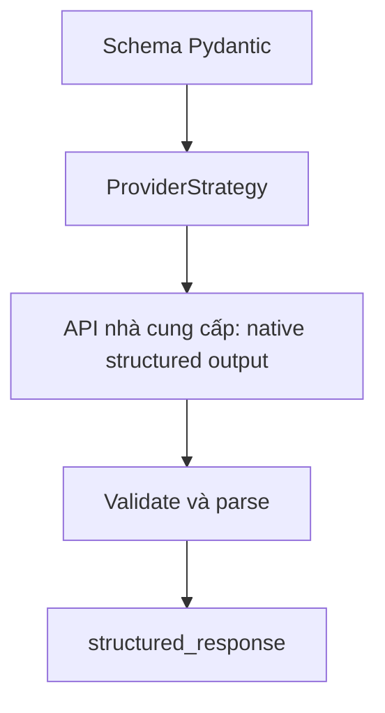
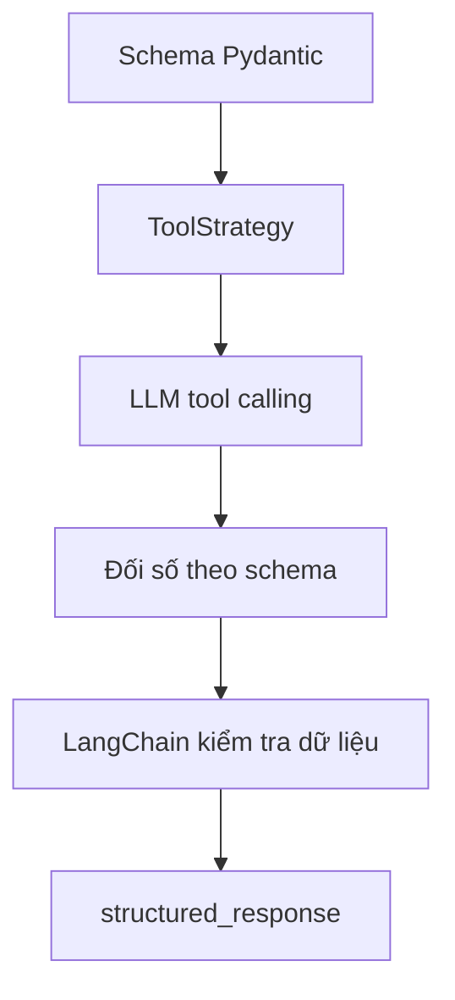

# Bài 09 — ProviderStrategy và ToolStrategy: cơ chế đầu ra có cấu trúc

> **Chương 03:** Xây dựng Search Agent bằng LangChain · **Loại:** Lý thuyết nâng cao kết hợp lab · **Thực hành:** `../examples/09_strategy_compare.py`

## 1. Tóm tắt

LangChain hỗ trợ hai chiến lược tạo **structured output**. `ProviderStrategy` khai thác khả năng trả dữ liệu theo schema của chính nhà cung cấp mô hình; `ToolStrategy` sử dụng **tool calling** để yêu cầu mô hình sinh đối số theo schema mong muốn. Khi truyền trực tiếp kiểu Pydantic vào `response_format`, LangChain có thể **tự chọn chiến lược** theo năng lực model/provider được khai báo.

## 2. Mục tiêu học tập

- Phân biệt `ProviderStrategy`, `ToolStrategy` và chế độ tự chọn.
- Giải thích tại sao tool calling có thể được dùng để sinh output có cấu trúc.
- Sử dụng ba cấu hình với cùng một schema và phân tích khác biệt.
- Chọn phương án có fallback phù hợp với model và tính năng thực tế.

## 3. Đường đi của ProviderStrategy



Khi nhà cung cấp hỗ trợ structured output bản địa, API của họ nhận yêu cầu ràng buộc định dạng theo schema. Đây thường là lựa chọn thuận lợi vì phần lớn công việc về định dạng nằm ở API mô hình. Tuy nhiên, **mức độ hỗ trợ phụ thuộc model, provider và phiên bản tích hợp**; không phải cứ có chức năng chat là có native structured output. Khả năng hỗ trợ đồng thời **tools và structured output** cũng cần kiểm tra riêng.

Ví dụ cấu hình tường minh:

```python
from langchain.agents import create_agent
from langchain.agents.structured_output import ProviderStrategy

agent = create_agent(
    model=model,
    tools=[],
    response_format=ProviderStrategy(AgentResponse),
)
```

Đoạn minh họa giả định `model` và `AgentResponse` đã được định nghĩa. Khi xây ứng dụng thật, thêm prompt và bảo vệ dữ liệu theo nghiệp vụ.

## 4. Đường đi của ToolStrategy



Ở đây schema phản hồi được mô tả như một công cụ đặc biệt phục vụ **sinh dữ liệu có cấu trúc**. Mô hình trả thông tin theo định dạng tool-call để LangChain phân tích và xác thực. Đây không đồng nghĩa với việc tool bên ngoài đã chạy một tác vụ web; schema-tool nhằm biểu diễn **kết quả**. Một số cơ chế có thể yêu cầu mô hình thử lại khi output sai schema, tùy chiến lược và cấu hình xử lý lỗi.

```python
from langchain.agents.structured_output import ToolStrategy

agent = create_agent(
    model=model,
    tools=[],
    response_format=ToolStrategy(AgentResponse),
)
```

Không nên giả định `ToolStrategy` luôn rẻ hoặc đúng hơn. Nó có thể cần lượt mô hình bổ sung để khắc phục lỗi và không bảo đảm nội dung dữ kiện có thật.

## 5. Chế độ tự chọn bằng class Pydantic

```python
agent = create_agent(model=model, tools=[], response_format=AgentResponse)
```

Ở LangChain phiên bản hiện đại, khi truyền **schema type** trực tiếp, hệ thống sẽ cố gắng dùng native provider strategy nếu model hỗ trợ và fallback sang tool strategy khi không hỗ trợ. Việc lựa chọn dựa trên thông tin khả năng mô hình và phiên bản LangChain, vì vậy khi có vấn đề cần debug hãy chỉ định tường minh chiến lược và thử lại. Với **JSON Schema dạng dictionary**, không mặc nhiên dùng y như class Pydantic; theo tài liệu hiện hành cần bọc trong `ProviderStrategy` hoặc `ToolStrategy`.

| Thuộc tính | ProviderStrategy | ToolStrategy |
| --- | --- | --- |
| Nguồn áp dụng schema | API provider | Giao thức tool calling |
| Phụ thuộc | Native structured output | Model hỗ trợ tool calling |
| Cách cấu hình | `ProviderStrategy(Schema)` | `ToolStrategy(Schema)` |
| Kết quả truy cập | `structured_response` | `structured_response` |
| Lưu ý | Model/provider phải hỗ trợ | Có thể gặp lỗi parse/validation, retry |

## 6. Ví dụ và cách chạy

File `examples/09_strategy_compare.py` nhận tham số để so sánh ba chế độ, dùng cùng một Pydantic schema và cùng câu hỏi. Bài test không dùng Tavily mà chỉ yêu cầu mô hình giải thích khái niệm nhằm loại ảnh hưởng của web search.

```bash
uv run python examples/09_strategy_compare.py --strategy auto
uv run python examples/09_strategy_compare.py --strategy provider
uv run python examples/09_strategy_compare.py --strategy tool
```

Các lệnh cần `OPENAI_API_KEY` hợp lệ. Nếu mode `provider` báo model không hỗ trợ, đó là **kết quả tương thích**, không chứng minh cả LangChain hay Tavily hỏng. Thử model phù hợp hoặc dùng `--strategy tool`; đừng tự động loại bỏ validate.

## 7. Chọn chiến lược cho dự án tìm việc

Dự án có hai loại công cụ khác nhau: **tool tìm kiếm** để lấy dữ liệu thật và **chiến lược structured output** để định dạng câu trả lời. Việc cấu hình `TavilySearch` trong `tools=[...]` không đồng nhất với `ToolStrategy`; một bên lấy dữ liệu, một bên định dạng kết quả. Dữ liệu từ `TavilySearch` có thể chứa URL chưa xác minh, và `AgentResponse` có thể chứa URL model sinh khác. Bước kiểm tra URL hậu xử lý vẫn cần thiết trong mọi chiến lược.

Một pipeline đáng tin cậy gồm: **Search → Tool Observations → Extract Job Fields → Pydantic Validation → Grounding URLs → JSON/UI**. Nếu tìm kiếm thất bại, không nên tạo một danh sách việc làm đầy đủ từ trí nhớ của LLM.

## 8. Bài tập thực hành

**A — Kiến thức:** Viết khác biệt giữa tool để truy cập Internet và tool-schema dùng để yêu cầu structured output. Lấy ví dụ hai class/hàm tương ứng.

**B — So sánh thực nghiệm:** Chạy `09_strategy_compare.py` với hai chiến lược mà model của anh hỗ trợ. Ghi schema thu được, số lỗi, thông báo provider và dấu vết; không kết luận từ một lần chạy đơn lẻ.

**C — Fallback:** Thiết kế hàm thử `ProviderStrategy`, chỉ fallback sang `ToolStrategy` với **lỗi không hỗ trợ tính năng**. Các lỗi auth/quota hoặc API key không được bị lặng lẽ coi là lỗi chiến lược.

**Hoàn thành khi:** phân biệt được hai chiến lược, hiểu khi nào dùng auto và chứng minh rằng schema đúng không thay cho kiểm chứng nguồn.

## 9. Câu hỏi ôn tập

### Câu 1
`ProviderStrategy` sử dụng cơ chế nào?

A. Khả năng trả output theo schema do provider cung cấp.  
B. Luôn chạy Python bằng `eval`.  
C. Chỉ đọc dữ liệu từ SQLite.  
D. Chỉ hoạt động với mock file.

**Đáp án: A.** **Giải thích:** Schema được yêu cầu qua cơ chế native của API provider khi hỗ trợ.

### Câu 2
Điều gì đúng nhất về `ToolStrategy`?

A. Nó là dịch vụ tìm kiếm Tavily.  
B. Nó bảo đảm mọi đường dẫn tồn tại.  
C. Nó dùng tool-calling để tạo nội dung theo schema.  
D. Nó không cần một mô hình ngôn ngữ.

**Đáp án: C.** **Giải thích:** ToolStrategy khai thác định dạng lệnh gọi công cụ để thu dữ liệu có cấu trúc.

### Câu 3
Với `response_format=AgentResponse`, LangChain thường xử lý thế nào?

A. Trả HTML ngay lập tức.  
B. Tự chọn chiến lược phù hợp theo khả năng model/provider.  
C. Luôn bỏ mọi công cụ tìm kiếm.  
D. Tự tăng ngân sách API.

**Đáp án: B.** **Giải thích:** Truyền class schema cho phép tự chọn strategy, nhưng phải kiểm tra hỗ trợ thực tế.

### Câu 4
Điều kiện nào quan trọng nếu agent vừa dùng Tavily tool vừa cần structured output native?

A. Tên project bắt buộc là ReAct.  
B. JSON luôn có tối thiểu 10 trường.  
C. Không cần Pydantic.  
D. Model hỗ trợ sử dụng tools đồng thời với structured output.

**Đáp án: D.** **Giải thích:** Một số model/provider hạn chế kết hợp hai năng lực trong một phiên agent.

### Câu 5
Sau khi `ToolStrategy` trả về Pydantic object thành công, điều gì vẫn chưa được bảo đảm?

A. Trường `answer` có dạng chuỗi.  
B. Có thể truy cập dữ liệu theo tên trường.  
C. Tin tuyển dụng hoặc URL thực tế là đúng và còn hoạt động.  
D. Schema đã được dùng để validate.

**Đáp án: C.** **Giải thích:** Định dạng đúng không đồng nghĩa đã xác minh nội dung ngoài đời.

## 10. Tổng kết

Hai chiến lược khác nhau ở **nơi thực thi ràng buộc schema**: provider hay giao thức tool calling. Chọn được chiến lược phù hợp giúp code ổn định, nhưng bài toán chất lượng dữ liệu vẫn là **kiểm chứng bằng chứng, xử lý kết quả rỗng và ghi nhận mức độ chắc chắn**.
